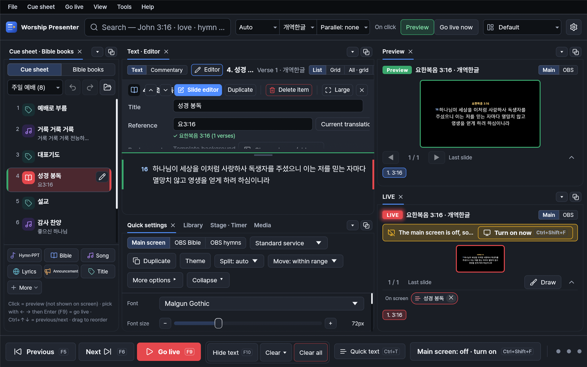
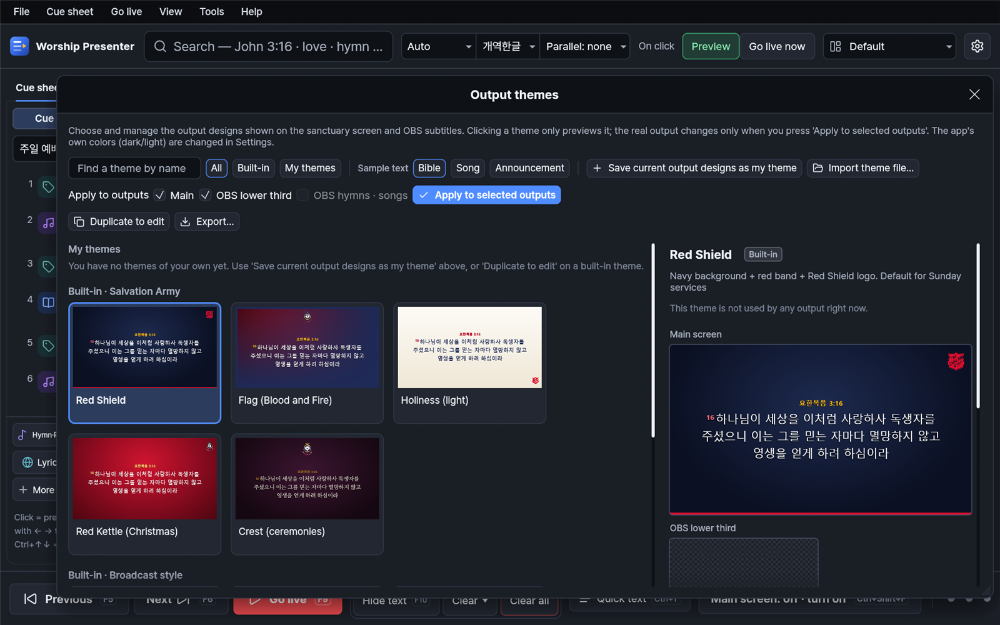

# Worship Presenter (WorshipPresenter)

> Formerly WorshipCue. Cue sheets, settings and data from 1.x carry over.

[한국어](README.md) | **English**

A **worship cue-sheet presentation app** for churches, for Windows 10 and 11.

Build the order of service ahead of time. During the service you just press **F9 to go live and F6 for the next slide**: Bible passages, song lyrics, hymn PowerPoints, announcements, images and videos go out in order to the sanctuary screen (second monitor) and to OBS.
Based on the Bible presentation app [BibleCast](https://github.com/hahadark/BibleCast).

- **Download**: [latest 2.x](https://github.com/hahadark/WorshipPresenter/releases/latest) — `WorshipPresenter-X.Y.Z-Setup.exe` (installer, recommended) or `WorshipPresenter-X.Y.Z-Portable.zip` (unzip and run).
- **macOS and the English edition**: there is no 2.x build yet. Keep using [1.14.1](https://github.com/hahadark/WorshipPresenter/releases/tag/v1.14.1) (`…-mac-arm64.dmg`, `…-English-Setup.exe`, `…-English-Portable.exe`). The 1.x guide is in [docs/v1](docs/v1/README.en.md).
- 2.x can show its interface in English (**View → Language · 언어 → English**), but it ships only with the Korean Revised Version (개역한글). Import an English translation via **File → Import Bible translation…** (JSON, CSV/TSV, Zefania XML, Bethlehem .bdb).

Left: cue sheet · middle: editor for the selected item · top right: Preview (green) · bottom right: LIVE (red) · bottom: go-live bar. The cue sheet shown is an example.

## What's new in 2.x

- The control screen was rebuilt in Rust (no Electron), so it starts quickly and uses less memory. The sanctuary screen and OBS pages are the same web output as 1.x.
- On first launch it copies your 1.x data (Bibles, cue sheets, settings) to `%APPDATA%\WorshipPresenter-rs\data`. The 1.x folder is left untouched. **Help → Re-import 1.x data…** copies it again.
- OBS browser-source URLs are unchanged.
- 2.0.2 adds a **Settings center** (9 categories, search, current/default values, reset per item or category, save status, shortcut conflict check), **Output themes** manager (save current design as your own theme, duplicate, rename, delete, import/export, apply to selected outputs and undo), **template duplicate** in the Quick settings bar, and the sanctuary screen now appears **all at once** when turned on instead of flashing white first.

## Install and update

1. Download and run `WorshipPresenter-X.Y.Z-Setup.exe` from [Releases](https://github.com/hahadark/WorshipPresenter/releases/latest).
2. A 1.x installation is replaced in place when you close 1.x; shortcuts are kept.
3. To update 2.x: **Help → Check for a new version → [Download and verify] → [Request installation now (close application)]**. The app closes and the new version is installed. It never restarts on its own during a service.

The app sends an anonymous daily ping (random install ID, version, UI language, OS) to count installations. Turn it off in **Settings → About · Updates**.

## Quick start

1. Connect the projector/TV and press **[Main screen: off · turn on]** in the bottom bar (Ctrl+Shift+F). Choose the monitor in **View → Output settings**.
2. Add items with the buttons at the bottom left (Hymn·PPT, Bible, Song, Lyrics, Announcement, Title).
3. During the service: click an item to preview it, press **F9** to go live, then **F6** for each next slide. **F5** goes back, **F10** hides the text.
4. Unplanned verse: type `John 3:16` in the search box (Ctrl+K) and press **Ctrl+Enter**.
5. One-off line (announcement fix, parking notice): **Ctrl+T** quick text.

## Default shortcuts

| Key | Action |
|---|---|
| F5 / F6 | Previous / next slide (LIVE) |
| F9 | Send preview live |
| Ctrl+Enter | Send the searched passage live immediately |
| F10 | Hide / restore output text |
| Ctrl+K | Focus search |
| Ctrl+B | Bible book list |
| PageUp / PageDown | Previous / next preview slide |
| Alt+← / Alt+→ | Previous / next verse in preview |
| Ctrl+Home | Preview: start of current chapter |
| Ctrl+↑ / Ctrl+↓ | Preview previous / next cue item |
| F2 | Edit selected item |
| Ctrl+Shift+E | Show / hide editor |
| Ctrl+Shift+F | Turn sanctuary screen on / off |
| Esc | Turn sanctuary screen off |
| Ctrl+T / Ctrl+M | Quick text / congregation message |
| Ctrl+L | Find lyrics on the web |
| Ctrl+H / Ctrl+P | Go-live history / print cue sheet |

All of these can be changed in **Settings → Shortcuts**. Fixed keys: Space, ← →, Enter, Alt+1–9 (macros), Ctrl+Z / Ctrl+Y, Ctrl+E, Ctrl+,.

## OBS

Add a **Browser source** (1920×1080) with:

| URL | Output |
|---|---|
| `http://127.0.0.1:37528/outputs/main` | Same as the sanctuary screen |
| `http://127.0.0.1:37528/outputs/overlay` | Transparent lower-third captions |
| `http://127.0.0.1:37528/outputs/stage` | Stage / preacher screen |

If port 37528 is busy the app uses the next free port; copy the exact URL from **Settings → OBS · Broadcast captions**. For a separate streaming PC, turn on **Tools → LAN output (OBS on another PC)** and use the address it shows (`http://192.168.x.x:37550/outputs/overlay?key=…`).

## Not yet

- No macOS or English-edition 2.x build (use 1.14.1).
- Testing with real OBS setups, cameras, Companion/audio gear and multi-monitor rigs is still limited. Do a rehearsal before an important service.
- The control-screen preview shows video/camera backgrounds by name only (they play on the sanctuary screen and in OBS).

## Bible data and copyright

Only the Korean Revised Version (개역한글, public domain) is included. Other Bible texts, commentaries, hymnals, scores, lyrics and song PowerPoints are not included; use them within the permission of their rights holders. The Salvation Army Red Shield and Crest logos are trademarks of The Salvation Army, included for worship presentation by Salvation Army corps and centres.

## License

GPL-3.0-or-later — [LICENSE](LICENSE). Third-party code, fonts, logos and Bible data follow their own terms — [THIRD_PARTY_NOTICES.md](THIRD_PARTY_NOTICES.md).
The 2.x (Rust) source is on the [`rust` branch](https://github.com/hahadark/WorshipPresenter/tree/rust); this `main` branch keeps the 1.x (Electron) source.
