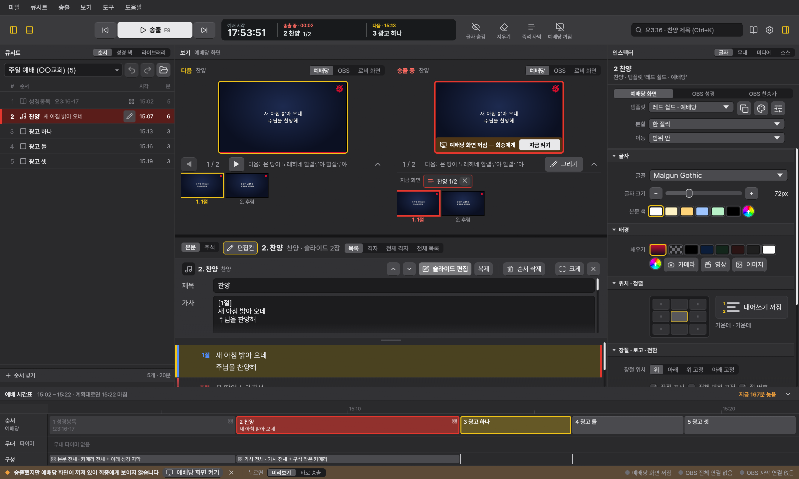
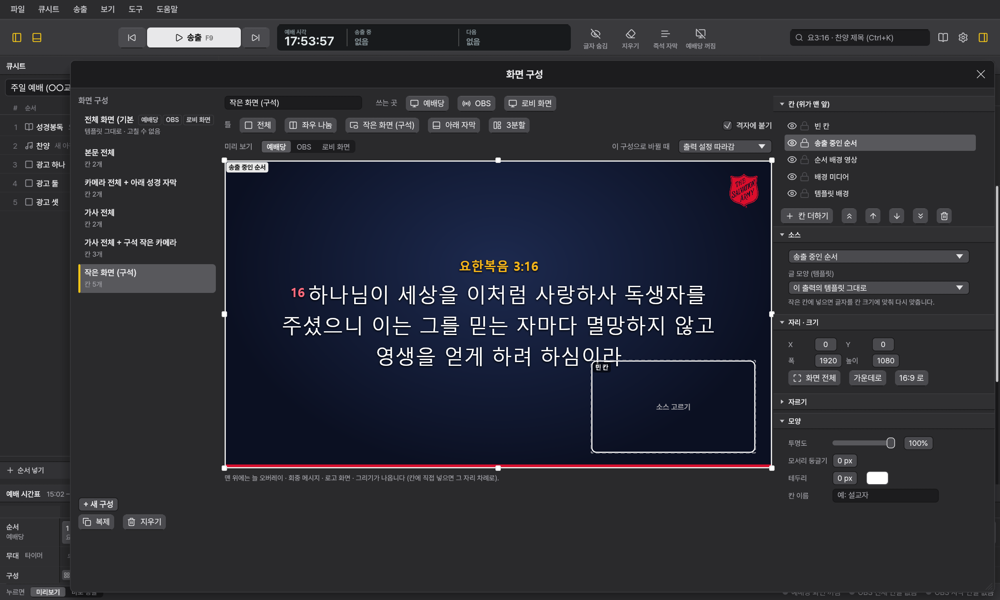
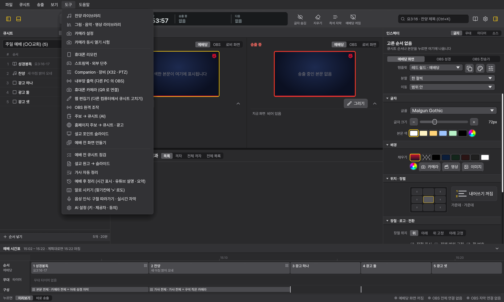
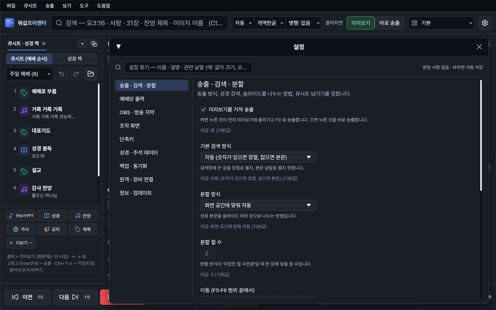
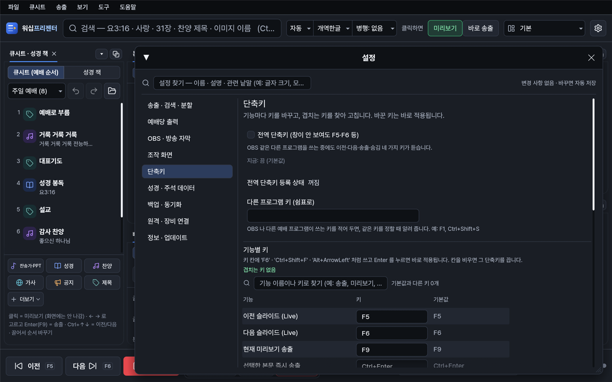
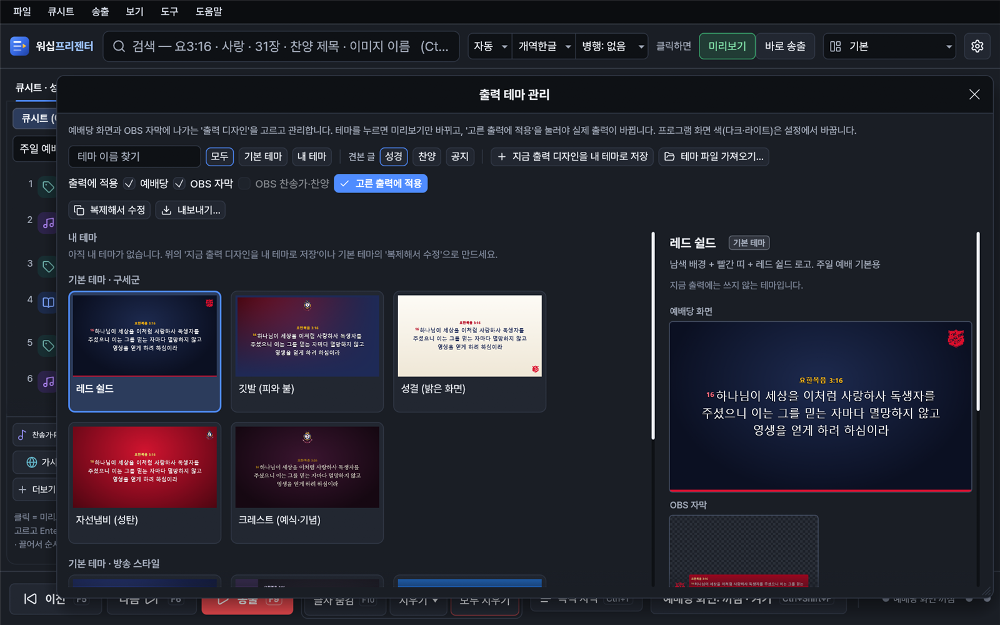
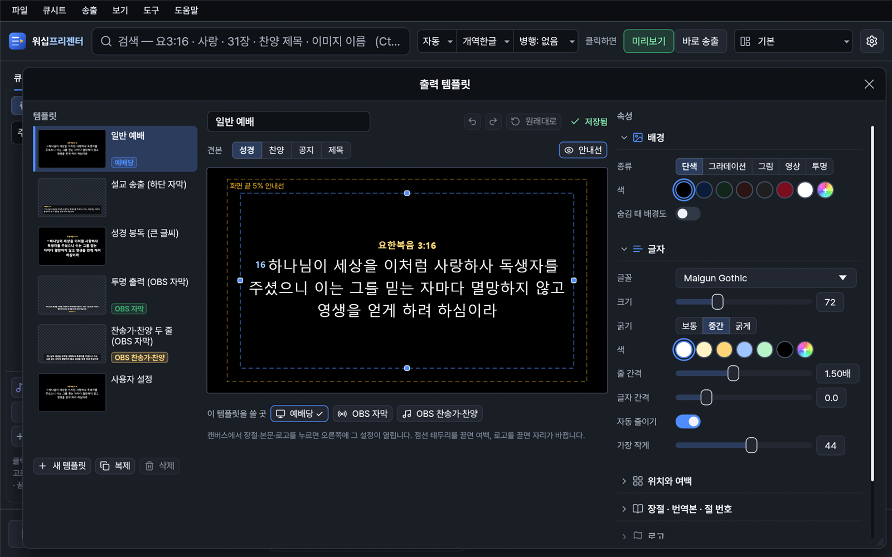

# 워십프리젠터 (WorshipPresenter)

> 옛 이름: WorshipCue. 1.x 때 만든 큐시트·설정·자료를 그대로 이어서 씁니다.

**한국어** | [English](README.en.md)

교회 **예배 순서(큐시트) 통합 송출 프로그램**입니다. Windows 10·11과 맥(애플 실리콘)에서 씁니다.

예배 순서를 미리 만들어 두면, 예배 중에는 **F9로 송출하고 F6으로 넘기기만** 하면 됩니다. 성경, 찬양 가사, 찬송가 PPT, 광고, 그림, 영상이 차례대로 예배당 화면(보조 모니터)과 OBS 방송에 나갑니다.
성경 송출 프로그램 [BibleCast](https://github.com/hahadark/BibleCast)를 바탕으로 만들었습니다.

- **받기**: [최신판 2.x](https://github.com/hahadark/WorshipPresenter/releases/latest) — `WorshipPresenter-X.Y.Z-Setup.exe`(설치판, 추천) 또는 `WorshipPresenter-X.Y.Z-Portable.zip`(설치 없이 압축만 풀어 쓰기). 개역한글 성경이 들어 있습니다.
- **설명서**: [사용자 설명서](docs/사용자설명서.md) · [OBS 설정 가이드](docs/OBS설정가이드.md)
- **맥**: `WorshipPresenter-X.Y.Z-mac-arm64.dmg` (애플 실리콘 전용, [맥에서 쓰기](#맥macos) 참고)
- **영어판**: 2.x 영어 전용판은 아직 없습니다. 2.x도 **보기 → Language·언어**에서 화면을 영어로 바꿀 수 있습니다. 영어판 1.x는 [1.14.1](https://github.com/hahadark/WorshipPresenter/releases/tag/v1.14.1) ([1.x 설명서](docs/v1/README.md))

2.1.0 화면. 위: 컨트롤 막대([이전 | 송출 F9 | 다음] · 상태 표시창: 예배 시각 · 송출 중 · 다음 · 글자 숨김 · 지우기 · 즉석 자막 · 예배당 화면 · 찾기) · 왼쪽: 큐시트 표 · 가운데: 다음(노랑) / 송출 중(빨강) 두 화면과 본문·편집 · 오른쪽: 인스펙터(글자·무대·미디어·소스) · 아래: 예배 시간표(구성 줄). 화면의 큐시트는 예시입니다.

## 목차

- [2.x에서 달라진 점](#2x에서-달라진-점)
- [설치와 업데이트](#설치와-업데이트)
- [5분 만에 시작하기](#5분-만에-시작하기)
- [주요 기능](#주요-기능)
- [메뉴 한눈에](#메뉴-한눈에)
- [단축키](#단축키)
- [OBS 연결](#obs-연결)
- [문제 해결](#문제-해결)
- [아직 안 된 것](#아직-안-된-것)
- [성경 데이터와 저작권](#성경-데이터와-저작권)
- [라이선스](#라이선스)
- [개발](#개발)

## 2.x에서 달라진 점

**2.1.0 — 화면 구성 · AI 도우미.** 소스(송출 중인 순서 · 카메라 · 웹 페이지 · 자막 …)를 칸에 놓아 예배당 · OBS · 추가 출력 화면을 따로 꾸밉니다([화면 구성](#화면-구성-소스를-칸에-놓기-210)). 아무것도 고르지 않으면 예전과 똑같이 나갑니다. 도구 메뉴에 [AI 도우미 일곱 가지](#ai-도우미-일곱-가지-210)(큐시트 점검 · 설교 원고 → 슬라이드 · 음성 인식 · 가사 정리 · 예배 후 정리 · 말로 시키기 · AI 설정)가 생겼고, 여러 창의 모양을 한 도구처럼 맞췄습니다.

**2.0.8 — 조작 화면 모양이 크게 바뀌었습니다.** 어두운 회색 바탕에 위 컨트롤 막대 · 왼쪽 큐시트 표 · 가운데 두 화면(다음 · 송출 중) · 오른쪽 인스펙터 · 아래 예배 시간표로 정리했습니다. 빨강은 송출 중, 노랑은 다음에만 씁니다. 끌어서 패널을 옮기던 작업공간은 고정 칸(접기/펴기)으로 바뀌었고, 기능과 단축키는 그대로입니다. 자리를 옮긴 조작은 [릴리스 설명](https://github.com/hahadark/WorshipPresenter/releases/tag/v2.0.8)에 있습니다. 예전 색이 좋으면 `설정 → 조작 화면 → 테마`에서 **어둡게** 를 고르세요.

2.0부터 조작 화면을 Rust로 새로 만들었습니다. 예배당 화면과 OBS 화면은 1.x와 같은 웹 화면을 그대로 씁니다.

- **가볍고 빨리 켜집니다.** 조작 화면이 Electron 없이 바로 그려집니다.
- **자료는 그대로입니다.** 처음 켤 때 1.x 자료(성경·큐시트·설정)를 새 폴더로 복사해 옵니다. 1.x 원본 폴더는 바꾸지 않습니다.
- **OBS 주소는 같습니다.** 1.x 때 OBS에 넣은 브라우저 소스를 고칠 필요가 없습니다.
- 2.0.2에서 **설정 센터**, **출력 테마 관리**, **템플릿 복제**가 생겼고, 예배당 화면을 켤 때 흰 화면이 먼저 보이던 문제를 고쳤습니다.
- 2.0.3에서 1.x에 있다가 빠졌던 기능을 되살렸습니다: **AI로 큐시트 만들기 화면**(파일 메뉴), **파일 끌어다 놓기·복사한 파일 붙여 넣기**, **큐시트 인쇄 옵션**, 찬송가 폴더별 찾기, 슬라이드쇼 그림 순서 바꾸기 등. 설정 같은 **추가 창은 바깥을 누르면 닫힙니다.**

## 설치와 업데이트

### 처음 설치

1. [Releases](https://github.com/hahadark/WorshipPresenter/releases/latest)에서 `WorshipPresenter-X.Y.Z-Setup.exe`를 받아 실행합니다.
2. 바탕화면과 시작 메뉴에 **워십프리젠터** 바로가기가 생깁니다.

설치하지 않고 쓰려면 `WorshipPresenter-X.Y.Z-Portable.zip`을 받아 압축을 풀고 `WorshipPresenter.exe`를 실행하세요. 포터블판은 새 버전을 알려 주기만 하고 직접 설치하지는 않습니다.

### 1.x를 쓰던 PC

- 1.x 설치판은 **프로그램을 끌 때 자동으로 2.x로 바뀝니다.** 같은 설치 자리, 같은 바로가기를 이어받습니다.
- 2.x를 처음 켜면 1.x 자료를 `%APPDATA%\WorshipPresenter-rs\data`로 복사해 옵니다. 1.x 자료 폴더(`%APPDATA%\WorshipCue\data`)는 그대로 남습니다.
- 복사가 덜 되었거나 1.x에서 더 작업한 내용을 다시 가져오려면 **도움말 → 1.x 자료 다시 가져오기…**를 쓰세요.

### 2.x 업데이트

2.x는 켤 때 새 버전이 있는지 확인합니다(설정 → 정보·업데이트에서 끌 수 있음). 새 버전이 있으면 이렇게 올립니다.

1. **도움말 → 새 버전 확인**
2. **[검증하여 다운로드]**: 설치 파일을 받아 해시(SHA-256)를 확인합니다.
3. **[지금 설치 요청]**: 프로그램이 닫히고 새 버전이 설치됩니다.

예배 중에 저절로 다시 시작하지 않습니다. 큐시트·성경·설정은 업데이트해도 그대로입니다.

### 맥(macOS)

1. [Releases](https://github.com/hahadark/WorshipPresenter/releases/latest)에서 `WorshipPresenter-X.Y.Z-mac-arm64.dmg`를 받습니다. **애플 실리콘(M1 이상) 맥 전용**이고 macOS 11 이상에서 씁니다. 인텔 맥은 지원하지 않습니다.
2. dmg를 열고 **워십프리젠터**를 `응용 프로그램` 폴더로 끌어다 놓습니다. 1.x 맥판이 있으면 바꿔 넣습니다.
3. **처음 열 때**: 애플 개발자 인증서로 서명하지 않은 프로그램이라 경고가 나옵니다. `응용 프로그램`에서 워십프리젠터를 **Control+클릭 → 열기 → 열기**. macOS 15 이상은 한 번 열어 본 뒤 `시스템 설정 → 개인정보 보호 및 보안` 맨 아래 **그래도 열기**를 누릅니다. "손상되었기 때문에 열 수 없습니다"가 나오면 터미널에서 `xattr -cr /Applications/WorshipPresenter.app`을 한 번 실행하세요.
4. 자료는 `~/Library/Application Support/WorshipPresenter-rs/data`에 둡니다. 처음 켤 때 1.x 맥판 자료(`~/Library/Application Support/WorshipCue/data`)를 복사해 오고, 원본은 바꾸지 않습니다.

맥에서 알아 둘 것:

- 단축키의 **Ctrl은 맥에서 ⌘(Command)**입니다(예: ⌘K 검색, ⌘⇧F 예배당 화면). 화면에는 Ctrl로 표시됩니다. 맥북에서 F5·F6·F9·F10은 **fn**을 같이 누르거나, `시스템 설정 → 키보드`에서 'F1, F2 등의 키를 표준 기능 키로 사용'을 켜세요.
- **업데이트는 자동이 아닙니다.** 도움말 → 새 버전 확인은 새 버전을 알려 주기만 합니다. 새 dmg를 받아 `응용 프로그램`에 덮어 넣으세요.
- **AI 키·OBS 비밀번호는 맥 로그인 키체인에 보관합니다**(2.0.3부터. 2.0.2에서 넣은 키는 그대로 읽힙니다). 1.x 맥판에 저장했던 키는 이어받지 못하니 다시 넣어야 합니다.
- 맥에서 안 되는 것: 전역 단축키, 한글 입력 자동 전환, 찬송가 PPT '화면 그대로' 읽기(PowerPoint 필요, 맥에서는 .pptx 글을 꺼내 보여 줌), PowerPoint 슬라이드 붙여 넣기, Finder에서 복사한 파일 붙여 넣기(끌어다 놓기는 됨).
- 카메라는 처음 쓸 때 허용 창이 뜹니다. 거절했다면 `시스템 설정 → 개인정보 보호 및 보안 → 카메라`에서 켜세요.

### 익명 사용 통계

몇 대에서 쓰는지 세려고 하루 한 번 **무작위 설치 번호 · 버전 · 화면 언어 · OS**만 보냅니다. 이름·교회·성경·큐시트 내용은 보내지 않습니다. **설정 → 정보·업데이트 → 익명 사용 통계 보내기**에서 끌 수 있습니다.

## 5분 만에 시작하기

1. **예배당 화면 켜기**: 보조 모니터(프로젝터·TV)를 연결하고 아래 줄의 **[예배당 화면: 꺼짐 · 켜기]**를 누릅니다(Ctrl+Shift+F). 어느 모니터에 띄울지는 **보기 → 출력 설정**에서 고릅니다.
2. **큐시트 만들기**: 왼쪽 아래 단추(**찬송가·PPT · 성경 · 찬양 · 가사 · 공지 · 제목**)로 순서를 하나씩 넣습니다. 주보가 있으면 **파일 → 주보로 큐시트 만들기 (AI)…**로 한 번에 만들 수도 있습니다(AI 없이 붙여 넣기도 됨). 파일은 탐색기에서 큐시트로 **끌어다 놓아도** 들어갑니다.
3. **찬송가 PPT 폴더 등록**: 찬송가·찬양 PPT가 든 폴더를 라이브러리 패널(찬송가·PPT)에 등록합니다.
4. **예배 중**: 큐시트 순서를 눌러 미리보기에 올리고 **F9(송출)**, 그다음은 **F6(다음)**만 누릅니다. 되돌아갈 때는 **F5**, 화면 글자를 잠깐 숨길 때는 **F10**.
5. **갑자기 필요한 구절**: 위 검색창(Ctrl+K)에 `요 3 16`처럼 쓰고 **Ctrl+Enter**로 바로 송출합니다.
6. **갑자기 필요한 한 줄**(광고 고침, 차량 안내): **Ctrl+T 즉석 자막**에 쓰고 Enter.
7. **OBS로 방송한다면**: [OBS 연결](#obs-연결)의 주소를 OBS 브라우저 소스에 넣습니다.

예배 전에 **도움말 → 연결 점검**을 한 번 눌러 예배당 화면·OBS 연결을 확인해 두세요.

## 주요 기능

### 큐시트와 송출

- 예배 순서를 큐시트로 만들고, 순서마다 성경·찬양 가사·찬송가 PPT·광고(공지)·제목·그림·영상·카메라를 넣습니다.
- **미리보기 → 송출** 두 단계로 실수를 줄입니다. 위 **[클릭하면 미리보기 / 바로 송출]**로 바로 송출 방식으로 바꿀 수 있습니다.
- 성경은 장절(`요3:16`, `시 23`)이나 본문 낱말로 찾고, 화면 공간에 맞춰 슬라이드를 자동으로 나눕니다. 병행 번역본을 함께 띄울 수 있습니다.
- 송출 단추 줄: 이전(F5) · 다음(F6) · 송출(F9) · 글자 숨김(F10) · 지우기 · 모두 지우기 · 즉석 자막 · 예배당 화면 켜기·끄기.
- 슬라이드 편집(Ctrl+E), 순서 복제, 실행 취소(Ctrl+Z)·다시 실행(Ctrl+Y), 큐시트 인쇄(Ctrl+P), 큐시트 관리(휴지통·복제·내보내기).
- 송출 기록(Ctrl+H)과 저작권 보고용 사용 기록.

### 화면 구성: 소스를 칸에 놓기 (2.1.0)

예배당 · OBS · 추가 출력이 **각자 다른 화면**을 내보낼 수 있습니다. 아무것도 고르지 않으면 예전과 똑같이 나갑니다.

- **보기 → 화면 구성 편집…** 에서 **+ 새 구성** → 틀(전체 · 좌우 나눔 · 작은 화면 · 아래 자막 · 3분할)을 고르고, 칸마다 **소스**(송출 중인 순서 · 카메라 · 웹 페이지 · 템플릿 배경 · 배경 미디어 · 오버레이 · 회중 메시지 · 로고 화면 · 실시간 자막)를 넣습니다. 칸은 끌어서 옮기고 손잡이로 크기를 바꿉니다(자르기 · 투명도 · 둥글기 · 테두리).
- 위의 **쓰는 곳 [예배당] [OBS] …** 를 누르면 그 출력에 바로 나갑니다. 예: 방송 = 설교자 카메라 전체 + 아래 성경 자막, 예배당 = 성경 본문 전체.
- **순서마다 · 종류마다**(성경 · 찬양 …) 다른 구성: 순서를 고르고 오른쪽 **인스펙터 → 소스** 탭의 '화면 구성'. 고르는 차례는 순서 → 종류 기본 → 출력 기본 → 전체 화면.
- **추가 출력**: **보기 → 출력 설정 → 출력** 에서 '로비 화면' 같은 출력을 더하고 모니터에 띄우거나 주소(`/outputs/out-…`)로 엽니다. 구성이 바뀔 때 카메라는 끊기지 않고 새 자리로 옮겨 갑니다(옮겨 가기 · 서서히 · 바로).
- 스트림덱 · Companion: `/api/trigger/scene?output=overlay&id=<구성>` (기본은 다음 순서까지 한 번, `&hold=1` 이면 계속). 휴대폰 리모컨에도 '화면 구성' 카드가 있습니다.
- **도구 → 카메라 동시 열기 시험**: 예배당 화면과 OBS(브라우저)가 같은 카메라를 함께 열 수 있는지 미리 확인합니다.

### AI 도우미 일곱 가지 (2.1.0)

모두 **도구** 메뉴 아래쪽에 있습니다. **AI 키가 없어도 규칙으로 하는 기본 동작은 다 됩니다.** AI 를 쓰는 부분은 **도구 → AI 설정**에서 키를 넣고, 처음 쓸 때 '무엇을 · 어디로 보내는지' 를 보여 주고 동의를 받습니다.

- **예배 전 큐시트 점검**: 빈 순서 · 없는 파일 · 주보와 다른 차례 등.
- **설교 원고 → 슬라이드**: txt · docx · hwp · hwpx 원고에서 제목 · 본문 성경 · 설교 포인트 · 인용을 골라 넣기.
- **음성 인식 — 설교 구절 따라가기 · 방송 실시간 자막**: 설교자가 말한 장절을 찾아 목록으로(켜면 **'다음' 칸까지만** — 저절로 송출하지 않음). 처음 켤 때 동의를 받고 음성 인식 엔진 · 모델(60~190MB)을 내려받습니다. **음성은 PC 밖으로 나가지 않습니다.** 실시간 자막은 기본 꺼짐, OBS 출력에만.
- **가사 자동 정리**: 붙여 넣은 가사의 줄 · 절 · 후렴을 정리해 두 칸으로 비교.
- **예배 후 정리**: 순서별 시간 표시(유튜브 챕터) · 유튜브 설명 · 설교 요약 재료 · 쇼츠 후보.
- **말로 시키기**: 찾기칸(Ctrl+K)에 `>` 로 시작해 '찬양 두 곡 넣어 줘' 처럼. 할 일 목록을 보여 주고 [실행]을 눌러야 하며, 송출 · 삭제는 하지 않습니다.
- **AI 설정**: 키 · 제공자(오픈라우터 · DeepSeek · OpenAI) · 모델 · 기능별 동의.

### 예배당 화면 한 번에 켜기 (2.0.2)

예배당 화면을 켜면, 창을 보이지 않게 띄운 채 글꼴·그림·슬라이드를 다 그린 뒤 **완성된 화면을 한 번에** 보여 줍니다. 처음 켤 때 흰 화면이 잠깐 비치던 문제를 고쳤습니다. 화면을 그리는 데 문제가 생겨도 5초 뒤에는 창이 뜹니다.

### 설정 센터 (2.0.2)

- 설정을 9개 분류로 정리했습니다: **송출·검색·분할 · 예배당 출력 · OBS·방송 자막 · 조작 화면 · 단축키 · 성경·주석 데이터 · 백업·동기화 · 원격·장비 연결 · 정보·업데이트**.
- 위 **설정 찾기**에 이름이나 낱말(예: 글자 크기, 모니터)을 쓰면 해당 설정이 바로 나옵니다.
- 항목마다 **지금 값과 기본값**이 보이고, 항목·분류별로 **기본값으로** 되돌릴 수 있습니다.
- 바꾸면 바로 저장되고, 오른쪽 위에 저장 중·저장됨·저장 실패가 표시됩니다.
- **단축키**에서 기능 이름이나 키로 찾고, 겹치는 키를 알려 줍니다. 메뉴와 송출 단추에는 지금 설정한 키가 표시됩니다.

### 출력 테마 관리 (2.0.2)

**보기 → 출력 테마 관리**에서 예배당 화면과 OBS 자막에 나가는 디자인을 고릅니다.

- 기본 테마(구세군 레드 쉴드·깃발·성결·자선냄비·크레스트, 방송 스타일)를 견본 글(성경·찬양·공지)로 미리 봅니다. 테마를 누르기만 해서는 실제 출력이 바뀌지 않습니다.
- **고른 출력에 적용**: 예배당 · OBS 자막 · OBS 찬송가·찬양 중 고른 곳에만 적용합니다. 적용한 뒤 **되돌리기**로 이전 디자인으로 돌아갈 수 있습니다.
- **지금 출력 디자인을 내 테마로 저장**, 기본 테마를 **복제해서 수정**, 내 테마의 이름 바꾸기·삭제·**내보내기**·**테마 파일 가져오기**를 할 수 있습니다.
- 내보낸 테마 파일에는 그림·영상 파일 자체가 아니라 **경로만** 들어갑니다. 다른 PC에서 쓰려면 그림 파일도 함께 옮기세요.

### 출력 템플릿 편집과 템플릿 복제

- **보기 → 출력 템플릿 편집**(또는 오른쪽 인스펙터의 **자세히** 아이콘)에서 배경(단색·그라데이션·그림·영상·투명), 글꼴·크기·색·줄 간격, 위치와 여백, 장절·번역본·절 번호, 로고, 효과를 고칩니다. 가운데 그림에서 글 영역·로고를 직접 끌어 옮길 수 있습니다.
- **템플릿 복제 (2.0.2)**: 오른쪽 **인스펙터 → 글자** 탭의 템플릿 옆 **복제** 아이콘을 누르면 지금 템플릿의 복사본을 만들어 그 출력(예배당 화면 · OBS 성경 · OBS 찬송가)에 바로 겁니다. 원래 템플릿은 그대로 남으니, 복사본만 마음 놓고 고치면 됩니다.

### 그 밖의 기능

- **찬송가·찬양 PPT**: 폴더를 등록해 찬송가·PPT를 찾아 넣습니다. `.pptx`는 글상자·표를 꺼내 템플릿에 맞춰 보여 주고, 화면 그대로 그림으로 보여 주는 방식은 PowerPoint가 필요합니다.
- **찬양 라이브러리**, **그림·음악·영상 라이브러리**, **카메라**.
- **무대 화면**(설교자 모니터)·설교 타이머, **휴대폰 리모컨**, **회중 메시지**(Ctrl+M), **오버레이**(시계·카운트다운·배너), **화면에 그리기·강조**, **매크로·예약 실행**(Alt+1~9).
- **주보로 큐시트 만들기 (AI)**: 순서 붙여 넣기(AI 없이) · 오픈라우터 API 키로 자동 · 채팅 AI 답 붙여 넣기/결과 파일 불러오기, 만든 뒤 확인 카드로 검토하고 열기.
- **파일 끌어다 놓기·붙여 넣기**: 그림·영상·음악·PPT·txt를 큐시트·라이브러리·배경·슬라이드 편집기에 끌어다 놓기, 탐색기에서 복사한 파일 Ctrl+V.
- **큐시트 인쇄**: 가사·공지 글, 성경 본문, 메모, 코드, 큰 글씨, 두 단을 골라 인쇄.
- **홈페이지 주보 → 큐시트·광고**, **설교 포인트 슬라이드**(AI 사용), **예배 전 화면 만들기**.
- **스트림덱·외부 단추**, **Companion·장비(X32·PTZ)**, **OBS 원격 조작**, **내부망 출력**(다른 PC의 OBS).
- **여러 PC 동기화·백업**, **판 접기·펴기(배치)**, 화면 언어 한국어·English.

각 기능의 자세한 사용법은 [사용자 설명서](docs/사용자설명서.md)를 보세요.

## 메뉴 한눈에

| 메뉴 | 들어 있는 것 |
|---|---|
| 파일 | 주보로 큐시트 만들기 (AI) · 성경 번역본 가져오기 · 사용 기록(저작권 보고) · 여러 PC 동기화·백업 · 설정(Ctrl+,) |
| 큐시트 | 슬라이드 편집(Ctrl+E) · 큐시트 관리(휴지통·복제·내보내기) · 실행 취소(Ctrl+Z) · 다시 실행(Ctrl+Y) · 큐시트 인쇄(Ctrl+P) |
| 송출 | 송출 기록(Ctrl+H) · 즉석 자막(Ctrl+T) · 회중 메시지(Ctrl+M) · 오버레이 · 무대 화면 · 매크로·예약 실행(Alt+1~9) · 화면에 그리기·강조 |
| 보기 | 배치(판 보이기·숨기기) · 주석 보기·가져오기 · 출력 템플릿 편집 · 출력 테마 관리 · **화면 구성 편집** · Language·언어 · OBS 자막 보기 방식 · 출력 설정(예배당 화면·모니터·OBS 숨김) |
| 도구 | 찬양 라이브러리 · 그림·음악·영상 라이브러리 · 카메라 설정 · 카메라 동시 열기 시험 · 휴대폰 리모컨 · 스트림덱·외부 단추 · Companion·장비 · 내부망 출력 · OBS 원격 조작 · 주보 → 큐시트 (AI) · 홈페이지 주보 → 큐시트·광고 · 설교 포인트 슬라이드 · 예배 전 화면 만들기 · 웹 편집기 · 휴대폰 카메라 · **AI 도우미**(예배 전 큐시트 점검 · 설교 원고 → 슬라이드 · 가사 자동 정리 · 예배 후 정리 · 말로 시키기 · 음성 인식 · AI 설정) |
| 도움말 | 연결 점검 · 로그 묶음 저장 · 로그 폴더 열기 · 사용 설명서 · 그림으로 보는 사용법 · OBS 연결 안내 · 단축키 보기 · 새 소식 · 문제 알리기·건의 · 정보·라이선스 · 새 버전 확인 · 1.x 자료 다시 가져오기 |

## 단축키

기본값입니다. **설정 → 단축키**에서 바꿀 수 있고, 바꾼 키는 메뉴와 단추에도 그대로 표시됩니다.

| 키 | 기능 |
|---|---|
| F5 / F6 | 이전 / 다음 슬라이드 (LIVE) |
| F9 | 지금 미리보기 송출 |
| Ctrl+Enter | 검색창에 쓴 본문 바로 송출 |
| F10 | 출력 글자 숨기기·되살리기 |
| Ctrl+K | 검색창으로 |
| Ctrl+B | 성경 책 목록 |
| PageUp / PageDown | 미리보기 이전 / 다음 슬라이드 |
| Alt+← / Alt+→ | 미리보기 이전 / 다음 절 |
| Ctrl+Home | 미리보기를 지금 장 처음으로 |
| Ctrl+↑ / Ctrl+↓ | 큐시트 이전 / 다음 순서 미리보기 |
| F2 | 고른 순서 편집 |
| Ctrl+Shift+E | 편집칸 보이기·숨기기 |
| Ctrl+Shift+F | 예배당 화면 켜기·끄기 |
| Esc | 예배당 화면 끄기 |
| Ctrl+T | 즉석 자막 |
| Ctrl+M | 회중 메시지 |
| Ctrl+L | 웹에서 가사 찾기 |
| Ctrl+H | 송출 기록 |
| Ctrl+P | 큐시트 인쇄 |

바꿀 수 없는 고정 키: Space(다음), ← →(고르기), Enter(송출), Alt+1~9(매크로), Ctrl+Z / Ctrl+Y(실행 취소 / 다시 실행), Ctrl+E(슬라이드 편집), Ctrl+,(설정).

**전역 단축키**(설정 → 단축키)를 켜면 OBS 같은 다른 프로그램을 보고 있어도 이전·다음·송출·숨김 네 가지 키가 듣습니다. 기본은 꺼져 있습니다.

## OBS 연결

OBS에 **브라우저 소스**를 추가하고 아래 주소를 넣습니다. 폭 1920, 높이 1080을 권합니다.

| 주소 | 나오는 것 |
|---|---|
| `http://127.0.0.1:37528/outputs/main` | 예배당 화면 그대로(전체 화면) |
| `http://127.0.0.1:37528/outputs/overlay` | 카메라 화면 위에 얹는 투명 자막 |
| `http://127.0.0.1:37528/outputs/stage` | 무대 화면(설교자·인도자용) |

- 주소는 **설정 → OBS·방송 자막**에서 [복사]할 수 있습니다. 37528 포트를 다른 프로그램이 쓰고 있으면 다음 번호(37529…)를 쓰므로, 설정에 보이는 주소를 확인하세요.
- **자막 PC와 방송(OBS) PC가 따로일 때**: **도구 → 내부망 출력**을 켜고, 나오는 주소(`http://192.168.x.x:37550/outputs/overlay?key=…`)를 방송 PC의 OBS에 넣습니다. 출력 화면만 열리고 조작 화면은 열리지 않습니다.
- 자세한 방법: [OBS 설정 가이드](docs/OBS설정가이드.md)

## 문제 해결

| 증상 | 확인 |
|---|---|
| 예배당 화면이 안 나옴 | **보기 → 출력 설정**에서 모니터 확인 후 아래 줄 **[예배당 화면: 꺼짐 · 켜기]**(Ctrl+Shift+F). 예배당 화면을 눌러 고른 뒤 Esc를 누르면 꺼집니다 |
| LIVE에 "예배당 화면이 꺼져 있어…"가 뜸 | 송출은 됐지만 예배당 창이 꺼져 있다는 뜻입니다. **[지금 켜기]**를 누르세요 |
| OBS에 안 나옴 | 아래 상태 줄에 "OBS … 연결 없음"이면 브라우저 소스 주소와 포트를 확인 |
| 휴대폰 리모컨이 안 열림 | 같은 Wi-Fi인지, Windows 방화벽에서 워십프리젠터의 '개인 네트워크' 허용 확인 |
| 찬송가 PPT가 그림으로 안 나옴 | '화면 그대로' 방식은 PowerPoint가 필요합니다. 옛 형식(.ppt/.pps)은 PowerPoint에서 .pptx로 저장해 넣으세요 |
| 편집칸이 안 보임 | 가운데 위 **[편집칸]** 단추 · F2 · Ctrl+Shift+E |
| 설정이 이상해짐 | **설정**에서 항목이나 분류마다 **[기본값으로]** |
| 1.x 자료가 안 보임 | **도움말 → 1.x 자료 다시 가져오기…** |
| 문제를 알리고 싶음 | **도움말 → 로그 묶음 저장…**으로 만든 파일을 **도움말 → 문제 알리기·건의**에 첨부 |

더 자세한 내용은 [사용자 설명서](docs/사용자설명서.md)를 보세요.

## 아직 안 된 것

- **영어 전용판 2.x는 아직 없습니다.** 2.x도 **보기 → Language·언어**에서 화면을 영어로 바꿀 수 있지만, 영어 성경은 들어 있지 않아 따로 가져와야 합니다. 영어판 1.x는 [1.14.1](https://github.com/hahadark/WorshipPresenter/releases/tag/v1.14.1), 설명은 [docs/v1](docs/v1/README.md)에 있습니다.
- **맥판 2.x는 2.0.2부터** 나왔습니다(2.0.3부터 키체인 보관). 맥 빌드 서버에서 자동 시험·실행 시험을 했지만, 실제 교회 맥에서 오래 써 본 시험은 아직입니다. 맥에서 안 되는 기능은 [맥에서 쓰기](#맥macos)를 보세요.
- 실제 OBS·카메라·Companion·조명/음향 장비, 여러 모니터 환경에서의 시험은 아직 충분하지 않습니다. 중요한 예배 전에는 한 번 미리 맞춰 보세요.
- 조작 화면의 미리보기에서는 영상·카메라 배경을 재생하지 않고 이름만 보여 줍니다(예배당 화면·OBS에서는 재생됩니다).

## 성경 데이터와 저작권

- 기본은 **개역한글**입니다. 개역개정 등은 [베들레헴 성경](https://bethlehembible.org/setup/#%EC%9C%88%EB%8F%84%EC%9A%B0)을 설치한 뒤 **파일 → 성경 번역본 가져오기… → 베들레헴 성경 폴더 찾기**로 가져오세요 ([자세한 방법](https://github.com/hahadark/BibleCast#성경-데이터-설치)).
- 성경 본문(개역한글 제외)·주석서·찬송가·악보·찬양 가사·찬양 PPT는 들어 있지 않습니다. 각 저작권자의 허락 범위(교회 저작권 라이선스 등) 안에서 사용하세요.
- 구세군 레드 쉴드·크레스트 로고는 구세군(The Salvation Army)의 상표이며, 구세군 교회·기관의 예배 송출용으로 포함했습니다.

## 라이선스

워십프리젠터의 소스 코드는 **GNU GPL v3 또는 그 이후 판**(GPL-3.0-or-later)으로 공개합니다 — [LICENSE](LICENSE).
누구나 쓰고, 고치고, 다시 나눌 수 있습니다. 고친 프로그램을 나눌 때는 그 소스도 같은 라이선스로 공개해야 합니다.
함께 쓰는 공개 코드·글꼴과 로고·성경 자료는 각각의 조건을 따릅니다 — [THIRD_PARTY_NOTICES.md](THIRD_PARTY_NOTICES.md).

## 개발

- 2.x(Rust 판) 소스는 이 저장소의 [`rust` 가지](https://github.com/hahadark/WorshipPresenter/tree/rust)에 있습니다. 조작 화면은 Rust + egui, 예배당 화면은 WebView2, OBS 화면은 같은 웹 출력입니다.
- 이 `main` 가지에는 1.x(Electron 판) 소스가 그대로 있습니다.
- 문제·건의: [Issues](https://github.com/hahadark/WorshipPresenter/issues)
