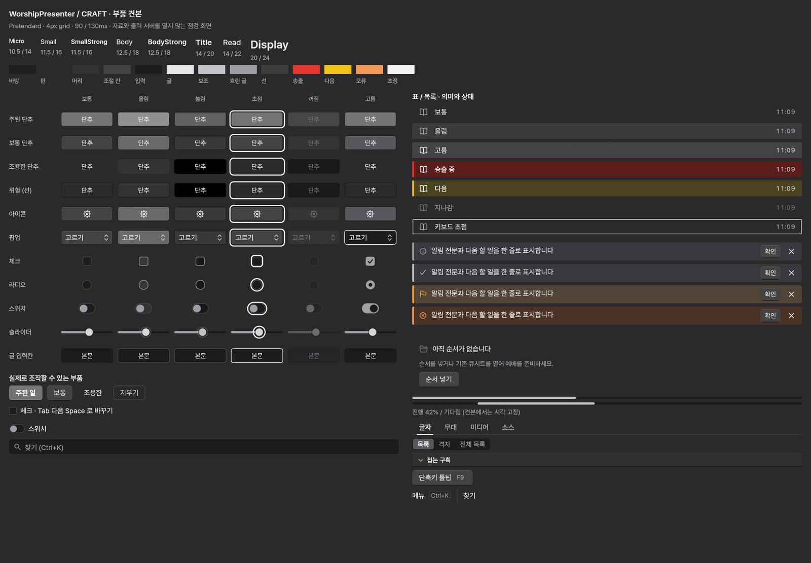
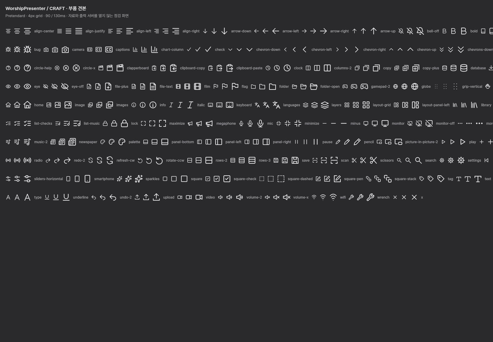
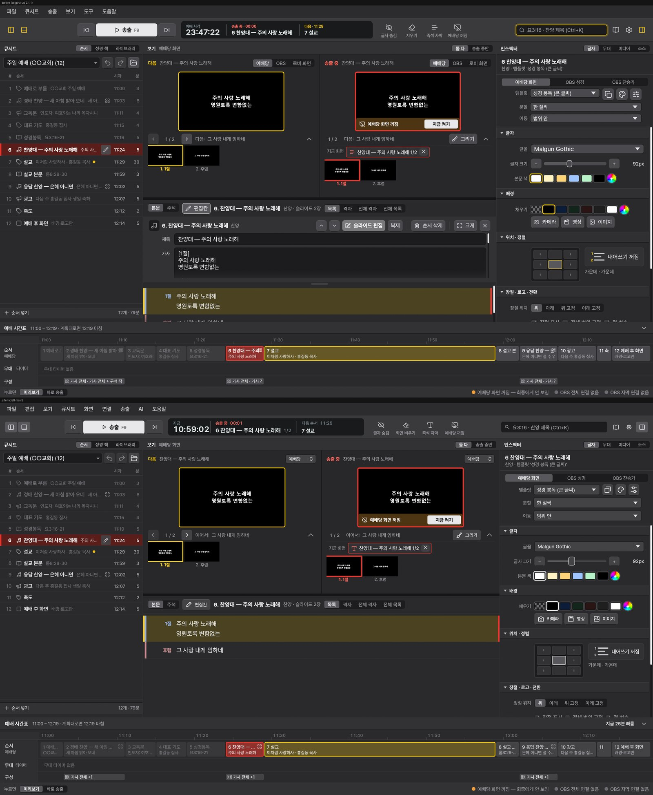

# 조작 화면 디자인 체계

2026-11-28 · `craft-main` · F1 소유: `theme.rs`, `widgets.rs`, `kit.rs`, `icons.rs`.
기존 전문가용 고정 판 배치는 유지한다. 부품은 `use crate::widgets;` 하나로 쓴다. 창 내부는 F2가 같은 API를 사용한다.

## 토큰

| 이름 | 크기(px) | 굵기 | 줄 높이(px) | 용도 |
|---|---:|---:|---:|---|
| `Type::Micro` | 10.5 | 500 | 14 | 시계 이름표, 눈금, 단축키 |
| `Type::Small` / `SmallStrong` | 11.5 | 400 / 600 | 16 | 양식 이름표, 부가 글 / 구획 머리 |
| `Type::Body` / `BodyStrong` | 12.5 | 400 / 600 | 18 | 조절 칸, 표 / 판 머리, 고른 줄 |
| `Type::Title` / `Read` | 14 | 600 / 400 | 20 / 22 | 순서 제목 / 읽는 본문 |
| `Type::Display` | 20 | 600 | 24 | 고정 폭 시각 |

Pretendard만 사용한다. `theme::ty(text, Type, color)` 또는 `Type::… .font()`를 쓴다. 출력용 글꼴과 슬라이드 그리기에는 이 규칙을 적용하지 않는다.

간격은 `theme::sp::{X4,X8,X12,X16,X20,X24,X32}`의 4px 격자. `X2`, `X6`은 아이콘 내부·글과 아이콘·촘촘한 줄 보정에만 사용한다. 판 좌우 여백 `sp::PANE=12`. 단추/입력칸은 `ctl(Ctl::Sm/Md/Lg)` = 22 / 26 / 32. 판 머리 `HEAD_H=28`, 목록 줄 `ROW_H=28`, 구획 머리 `SECTION_H=24`, 상태 줄 `STATUS_H=24`, 위 막대 `BAR_H=56`.

판 둥글기 0. 조절 칸은 `cr(Rad::Md)` = 4, 그 안에 1px 들인 선택칸 `Rad::Sm` = 3. 메뉴·툴팁·창만 6. 선 `LINE=1`, 초점과 끼움선 `LINE_EMPH=2`, 송출 뷰어 `LINE_LIVE=3`. 임의 그림자와 카드 장식은 추가하지 않는다.

## 색과 상태

`pal()`의 역할을 쓴다. `bg` 전체 바탕 → `panel` 판 → `head` 머리 → `raised` 조절 칸, `sunken` 입력과 트랙. 글은 `text` / `text2` / `muted` / `muted2`, 선은 `line` / `line2` / `ctl_line` / `edge`.

빨강 `live` / `live_dk` / `live_text`는 송출 중에만, 노랑 `next` / `next_bg`는 다음에만 쓴다. 고른 조절 칸은 `sel`과 밝은 무채색 선, 초점은 `focus`, 오류는 `danger_text` 주황, 성공은 `text2` 회색. `Kind::Danger`는 채우지 않은 보통 선 단추이며 확인·되돌리기를 함께 둔다.

| 상태 | 값 |
|---|---|
| 보통 | 역할 바탕 + 글 + 1px 선 |
| 올림 | `lift(base)` (어두운 테마 흰색 혼합, 밝은 테마 검정 혼합) |
| 눌림 | `press(base)` (어두운 쪽으로 14~16%) + 안쪽 윗선 |
| 초점 | `focus`, 2px 고리, 1px 간격. 색만 바꿔 초점을 숨기지 않음 |
| 꺼짐 | `disabled(color, panel)` = 글 38% + 판 62%; 상호작용 없음 |
| 고름 | `sel`, `text`, 무채색 선. 송출/다음 상태가 우선 |

`Vis::{NORMAL,HOVER,PRESS,FOCUS,OFF,ON}`으로 강제 상태를 그릴 수 있다. 실제 부품은 `Vis::of`로 읽는다. 표는 `RowVis`와 `paint_row`: 송출·다음은 3px 왼쪽 선과 낮은 채도 바탕, 고름은 회색, 지나감은 흐린 글. 긴 글은 `elide` / `text_elided`와 전문 툴팁. 숫자는 `tnum` / `Tnum`으로 자릿수 고정, 표에서는 오른쪽 맞춤.

## 부품 API

| 부품 | API |
|---|---|
| 단추 / 아이콘 / 펼침 | `Btn` + `Kind::{Primary,Default,Ghost,Danger,Send}`, `.icon_only`, `.caret` |
| 구획 단추 / 탭 | `segmented[_with/_cells]`, `tabs` |
| 고르기 칸 | `popup_btn`, `select` |
| 체크 / 라디오 / 스위치 | `checkbox[_enabled]`, `radio`, `switch` |
| 슬라이더 | `slider` (초점이 있으면 좌우 화살표) |
| 글 입력칸 | `text_field[_sized]` (egui TextEdit의 선택·IME 유지) |
| 표 / 목록 | `paint_row` + `RowVis`; 클릭·끌기 정책은 사용하는 화면 소유 |
| 구획 머리 | `section_head`, `group_head` |
| 양식 | `form_row`, `form_label`; 이름표 열 너비 통일 |
| 툴팁 | `tip(response, 설명, 단축키)`, `tip_auto` |
| 오른쪽 클릭 메뉴 | egui `response.context_menu`; 전역 테마의 글·간격·둥글기 적용 |
| 스크롤 막대 | egui `ScrollArea`; 전역 테마의 선·트랙 사용 |
| 판 사이 손잡이 | `splitter` |
| 알림 띠 | `notice` + `Tone::{Info,Ok,Warn,Error}` |
| 빈 상태 / 진행 | `empty`, `loading`, `progress` |

모든 조작 가능한 새 부품은 `Sense::click` 또는 TextEdit로 Tab 초점을 받는다. Enter/Space는 egui 클릭 동작, 슬라이더 좌우 키는 한 단계 이동. 툴팁은 단축키를 별도 칩으로 표시한다.

## 움직임과 다시 그리기

`T_FAST=0.09s` 올림·눌림, `T_MED=0.13s` 고름 이동·접기. `anim_bool` / `anim_value`는 egui가 움직이는 동안만 프레임을 요청한다. `ui.reduceMotion` 기본 꺼짐, 설정 → 조작 화면 → 움직임 줄이기. 켜면 즉시 상태를 바꾸며 출력 화면의 전환은 그대로다. 불확정 진행/돌림 표시만 보이는 동안 33/50ms에 요청하고, 감소 설정에서는 정지한다.

## 견본과 캡처

`wp-app --specimen --win 1440x1000 --shot tmp/craft/specimen.png`는 실제 자료, DB, 출력 서버, 모니터를 열지 않는다. `--data`를 함께 주면 그 폴더의 `settings.json`에서 테마와 배율만 읽는다. `--specimen icons`는 이름표와 16/20/24px 아이콘을 나열한다. 견본의 진행 시각은 고정한다.

`node tools/craft/shots.js --exe target/debug/wp-app.exe --seed tmp/craft/seed --out tmp/craft/after --only specimen`로 테마와 배율별 그림을 만든다. 앱이 직접 찍고 종료하며 키보드·마우스를 건드리지 않는다. 실제 주 화면의 전후 쌍은 `tmp/craft/before`, `tmp/craft/after`에 보관한다.

## 아이콘

- 원본: `assets/icons/craft.json` (이름 → 16×16 viewBox 안의 SVG 경로). 선 1.25 · 둥근 끝 · 둥근 이음, 채우지 않음. 큰 모양은 0.5 칸에 맞춰 100 · 125 · 150% 에서 흐리지 않게.
- 낱개 SVG: `python tools/craft/icons.py` 가 `assets/icons/craft/<이름>.svg` 를 만든다 (`--check` 는 같은지만 본다). 고친 뒤에는 이 명령을 다시 돌려 둘을 맞춘다.
- 쓰는 법: `icons::paint(ui, rect, "이름", 색)` · `icons::show(ui, "이름", 크기, 색)`. 창(F2)도 같은 이름을 쓴다. craft 에 없는 이름은 Lucide(web/shared/icons.js) 그대로 나온다.
- **되돌리기**: `crates/wp-app/src/icons.rs` 의 `const USE_CRAFT_ICONS: bool = true;` 를 `false` 로 바꾸면 예전 Lucide 한 벌. 실행할 때만 견주려면 환경변수 `WP_ICONS=lucide`.
- 견본: `wp-app --specimen icons --shot x.png` (16 · 20 · 24px).

이름표 (100개): `align-center` · `align-justify` · `align-left` · `align-right` · `arrow-down` · `arrow-left` · `arrow-right` · `arrow-up` · `bold` · `book-open` · `brush` · `camera` · `captions` · `check` · `chevron-down` · `chevron-left` · `chevron-right` · `chevron-up` · `chevrons-down` · `chevrons-up` · `circle` · `circle-check` · `circle-help` · `circle-x` · `clapperboard` · `clock` · `columns-2` · `copy` · `copy-plus` · `download` · `eraser` · `external-link` · `eye` · `eye-off` · `file-text` · `flag` · `folder` · `folder-open` · `globe` · `grip-vertical` · `hand` · `home` · `image` · `images` · `info` · `italic` · `keyboard` · `layers` · `layout-grid` · `link` · `list` · `maximize` · `megaphone` · `mic` · `minimize` · `minus` · `monitor` · `monitor-off` · `more-horizontal` · `mouse-pointer-2` · `music` · `music-2` · `palette` · `panel-bottom` · `panel-left` · `panel-right` · `pause` · `pencil` · `play` · `plus` · `power` · `presentation` · `redo-2` · `refresh-cw` · `rotate-ccw` · `rows-2` · `save` · `scan` · `scissors` · `search` · `settings` · `skip-back` · `skip-forward` · `sliders-horizontal` · `square` · `square-pen` · `tag` · `text` · `timer` · `trash-2` · `triangle-alert` · `type` · `underline` · `undo-2` · `upload` · `video` · `volume-2` · `volume-x` · `wifi` · `x`

## 이번에 더한 공용 부품 (2026-11-28 2차)

| 부품 | 쓰는 곳 |
|---|---|
| `theme::pick()` | 고른 것 표시 선 (색 견본 · 정렬 칸 · 여러 장 고름 · 고른 줄 테두리). 전문가 테마는 밝은 무채색, 옛 테마는 강조색. 노랑(`next` · `accent`)은 '다음' 에만 |
| `widgets::fade_edge(ui, rect, left, 바탕)` | 넘치는 가로 줄의 끝을 흐리게 (슬라이드 줄) |
| `widgets::elide` · `Tnum` | 말줄임 · 자릿수 폭 고정 숫자 (표시창 · 시간표 · 쪽 수) |
| `probar_ui::BarFit` | 컨트롤 막대가 폭에 따라 덜어 내는 단계 (아래 표). 시험 `bar_never_overlaps_and_steps_in_order` |

### 컨트롤 막대 폭 단계 (`BarFit::fit`)

넓을 때 모습에서 하나씩 덜어 내고 겹치지 않는다(665px = 1000×640 · 150% 까지 시험).
1 찾기칸 260 → 180 · 2 도구 이름 빼고 아이콘만(이름은 툴팁 첫머리) · 3 송출 단추 좁게 · 4 찾기칸 140 · 5 표시창 '지금' 칸 빼기(툴팁) ·
6 송출 단추의 F9 글 빼기 · 7 찾기칸 120 · 8 판 접기 · 설정 아이콘 빼기(보기 · 파일 메뉴에 같은 것) · 9 틈 8 · 찾기칸 104.
표시창('송출 중' 이 읽혀야 함)은 찾기칸보다 나중에 줄인다. 도구 칸 폭은 가장 긴 이름에 맞춘다(영어).

## 주 화면 정리 (craft-main)

| 구역 | 바뀐 것 |
|---|---|
| 표시창 | [지금 \| 송출 중 \| 다음 순서]. 송출 중 칸이 가장 넓고 제목 14 굵게, 숫자는 자릿수 고정(초가 바뀌어도 흔들리지 않음), 넘치면 말줄임 + 툴팁. 숨겼으면 '· 글자 숨김' / '· 화면 비움' 주황 |
| '다음' 의 뜻 | 노랑 '다음' 뷰어 = F9 로 나갈 것 (툴팁). 표시창은 '다음 순서', 슬라이드 아래 줄은 '이어서:' |
| 뷰어 | 출력 고르기 [예배당 \| OBS \| 로비] 구획 단추 → 작은 고르기 칸 (뷰어마다 따로 고르는 기능은 그대로). 빈 뷰어 테두리는 회색 |
| 편집칸 | 머리의 순서 이름(본문 판 머리와 겹침) → '편집칸 · 6번 찬양'. 열림/닫힘을 기억(설정 `rsEditorOpen`). 송출 중인 순서를 고르면 접어 둔다 — 편집칸 단추 · F2 · Ctrl+Shift+E 로 펼침 |
| 노랑 · 빨강 규칙 | 판 접기 아이콘 · 찾기칸 초점 · 즉석 자막 켜짐 · 시간표 무대 타이머 · 색 견본 · 정렬 칸 · 여러 장 고름 · 판 손잡이 · 순서 넣기 펼침 → 회색. 상태 줄 오류 → 주황 |
| 시간표 | 막대 글은 말줄임(글자 중간에서 잘리지 않음), 좁은 막대는 번호만, 구성 줄은 이름 하나 + 개수, 눈금 숫자 폭 고정 |
| 인스펙터 | 무대 탭 = 글자 탭 양식(구획 머리 · 이름표 열 78 · 여백 12), 지금 떠 있는 무대 메시지. 글꼴 고르기 · 내어쓰기 단추를 글자 단계에. 고른 순서 없으면 "템플릿 '…'" + '템플릿 전체를 고칩니다' |
| 빈 상태 | 빈 큐시트(순서 넣기 · Ctrl+V 가사 · 찾아서 넣기), 빈 본문(Ctrl+K · 순서 누르기 · F9) |
| 말 | 숨김 · 보이기 한 쌍: 글자 숨김/보이기 · 배경 숨김/보이기 · 모두 숨김, 도구 이름 '지우기' → '화면 비우기' (하는 일은 같음) |
| 지금 화면 칩 | 이름 자막 · 회중 메시지 · 무대 메시지도 칩으로 (✕ 로 내림) |
| 상태 줄 | 잘린 알림은 눌러서 전문 + 할 일, 잘리지 않은 것은 예전처럼 눌러 닫기 |
| 끌어서 차례 바꾸기 | 끼움 선 = 초점색 2px + 왼쪽 동그라미, 끌리는 줄 이름표, 제자리 흐림 |

### 자리 옮긴 조작 (예전 자리 → 새 자리)

| 조작 | 예전 | 새 자리 |
|---|---|---|
| 뷰어 출력 고르기 | 뷰어 머리 구획 단추 세 칸 | 뷰어 머리 오른쪽 작은 고르기 칸 (같은 목록) |
| 판 접기 · 설정 아이콘 (아주 좁은 창) | 막대 양 끝 | 보기 메뉴 '판 보이기 · 숨기기' · 설정 메뉴 (넓으면 예전 자리 그대로) |
| 무대 탭 일시정지 · 계속 | 글자 단추 둘 | '조절' 줄 첫 아이콘 하나 (진행 중이면 일시정지, 멈췄으면 계속) |
| 무대 탭 '그 시각까지 시작' | 단추 이름 | '몇 시까지' 줄의 [시작] (같은 동작) |
| 무대 화면 주소 | 단추 줄 안 흐린 글 | [주소 복사] 단추 아래 흐린 글 |

단축키는 하나도 바꾸지 않았다.

