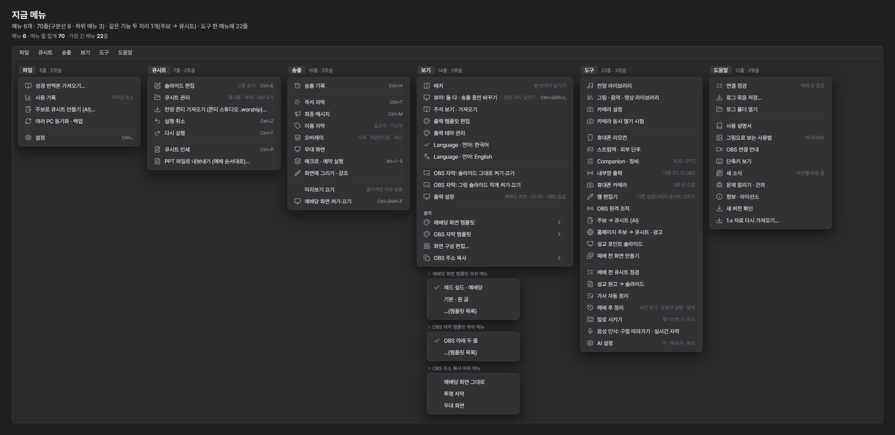
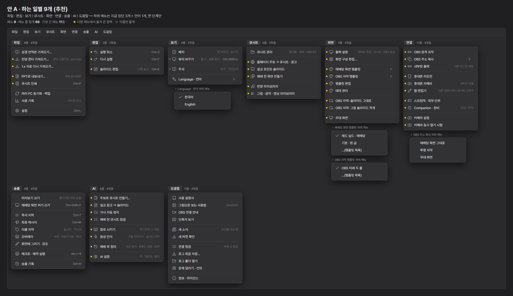

# 워십프리젠터(Rust판) 메뉴 막대 정돈 시안

맨 위 메뉴 막대(지금 6개 · 70줄)를 맥·윈도우 관례와 예배 흐름에 맞춰 다시 묶는 시안 세 가지입니다. **기능은 하나도 빼지 않았고 단축키도 그대로**이며, 자리와 이름만 바꿉니다. 코드는 아직 고치지 않았습니다 — 그림을 보고 하나를 골라 주시면 그때 적용합니다.

기준: `origin/rust` a311ce8 (`crates/wp-app/src/menubar.rs` `menus()` + `track_c.rs` `menu_bar` 의 덧붙임). 데모 자료는 가상(○○교회)입니다.

## 그림

| 그림 | 내용 |
|---|---|
| [current.png](current.png) | 지금 메뉴 6개를 모두 펼친 모습 |
| [a.png](a.png) | **안 A (추천)** — 하는 일별 9개 |
| [b.png](b.png) | 안 B — 지금 이름 그대로 7개 |
| [c.png](c.png) | 안 C — 잘게 나눈 10개 |
| `cap\menu-파일.png` · `menu-큐시트.png` · `menu-송출.png` · `menu-보기.png` · `menu-도구.png` · `menu-도움말.png` | 실제 프로그램(임시 자료 폴더)에서 메뉴를 펼친 캡처 6장 |

그림 읽는 법: 노란 점 = 다른 메뉴에서 옮겨 온 항목(안 B 는 하위 메뉴로 들어간 것도), 빈 점 = 자리는 그대로이고 이름만 짧게 한 항목. 항목 오른쪽 흐린 글 = 지금 괄호 안에 있던 설명.

다시 찍는 법 (이 폴더에서):

```
node shot.js current a b c      # current.html a.html b.html c.html → PNG (설치된 크롬 + puppeteer-core)
node check.js                   # 안마다 빠진 기능 · 중복 · 메뉴별 줄/구분선 수
node gen-tables.js > tables.md  # 아래 표 두 개
```

자료는 모두 `menus.js` 에 있습니다 (`F` = 지금 기능 전부, `PLANS` = 지금 · A · B · C 의 메뉴 구성). 안을 손보려면 이 파일만 고치고 위 세 명령을 다시 돌리면 됩니다.

## 지금 메뉴의 문제



메뉴 6개 · 70줄 · 구분선 9 · 하위 메뉴 3 · 작은 제목 1.

| 메뉴 | 줄 | 구분선 | 하위 메뉴 |
|---|---|---|---|
| 파일 | 5 | 1 | |
| 큐시트 | 7 | 1 | |
| 송출 | 10 | 2 | |
| 보기 | 14 | 2 | 3 |
| 도구 | 22 | 2 | |
| 도움말 | 12 | 1 | |

- **도구가 22줄.** AI 7줄 · 장비 · OBS · 주보 · 라이브러리가 한 메뉴에 있고 구분선은 2개뿐이라 찾으려면 끝까지 읽어야 합니다.
- **보기 14줄에 성격이 다른 것이 섞임.** 조작 화면 보기(배치 · 뷰어)와 출력 설정 · 템플릿 · OBS 자막 · OBS 주소가 한 메뉴에 있고, 언어 두 줄이 그 한가운데 있습니다.
- **편집 메뉴가 없음.** 실행 취소 · 다시 실행이 '큐시트' 에 있습니다.
- **인쇄 · PPT 내보내기가 '큐시트' 에.** 맥 · 윈도우 관례는 파일 메뉴입니다.
- **같은 기능이 두 자리 (1개).** 파일 '주보로 큐시트 만들기 (AI)…' 와 도구 '주보 → 큐시트 (AI)' 는 같은 창을 엽니다.
- **자리가 어색한 것.** 무대 화면이 송출에, '1.x 자료 다시 가져오기' 가 도움말에 있습니다.
- **묶음이 흐림.** 큐시트는 7줄에 구분선 1개, 도움말은 12줄에 구분선 1개입니다.

## 지금 메뉴 항목 (70줄)

'다른 자리' 는 같은 일을 메뉴 말고 할 수 있는 곳입니다.

| 메뉴 | 항목 이름 (지금) | 단축키 | 하는 일 | 다른 자리 |
|---|---|---|---|---|
| 파일 | 성경 번역본 가져오기… |  | 성경 파일을 분석해 번역본으로 가져오기 · 관리 | 설정 → 성경 데이터 |
| 파일 | 사용 기록 (저작권 보고) |  | 송출한 찬양 기록을 기간별로 모아 저작권 보고용 CSV | 설정 → 백업 |
| 파일 | 주보로 큐시트 만들기 (AI)… |  | 주보 글을 붙여 넣으면 AI(또는 규칙)가 큐시트 순서로 | 큐시트 오른쪽 클릭 · 큐시트 관리 창 |
| 파일 | 여러 PC 동기화 · 백업 |  | 동기화 폴더 · 지금 백업 · 백업에서 되돌리기 | 설정 → 백업 |
| 파일 | 설정 | Ctrl+, | 설정 창 | 도구 막대 ⚙ |
| 큐시트 | 슬라이드 편집 (고른 순서) | Ctrl+E | 고른 순서의 슬라이드 편집기 | 가운데 단추 · 슬라이드 오른쪽 클릭 |
| 큐시트 | 큐시트 관리 (휴지통 · 복제 · 내보내기) |  | 큐시트 새로 · 복제 · 서식 · 내보내기·가져오기 · 휴지통 | 큐시트 판 머리 단추 · 오른쪽 클릭 · 설정 |
| 큐시트 | 찬양 콘티 가져오기 (콘티 스튜디오 .worship)… |  | 콘티 스튜디오 .worship 파일을 큐시트로 | — |
| 큐시트 | 실행 취소 | Ctrl+Z | 큐시트 순서 변경 되돌리기 | 단축키 |
| 큐시트 | 다시 실행 | Ctrl+Y | 되돌린 것 다시 | 단축키 |
| 큐시트 | 큐시트 인쇄 | Ctrl+P | 큐시트 인쇄 | 큐시트 관리 창 |
| 큐시트 | PPT 파일로 내보내기 (예배 순서대로)… |  | 예배 순서대로 PPT 한 파일로 내보내기 | — |
| 송출 | 송출 기록 | Ctrl+H | 지금까지 송출한 것 목록 · 다시 송출 | 뷰어 오른쪽 클릭 |
| 송출 | 즉석 자막 | Ctrl+T | 글을 써서 바로 송출 | 도구 막대 '즉석 자막' |
| 송출 | 회중 메시지 | Ctrl+M | 회중 메시지 띠 (아이 부모 호출 등) | — |
| 송출 | 이름 자막 (설교자 · 기도자) |  | 설교자 · 기도자 이름 자막 | — |
| 송출 | 오버레이 (시계 · 카운트다운 · 배너) |  | 시계 · 카운트다운 · 배너 오버레이 | — |
| 송출 | 무대 화면 |  | 무대 화면 창 (순서표 · 고정 글 · 타이머) | 뷰어 오른쪽 클릭 · 인스펙터 무대 탭 |
| 송출 | 매크로 · 예약 실행 | Alt+1~9 | 여러 동작을 한 번에 · 예약 실행 | 순서 자동 동작 |
| 송출 | 화면에 그리기 · 강조 |  | 송출 화면 위에 펜으로 그리기 · 강조 | 뷰어 '그리기' 단추 · 오른쪽 클릭 |
| 송출 | 미리보기 끄기 (클릭하면 바로 송출) |  | 누르면 다음 칸을 거치지 않고 바로 송출 (켜기·끄기) | 아래 줄 '미리보기 | 바로 송출' |
| 송출 | 예배당 화면 켜기·끄기 | Ctrl+Shift+F | 예배당 화면(모니터 출력) 켜기·끄기 | 도구 막대 '예배당 꺼짐' 단추 |
| 보기 | 배치 (판 보이기·숨기기) |  | 판 보이기·숨기기 · 배치 저장 | 설정 → 조작 화면 · 도구 막대 판 단추 |
| 보기 | 뷰어: 둘 다 · 송출 중만 바꾸기 (본문 자리 넓히기) | Ctrl+Shift+L | 뷰어 둘 다 ↔ 송출 중만 | 뷰어 위 '둘 다 | 송출 중만' |
| 보기 | 주석 보기 · 가져오기 |  | 주석서 보기 · EPUB 가져오기 | 본문 칸 '주석' 탭 · 설정 |
| 보기 | 출력 템플릿 편집 |  | 템플릿 편집 창 (글꼴 · 색 · 배경 · 여백) | 인스펙터 글자 탭 ⚙ · 설정 |
| 보기 | 출력 테마 관리 |  | 테마 묶음에서 템플릿 가져오기 | 인스펙터 글자 탭 · 설정 |
| 보기 | Language · 언어: 한국어 |  | 화면 언어 한국어 | 설정 → 조작 화면 |
| 보기 | Language · 언어: English |  | 화면 언어 영어 | 설정 → 조작 화면 |
| 보기 | OBS 자막: 슬라이드 그대로 켜기·끄기 |  | OBS 자막에 슬라이드 그대로 (켜기·끄기) | 설정 → 출력 |
| 보기 | OBS 자막: 그림 슬라이드 작게 켜기·끄기 |  | OBS 자막에 그림 슬라이드를 작게 (켜기·끄기) | — |
| 보기 | 출력 설정 (예배당 화면 · 모니터 · OBS 숨김) |  | 출력 설정 창 (모니터 · 추가 출력 · OBS 숨김) | 도구 막대 출력 단추 · 인스펙터 소스 탭 · 설정 |
| 보기 | 예배당 화면 템플릿 |  | 예배당 화면 템플릿 고르기 (하위 메뉴) | 인스펙터 글자 탭 템플릿 칸 |
| 보기 | OBS 자막 템플릿 |  | OBS 자막 템플릿 고르기 (하위 메뉴) | 인스펙터 'OBS 성경' 탭 |
| 보기 | 화면 구성 편집… |  | 화면 구성 편집기 | 인스펙터 소스 탭 |
| 보기 | OBS 주소 복사 |  | OBS 에 넣을 주소 3개 복사 (하위 메뉴) | 출력 설정 창 |
| 도구 | 찬양 라이브러리 |  | 찬양 라이브러리 창 | 왼쪽 판 라이브러리 탭 |
| 도구 | 그림 · 음악 · 영상 라이브러리 |  | 그림 · 음악 · 영상 라이브러리 창 | 뷰어 오른쪽 클릭 '송출 배경' |
| 도구 | 카메라 설정 |  | 카메라 · 캡처 장치 이름 붙이기 | 인스펙터 미디어 탭 · 설정 |
| 도구 | 카메라 동시 열기 시험 |  | 카메라 여러 대 동시에 열리는지 시험 | — |
| 도구 | 휴대폰 리모컨 |  | 휴대폰으로 슬라이드 넘기기 (QR · PIN) | 설정 → 원격 |
| 도구 | 스트림덱 · 외부 단추 |  | 스트림덱 · 외부 프로그램에서 주소로 동작 | 설정 → 원격 |
| 도구 | Companion · 장비 (X32 · PTZ) |  | Companion · X32 · PTZ 장비 등록 | 설정 → 원격 |
| 도구 | 내부망 출력 (다른 PC 의 OBS) |  | 다른 PC 의 OBS 가 출력 화면을 열게 | 설정 → OBS · 원격 |
| 도구 | 휴대폰 카메라 (QR 로 연결) |  | 휴대폰을 카메라로 (QR) | — |
| 도구 | 웹 편집기 (다른 컴퓨터에서 큐시트 고치기) |  | 다른 컴퓨터 브라우저에서 큐시트 고치기 | — |
| 도구 | OBS 원격 조작 |  | OBS 연결 · 장면 · 방송/녹화 | 아래 상태 줄 OBS 칸 · 설정 |
| 도구 | 주보 → 큐시트 (AI) |  | 주보 글을 붙여 넣으면 AI(또는 규칙)가 큐시트 순서로 | 큐시트 오른쪽 클릭 · 큐시트 관리 창 |
| 도구 | 홈페이지 주보 → 큐시트 · 광고 |  | 홈페이지 주보 JSON → 큐시트 · 광고 슬라이드 | — |
| 도구 | 설교 포인트 슬라이드 |  | 설교 원고 → 대지 제목 슬라이드 | 순서 넣기 |
| 도구 | 예배 전 화면 만들기 |  | 예배 전 대기 화면 슬라이드쇼 만들기 | 순서 넣기 |
| 도구 | 예배 전 큐시트 점검 |  | 예배 전 큐시트 빠진 곳 점검 (AI) | — |
| 도구 | 설교 원고 → 슬라이드 |  | 설교 원고 → 슬라이드 (AI) | 순서 넣기 |
| 도구 | 가사 자동 정리 |  | 붙여 넣은 가사 자동 정리 (AI) | — |
| 도구 | 예배 후 정리 (시간 표시 · 유튜브 설명 · 요약) |  | 예배 후 시간 표시 · 유튜브 설명 · 요약 (AI) | — |
| 도구 | 말로 시키기 (찾기칸에 '>' 로도) |  | 말(글)로 명령 · 찾기칸 ">" | 찾기칸에 '>' |
| 도구 | 음성 인식: 구절 따라가기 · 실시간 자막 |  | 음성 인식 → 구절 따라가기 · 실시간 자막 | — |
| 도구 | AI 설정 (키 · 제공자 · 동의) |  | AI 키 · 제공자 · 동의 | 설정 → AI |
| 도움말 | 연결 점검 (예배 전 점검) |  | 출력 · OBS · 장비 · 동기화 연결 한 번에 점검 | 설정 → 원격 |
| 도움말 | 로그 묶음 저장… |  | 로그를 묶어 파일로 (문제 알릴 때) | — |
| 도움말 | 로그 폴더 열기 |  | 로그 폴더 열기 | 동기화 창 '로그 폴더' |
| 도움말 | 사용 설명서 |  | 사용 설명서 열기 | — |
| 도움말 | 그림으로 보는 사용법 (README) |  | README (그림 설명) | — |
| 도움말 | OBS 연결 안내 |  | OBS 연결 안내 문서 | 출력 설정 창 안내 링크 |
| 도움말 | 단축키 보기 |  | 단축키 표 | 설정 → 정보 |
| 도움말 | 새 소식 (버전별 바뀐 점) |  | 버전별 바뀐 점 | — |
| 도움말 | 문제 알리기 · 건의 |  | 문제 알리기 · 건의 (GitHub) | — |
| 도움말 | 정보 · 라이선스 |  | 정보 · 라이선스 | 설정 → 정보 |
| 도움말 | 새 버전 확인 |  | 새 버전 확인 · 내려받기 | 설정 → 정보 |
| 도움말 | 1.x 자료 다시 가져오기… |  | 1.x(Electron) 자료 다시 가져오기 | — |

## 안 세 가지

세 안 모두 **파일 · 편집 · 보기 · 도움말은 같습니다** (아래 안 A 에 한 번만 적음). 다른 것은 가운데 업무 메뉴를 몇 개로, 어떤 이름으로 나누느냐입니다.

순서 원칙:

- 맥 관례대로 파일 · 편집 · 보기가 앞, 도움말이 맨 끝. 업무 메뉴는 그 사이에 둡니다(애플 HIG 는 앱 고유 메뉴를 보기와 창 사이에 두라고 합니다).
- 업무 메뉴는 예배 흐름 순서: 준비(큐시트) → 화면 → 연결 → 송출 → AI(예배 후 정리까지).
- **'창' 메뉴는 두지 않았습니다.** 이 앱에는 여러 창을 목록으로 오가는 기능이 없어서, 배치 · 뷰어 바꾸기는 '보기' 에 둡니다.
- 설정은 윈도우 관례대로 파일 맨 아래 (맥에서 앱 메뉴로 옮길지는 나중 과제).
- 아래 목록에서 항목은 쉼표로, 구분선 묶음은 ` | ` 로, 하위 메뉴는 `▸` 로(안 B 는 그 안을 `[ ]` 로) 적었습니다.

### 안 A — 하는 일별 9개 (추천)

메뉴 막대: **파일 · 편집 · 보기 · 큐시트 · 화면 · 연결 · 송출 · AI · 도움말**

- **파일** (8줄): 성경 번역본 가져오기…, 찬양 콘티 가져오기…, 1.x 자료 다시 가져오기… | PPT로 내보내기…, 큐시트 인쇄 | 여러 PC 동기화 · 백업, 사용 기록 | 설정
- **편집** (3줄): 실행 취소, 다시 실행 | 슬라이드 편집
- **보기** (4줄): 배치, 뷰어 바꾸기 | 주석 | Language · 언어 ▸
- **큐시트** (6줄): 큐시트 관리 | 홈페이지 주보 → 큐시트 · 광고, 설교 포인트 슬라이드, 예배 전 화면 만들기 | 찬양 라이브러리, 그림 · 음악 · 영상 라이브러리
- **화면** (9줄): 출력 설정, 화면 구성 편집… | 예배당 화면 템플릿 ▸, OBS 자막 템플릿 ▸, 템플릿 편집, 테마 관리 | OBS 자막: 슬라이드 그대로, OBS 자막: 그림 슬라이드 작게 | 무대 화면
- **연결** (10줄): OBS 원격 조작, OBS 주소 복사 ▸, 내부망 출력 | 휴대폰 리모컨, 휴대폰 카메라, 웹 편집기 | 스트림덱 · 외부 단추, Companion · 장비 | 카메라 설정, 카메라 동시 열기 시험
- **송출** (9줄): 미리보기 끄기, 예배당 화면 켜기·끄기 | 즉석 자막, 회중 메시지, 이름 자막, 오버레이, 화면에 그리기 · 강조 | 매크로 · 예약 실행 | 송출 기록
- **AI** (8줄): 주보로 큐시트 만들기…, 설교 원고 → 슬라이드, 가사 자동 정리, 예배 전 큐시트 점검 | 말로 시키기, 음성 인식 | 예배 후 정리 | AI 설정
- **도움말** (11줄): 사용 설명서, 그림으로 보는 사용법, OBS 연결 안내, 단축키 보기 | 새 소식, 새 버전 확인 | 연결 점검, 로그 묶음 저장…, 로그 폴더 열기, 문제 알리기 · 건의 | 정보 · 라이선스



합계 68줄(중복 1줄이 빠지고 언어 2줄이 하위 메뉴 1줄로), 가장 긴 메뉴 11줄. 하위 메뉴는 지금 있던 3개 + 언어 1개, 모두 한 단계.

- 좋은 점: 모든 메뉴가 12줄 이하이고 묶음이 2~4개. '화면'(어떻게 보이나) · '연결'(무엇과 잇나)처럼 찾는 사람이 떠올리는 이름. AI 기능 8개가 한 메뉴. 같은 기능 중복 없음. 메뉴 이름이 10개 미만.
- 약점: OBS 관련이 두 곳으로 나뉩니다 — 자막 모양(템플릿 · 슬라이드 그대로 · 그림 작게)은 '화면', 접속(원격 조작 · 주소 복사 · 내부망)은 '연결'. 메뉴 이름 3개(화면 · 연결 · AI)가 새로 생기고 '도구' 가 없어져 처음에는 낯섭니다.

### 안 B — 지금 이름 그대로 7개

메뉴 막대: **파일 · 편집 · 보기 · 큐시트 · 송출 · 도구 · 도움말**

파일 · 편집 · 보기 · 도움말은 안 A 와 같음.

- **큐시트** (9줄): 큐시트 관리 | 주보로 큐시트 만들기 (AI)…, 홈페이지 주보 → 큐시트 · 광고, 설교 포인트 슬라이드, 설교 원고 → 슬라이드 (AI), 예배 전 화면 만들기 | 찬양 라이브러리, 그림 · 음악 · 영상 라이브러리 | 예배 전 큐시트 점검 (AI)
- **송출** (10줄): 미리보기 끄기, 예배당 화면 켜기·끄기, 무대 화면 | 즉석 자막, 회중 메시지, 이름 자막, 오버레이, 화면에 그리기 · 강조 | 매크로 · 예약 실행 | 송출 기록
- **도구** (9줄): 출력 설정, 화면 구성 편집… | 예배당 화면 템플릿 ▸, OBS 자막 템플릿 ▸, 템플릿 편집, 테마 관리 | OBS ▸ [OBS 원격 조작, 내부망 출력 | OBS 자막: 슬라이드 그대로, OBS 자막: 그림 슬라이드 작게 | 예배당 화면 그대로, 투명 자막, 무대 화면], 장비 · 휴대폰 ▸ [휴대폰 리모컨, 휴대폰 카메라, 웹 편집기 | 스트림덱 · 외부 단추, Companion · 장비 | 카메라 설정, 카메라 동시 열기 시험], AI ▸ [가사 자동 정리 | 말로 시키기, 음성 인식 | 예배 후 정리 | AI 설정]


메뉴 줄 합계 54줄이지만 '도구' 의 하위 메뉴 셋(OBS · 장비·휴대폰 · AI) 안에 19줄이 더 있습니다.

- 좋은 점: 메뉴 이름이 지금과 거의 같아(편집만 새로 생김) 익숙합니다. 막대가 짧습니다.
- 약점: 하위 메뉴 안에 숨은 항목이 많아 두 번 펼쳐야 합니다(도구 하위 메뉴 5개). AI 가 큐시트(주보 · 설교 원고 · 점검)와 도구 ▸ AI 로 갈립니다. OBS 주소 복사가 하위 메뉴 안의 세 줄이 됩니다. '도구' 가 여전히 '그 밖의 것' 모음입니다.

### 안 C — 잘게 나눈 10개

메뉴 막대: **파일 · 편집 · 보기 · 큐시트 · 화면 · 방송 · 장비 · 송출 · AI · 도움말**

파일 · 편집 · 보기 · 큐시트 · AI · 도움말은 안 A 와 같음.

- **화면** (6줄): 출력 설정, 화면 구성 편집… | 예배당 화면 템플릿 ▸, 템플릿 편집, 테마 관리 | 무대 화면
- **방송** (8줄): OBS 원격 조작, OBS 주소 복사 ▸, 내부망 출력 | OBS 자막 템플릿 ▸, OBS 자막: 슬라이드 그대로, OBS 자막: 그림 슬라이드 작게 | 이름 자막, 오버레이
- **장비** (7줄): 휴대폰 리모컨, 휴대폰 카메라, 웹 편집기 | 스트림덱 · 외부 단추, Companion · 장비 | 카메라 설정, 카메라 동시 열기 시험
- **송출** (7줄): 미리보기 끄기, 예배당 화면 켜기·끄기 | 즉석 자막, 회중 메시지, 화면에 그리기 · 강조 | 매크로 · 예약 실행 | 송출 기록


합계 68줄, 업무 메뉴는 모두 6~8줄.

- 좋은 점: 메뉴 하나하나가 가장 짧습니다. OBS 관련(원격 · 주소 · 자막 템플릿 · 자막 모양)이 '방송' 한 메뉴에 모입니다.
- 약점: 메뉴 이름이 10개라 막대가 길고 좁은 창에서 빠듯합니다. '방송' 과 '송출' 이 뜻이 비슷해 헷갈립니다. 이름 자막 · 오버레이가 '송출' 에서 '방송' 으로 가서, 예배당 화면에도 쓰는 사람에게는 어색합니다.

## 옮김 표

굵게 = 자리가 바뀌는 항목. `›` 는 하위 메뉴 안.

| 항목 | 지금 | 안 A | 안 B | 안 C | 새 이름 (A·C 기준, 바뀐 것만) |
|---|---|---|---|---|---|
| 성경 번역본 가져오기… | 파일 | 파일 | 파일 | 파일 |  |
| 사용 기록 (저작권 보고) | 파일 | 파일 | 파일 | 파일 |  |
| 주보로 큐시트 만들기 (AI)… | 파일 · 도구 | **AI** | **큐시트** | **AI** | 주보로 큐시트 만들기… |
| 여러 PC 동기화 · 백업 | 파일 | 파일 | 파일 | 파일 |  |
| 설정 | 파일 | 파일 | 파일 | 파일 |  |
| 슬라이드 편집 (고른 순서) | 큐시트 | **편집** | **편집** | **편집** |  |
| 큐시트 관리 (휴지통 · 복제 · 내보내기) | 큐시트 | 큐시트 | 큐시트 | 큐시트 |  |
| 찬양 콘티 가져오기 (콘티 스튜디오 .worship)… | 큐시트 | **파일** | **파일** | **파일** | 찬양 콘티 가져오기… |
| 실행 취소 | 큐시트 | **편집** | **편집** | **편집** |  |
| 다시 실행 | 큐시트 | **편집** | **편집** | **편집** |  |
| 큐시트 인쇄 | 큐시트 | **파일** | **파일** | **파일** |  |
| PPT 파일로 내보내기 (예배 순서대로)… | 큐시트 | **파일** | **파일** | **파일** | PPT로 내보내기… |
| 송출 기록 | 송출 | 송출 | 송출 | 송출 |  |
| 즉석 자막 | 송출 | 송출 | 송출 | 송출 |  |
| 회중 메시지 | 송출 | 송출 | 송출 | 송출 |  |
| 이름 자막 (설교자 · 기도자) | 송출 | 송출 | 송출 | **방송** |  |
| 오버레이 (시계 · 카운트다운 · 배너) | 송출 | 송출 | 송출 | **방송** |  |
| 무대 화면 | 송출 | **화면** | 송출 | **화면** |  |
| 매크로 · 예약 실행 | 송출 | 송출 | 송출 | 송출 |  |
| 화면에 그리기 · 강조 | 송출 | 송출 | 송출 | 송출 |  |
| 미리보기 끄기 (클릭하면 바로 송출) | 송출 | 송출 | 송출 | 송출 |  |
| 예배당 화면 켜기·끄기 | 송출 | 송출 | 송출 | 송출 |  |
| 배치 (판 보이기·숨기기) | 보기 | 보기 | 보기 | 보기 |  |
| 뷰어: 둘 다 · 송출 중만 바꾸기 (본문 자리 넓히기) | 보기 | 보기 | 보기 | 보기 | 뷰어 바꾸기 |
| 주석 보기 · 가져오기 | 보기 | 보기 | 보기 | 보기 | 주석 |
| 출력 템플릿 편집 | 보기 | **화면** | **도구** | **화면** | 템플릿 편집 |
| 출력 테마 관리 | 보기 | **화면** | **도구** | **화면** | 테마 관리 |
| Language · 언어 (한국어 · English) | 보기 | **보기 › Language · 언어** | **보기 › Language · 언어** | **보기 › Language · 언어** | Language · 언어 ▸ 한국어 / English |
| OBS 자막: 슬라이드 그대로 켜기·끄기 | 보기 | **화면** | **도구 › OBS** | **방송** | OBS 자막: 슬라이드 그대로 |
| OBS 자막: 그림 슬라이드 작게 켜기·끄기 | 보기 | **화면** | **도구 › OBS** | **방송** | OBS 자막: 그림 슬라이드 작게 |
| 출력 설정 (예배당 화면 · 모니터 · OBS 숨김) | 보기 | **화면** | **도구** | **화면** |  |
| 예배당 화면 템플릿 | 보기 | **화면** | **도구** | **화면** |  |
| OBS 자막 템플릿 | 보기 | **화면** | **도구** | **방송** |  |
| 화면 구성 편집… | 보기 | **화면** | **도구** | **화면** |  |
| OBS 주소 복사 | 보기 | **연결** | **도구 › OBS (주소 3줄)** | **방송** |  |
| 찬양 라이브러리 | 도구 | **큐시트** | **큐시트** | **큐시트** |  |
| 그림 · 음악 · 영상 라이브러리 | 도구 | **큐시트** | **큐시트** | **큐시트** |  |
| 카메라 설정 | 도구 | **연결** | **도구 › 장비 · 휴대폰** | **장비** |  |
| 카메라 동시 열기 시험 | 도구 | **연결** | **도구 › 장비 · 휴대폰** | **장비** |  |
| 휴대폰 리모컨 | 도구 | **연결** | **도구 › 장비 · 휴대폰** | **장비** |  |
| 스트림덱 · 외부 단추 | 도구 | **연결** | **도구 › 장비 · 휴대폰** | **장비** |  |
| Companion · 장비 (X32 · PTZ) | 도구 | **연결** | **도구 › 장비 · 휴대폰** | **장비** |  |
| 내부망 출력 (다른 PC 의 OBS) | 도구 | **연결** | **도구 › OBS** | **방송** |  |
| 휴대폰 카메라 (QR 로 연결) | 도구 | **연결** | **도구 › 장비 · 휴대폰** | **장비** |  |
| 웹 편집기 (다른 컴퓨터에서 큐시트 고치기) | 도구 | **연결** | **도구 › 장비 · 휴대폰** | **장비** |  |
| OBS 원격 조작 | 도구 | **연결** | **도구 › OBS** | **방송** |  |
| 홈페이지 주보 → 큐시트 · 광고 | 도구 | **큐시트** | **큐시트** | **큐시트** |  |
| 설교 포인트 슬라이드 | 도구 | **큐시트** | **큐시트** | **큐시트** |  |
| 예배 전 화면 만들기 | 도구 | **큐시트** | **큐시트** | **큐시트** |  |
| 예배 전 큐시트 점검 | 도구 | **AI** | **큐시트** | **AI** |  |
| 설교 원고 → 슬라이드 | 도구 | **AI** | **큐시트** | **AI** |  |
| 가사 자동 정리 | 도구 | **AI** | **도구 › AI** | **AI** |  |
| 예배 후 정리 (시간 표시 · 유튜브 설명 · 요약) | 도구 | **AI** | **도구 › AI** | **AI** |  |
| 말로 시키기 (찾기칸에 '>' 로도) | 도구 | **AI** | **도구 › AI** | **AI** |  |
| 음성 인식: 구절 따라가기 · 실시간 자막 | 도구 | **AI** | **도구 › AI** | **AI** | 음성 인식 |
| AI 설정 (키 · 제공자 · 동의) | 도구 | **AI** | **도구 › AI** | **AI** |  |
| 연결 점검 (예배 전 점검) | 도움말 | 도움말 | 도움말 | 도움말 |  |
| 로그 묶음 저장… | 도움말 | 도움말 | 도움말 | 도움말 |  |
| 로그 폴더 열기 | 도움말 | 도움말 | 도움말 | 도움말 |  |
| 사용 설명서 | 도움말 | 도움말 | 도움말 | 도움말 |  |
| 그림으로 보는 사용법 (README) | 도움말 | 도움말 | 도움말 | 도움말 |  |
| OBS 연결 안내 | 도움말 | 도움말 | 도움말 | 도움말 |  |
| 단축키 보기 | 도움말 | 도움말 | 도움말 | 도움말 |  |
| 새 소식 (버전별 바뀐 점) | 도움말 | 도움말 | 도움말 | 도움말 |  |
| 문제 알리기 · 건의 | 도움말 | 도움말 | 도움말 | 도움말 |  |
| 정보 · 라이선스 | 도움말 | 도움말 | 도움말 | 도움말 |  |
| 새 버전 확인 | 도움말 | 도움말 | 도움말 | 도움말 |  |
| 1.x 자료 다시 가져오기… | 도움말 | **파일** | **파일** | **파일** |  |

### 이름 바꾼 것

- 괄호 설명은 이름에서 빼고 **메뉴 오른쪽 흐린 글**로 보냅니다. 지금도 `menubar::split_desc` 가 끝의 괄호를 그렇게 그리므로 보이는 모습은 거의 같고, 이름 뒤 `…` 때문에 안 나뉘던 것만 정리됩니다.
  - 찬양 콘티 가져오기 (콘티 스튜디오 .worship)… → **찬양 콘티 가져오기…** · 흐린 글 '콘티 스튜디오 .worship'
  - PPT 파일로 내보내기 (예배 순서대로)… → **PPT로 내보내기…** · 흐린 글 '예배 순서대로'
  - 뷰어: 둘 다 · 송출 중만 바꾸기 (본문 자리 넓히기) → **뷰어 바꾸기** · 흐린 글 '둘 다 · 송출 중만'
  - 주석 보기 · 가져오기 → **주석** · 흐린 글 '보기 · 가져오기'
  - 음성 인식: 구절 따라가기 · 실시간 자막 → **음성 인식** · 흐린 글 '구절 따라가기 · 실시간 자막'
- 메뉴 이름이 이미 말해 주는 낱말은 뺍니다.
  - 출력 템플릿 편집 → **템플릿 편집**, 출력 테마 관리 → **테마 관리** ('화면' 메뉴 안이므로)
  - 주보로 큐시트 만들기 (AI)… → **주보로 큐시트 만들기…** ('AI' 메뉴 안이므로. 안 B 는 큐시트 메뉴라 '(AI)' 를 그대로 둠)
- '켜기·끄기' 는 **✓ 표시**로 대신하자는 제안입니다.
  - OBS 자막: 슬라이드 그대로 켜기·끄기 → **OBS 자막: 슬라이드 그대로** (켜져 있으면 ✓)
  - OBS 자막: 그림 슬라이드 작게 켜기·끄기 → **OBS 자막: 그림 슬라이드 작게** (켜져 있으면 ✓)
  - '예배당 화면 켜기·끄기' 는 시안에서 이름을 그대로 두었습니다 (같은 방식으로 '예배당 화면 켜기' + ✓ 로 바꿀 수 있음 — 아래 질문).
- 언어 두 줄 'Language · 언어: 한국어 / English' → 하위 메뉴 **Language · 언어 ▸** 한국어(✓) · English.

## 단축키

**바꾼 것 없음.** Ctrl+, (설정) · Ctrl+E (슬라이드 편집) · Ctrl+Z / Ctrl+Y · Ctrl+P (인쇄) · Ctrl+H (송출 기록) · Ctrl+T (즉석 자막) · Ctrl+M (회중 메시지) · Alt+1~9 (매크로) · Ctrl+Shift+F (예배당 화면) · Ctrl+Shift+L (뷰어 바꾸기) 모두 그대로입니다.

## 추천: 안 A

- 메뉴마다 12줄 이하(가장 긴 것 11줄)이고 묶음이 2~4개라 한눈에 들어옵니다. 지금은 22줄 · 14줄짜리가 있습니다.
- 하위 메뉴가 한 단계뿐이고, 새로 생기는 것은 언어 하나입니다. 안 B 처럼 기능을 하위 메뉴 뒤에 숨기지 않습니다.
- '화면'(어떻게 보이나: 출력 설정 · 화면 구성 · 템플릿 · OBS 자막 모양 · 무대)과 '연결'(무엇과 잇나: OBS 원격 · 주소 · 내부망 · 휴대폰 · 스트림덱 · 장비 · 카메라)은 찾는 사람이 떠올리는 말입니다.
- AI 기능 8개가 한 메뉴에 모이고, 같은 기능이 두 자리에 있던 것이 없어집니다.
- 메뉴 이름이 9개로 10개 미만이라 막대가 안 C 보다 덜 붐빕니다.
- 약점은 위에 적은 대로 OBS 가 화면(모양)과 연결(접속)로 나뉘는 것입니다. 걸리시면 안 C 의 '방송' 처럼 OBS 를 한 메뉴로 모으는 쪽으로 바꿀 수 있습니다.

## 고를 때 함께 정해 주실 것

1. 메뉴 이름 **'화면' 으로 할까요, '출력' 으로 할까요?** 프로그램 안 용어는 '출력 설정 · 출력 템플릿' 이지만, '출력' 은 '송출' 과 헷갈리기 쉬워 시안은 '화면' 으로 했습니다.
2. 메뉴 이름 **'연결' 로 할까요, '장비' 로 할까요?** OBS · 내부망 · 웹 편집기처럼 장비가 아닌 것도 있어 시안은 '연결' 로 했습니다.
3. **언어를 하위 메뉴(보기 ▸ Language · 언어)로** 넣어도 될까요? 처음 쓰는 영어 사용자가 찾기 쉽도록 이름에 'Language' 는 그대로 둡니다.
4. (작은 것) '예배당 화면 켜기·끄기' 도 '예배당 화면 켜기' + ✓ 로 바꿀까요?

## 적용할 때 고칠 곳 (고르신 뒤에)

- `crates/wp-app/src/menubar.rs` — `menus()` 의 메뉴 · 항목 차례와 이름, `icon_of`.
- `crates/wp-app/src/track_c.rs` `menu_bar` — `"송출"` · `"보기"` 메뉴 이름에 맞춰 덧붙이는 부분(100 · 106줄)을 새 메뉴 이름으로. 미리보기 끄기 · 예배당 화면 켜기·끄기는 송출에 그대로, 템플릿 ▸ 두 개 · 화면 구성 편집은 '화면' 으로, OBS 주소 복사 ▸ 는 '연결' 로.
- 시험
  - `trackd_ui.rs` 1069~1073줄 `menu_has_ai_entries` — 파일 메뉴에 `d:bulletin` '(AI)' 와 '주보 → 큐시트 (AI)' 가 있기를 기대함.
  - `audite_tests.rs` 19 · 29줄 — `menu-보기` 를 누름(옮긴 항목을 찾는다면 새 메뉴 이름으로).
  - `ai_ui.rs` 461줄 `ai_menu_items_are_handled`.
  - `menubar.rs` 의 `split_desc` 시험(419줄, '주보로 큐시트 만들기 (AI)…').
- 점검 도구: `tools/polish/shots.js` 42줄의 메뉴 이름 목록, `--open-menu <메뉴 이름>` 인자.
- 영어 사전(`crates/wp-core/data/en.json`): 새 메뉴 이름 Edit · Screen(또는 Output) · Connect · AI 와 바뀐 항목 이름.
- 사용 설명서 · README 의 메뉴 설명('메뉴 한눈에' 표와 그림).
