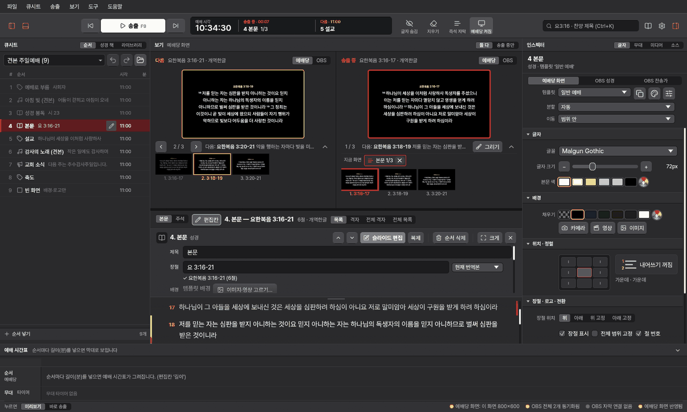
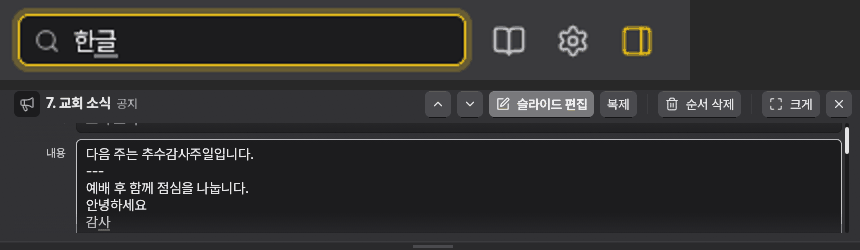

# egui 조작 화면을 웹(WebAssembly)으로 — 관문 시험과 판정 (2026-11-28)

## 판정: 이 길로 간다

설치판 조작 화면 코드(wp-app · wp-core)를 **그대로** wasm32 로 빌드해, Windows 의 Edge 와 Chrome 에 띄웠다.
조작 화면 전체가 뜨고, **실제 Windows 한국어 입력기**로 친 한글 입력 시험 15개가 두 브라우저 모두 통과했다.
글 입력 칸을 HTML 로 덧댈 필요는 없었다(eframe 0.37 의 숨은 `<input>` 이 IME 조합을 받는다).
움직임은 60fps 로 고르고, 50Mbps 회선을 흉내 낸 첫 열기는 3~4초다. 걱정거리는 크기(압축 7.8MB)와
'브라우저에서 오류(panic)가 나면 조작 화면 전체가 멈춘다'는 점이며, 아래 '남은 위험'에 적었다.

- 앞선 Codex 작업자의 '안 된다' 판정(그대로 빌드하면 mio 에서 막힘)은 출발점이었고, 플랫폼 층으로 넘었다.
- 시작점: `a311ce8` (origin/rust 2.1.1 기록)에서 시험한 뒤 `origin/web` 위로 옮기고(9e0707e 위에 다시 쌓음) a5d46fa 를 합쳤다. 가지 `web-egui`.



## 증거

| 무엇 | 결과 |
|---|---|
| 빌드 | `bash tools/web/build.sh` → `dist-web/` (wasm-bindgen 0.2.130 · wasm-opt -O2) |
| 파일 크기 | `wp-app_bg.wasm` 30,978,006 바이트 → brotli 7,759,399 (7.4 MiB) · `wp-app.js` 100KB → 13KB |
| 첫 열기 (캐시 없음) | 내 PC(127.0.0.1): 첫 그림까지 1.2~2.1초. 50Mbps · 지연 20ms 흉내: Edge 3.4초 · Chrome 3.8~4.1초 (받기 1.8~2.7초 + 시작 0.2초 + 첫 프레임 0.4초). PC 가 바쁠 때 한 번 8.6초 |
| 첫 프레임 | 280~560ms (글꼴 아틀라스 만들기, 설치판도 같은 경고) |
| 움직임 | 마우스로 큐시트 · 검색 결과 위를 3초 움직이며 잼: 두 브라우저 모두 평균 16.67ms · 95% 16.8ms · 최대 19ms (60fps, 끊김 없음) |
| 한글 입력 (실제 IME) | Edge 15/15 · Chrome 15/15 (아래 표) |
| 단축키 (실제 키보드) | Edge · Chrome × 앱 창 · 일반 탭 네 가지 모두: F9 송출 · Space · F6 다음 · **F5 이전(새로 고침 안 됨)** · F10 가리기 · Ctrl+K 검색 · Ctrl+R 막힘 |
| 송출 | 큐시트 순서 → 미리보기 → 송출 → 같은 브라우저의 출력 탭에 그대로 (요한복음 3:16-17). 나중에 연 출력 탭도 `sync` 로 지금 화면을 받음. 무대 화면도 받음. 조작 화면 상태 줄에 연결된 출력 수 |
| 설치판 시험 | 아래 '최종 검증 기록' |

시험 도구 (모두 `tools/web/`):
- `probe.js` — 브라우저를 띄워(CDP) 여는 시간 · 콘솔 · 화면 그림. `--headful --app` 이면 실제 창, `--net 50,20` 회선 흉내, `--steps` 로 시나리오.
- `ime-keys.ps1` — 실제 운영체제 키 입력(SendInput 가상 키)이 **한국어 입력기를 거쳐** 조합되게 누른다. CDP 의 글 넣기 · 조합 흉내는 IME 시험을 대신하지 않으므로 이것으로 시험했다.
- `steps/ime-full.js` (한글 15개) · `steps/keys.js` (단축키) · `steps/send.js` (송출) · `steps/frames.js` (움직임) · `steps/search-ime.js` (CDP 흉내, 참고용).
- 점검 상태: 주소에 `?debug=1` 이면 `window.wpDebug()` 가 검색 칸 글 · 큐시트 순서 · 초점 · 송출 상태를 JSON 으로 준다 (평소에는 만들지 않음).

### 한글 입력 시험 (실제 Windows 한국어 IME, 두벌식)

| 칸 | 조작 | 기대 | Edge | Chrome |
|---|---|---|---|---|
| 성경 검색 | `요한복음 3장 16절` + Enter | 그대로 · 요한복음 3:16 미리보기 | 통과 | 통과 |
| 성경 검색 | 조합 중 Backspace (한그 → 한ㄱ → 한, 이어서 글) | `한글` | 통과 | 통과 |
| 성경 검색 | 확정 뒤 Backspace 두 번 | `한` | 통과 | 통과 |
| 성경 검색 | 조합 중 한/영 전환 뒤 abc | `요abc` (요 한 번만) | 통과 | 통과 |
| 성경 검색 | 조합 중 Enter | `요` (두 번 안 들어감) | 통과 | 통과 |
| 성경 검색 | 조합 중 마우스로 다른 곳 | `한` (한 번만 확정) | 통과 | 통과 |
| 성경 검색 | 붙여 넣기 | `시편 23편` | 통과 | 통과 |
| 큐시트 '내용' (여러 줄) | 순서 고르기 | 처음 내용 그대로 | 통과 | 통과 |
| 〃 | 줄 끝 Enter · `안녕하세요` · 조합 중 Enter · `감사` | 조합 중 화면 | 통과 | 통과 |
| 〃 | 다른 곳 누름 | 마지막 음절 한 번만 확정 (`…\n안녕하세요\n감사`) | 통과 | 통과 |
| 〃 | 조합 중 Backspace | `한글` 줄 | 통과 | 통과 |
| 〃 | 여러 줄 붙여 넣기 | 줄바꿈 · 순서 그대로 | 통과 | 통과 |
| 〃 | Ctrl+Z | 방금 친 것만 되돌림 | 통과 | 통과 |
| 〃 | Ctrl+A 뒤 `새 글` | `새 글` | 통과 | 통과 |
| 내용 → 검색 오가기 | 내용 칸 조합 중 검색 칸 누르고 `요` + Enter | 내용 `새 글한` · 검색 `요` (남은 조합이 다른 칸에 안 감) | 통과 | 통과 |



시험 조건과 한계:
- 키는 운영체제 입력, **마우스 누름은 CDP** 로 했다. 시험 도중(10:00:46) Windows 방화벽 알림 창(PickerHost, `FirewallNotificationDialogServer`)이 주 모니터를 어둡게 덮어 운영체제 마우스가 브라우저에 닿지 않았기 때문이다. 이 창은 보안 결정이라 건드리지 않았다(사관님이 정할 일). 키보드는 브라우저에 그대로 갔다. `WP_OS_MOUSE=1` 이면 마우스도 운영체제 입력으로 시험한다.
- 화면 배율 150% PC 에서 브라우저 배율을 1 로 고정해 시험했다(`--force-device-scale-factor=1`). 실제 배율(1.5)에서의 글자 선명도 · 칸 크기는 따로 보지 않았다.
- 입력기 한/영 상태는 운영체제가 알려 주는 값이 Chrome 에서 틀린 적이 있어, 'dk' 를 쳐 보고 맞췄다(시험 도구의 일, 앱과는 무관).
- macOS · 다른 입력기(세벌식 · 구글 한글)는 시험하지 않았다.

## 설치판을 바꾸지 않는 플랫폼 층 (한 것)

기존 파일은 조건부 컴파일(`#[cfg(target_arch = "wasm32")]`)로 몇 줄씩만 덧붙였고, 웹 전용 일은 새 모듈에 두었다.
설치판 빌드에는 새 모듈이 들어가지 않는다.

| 막던 것 | 웹에서 바꾼 것 | 자리 |
|---|---|---|
| tokio net · mio, axum 서버, TLS(ring · rustls · rcgen), ureq TLS | Cargo 의존성을 target 별로: 설치판은 그대로, 웹은 tokio(sync · rt · time) · axum(타입만, 서버 안 띄움) · ureq(TLS 없음, 부르면 오류) | `crates/*/Cargo.toml` |
| 서버 모듈(server · remote · webedit · phonecam · lan)의 tokio::fs · net, ConnectInfo | 처리기 코드는 그대로 컴파일, 소켓을 여는 함수만 웹에서 빈 것 | `wp-core/src/web/{tokio_shim,axum_shim}.rs` + 각 파일 `use` 한 줄 · `start` 자리 |
| SQLite (rusqlite bundled = C) | rusqlite 그대로 + `sqlite-wasm-rs`(메모리 VFS), C 는 wasi-sdk clang 으로 컴파일 | `wp-core/Cargo.toml`, `tools/web/env.sh` |
| std::time::Instant (브라우저에서 panic) | `web_time::Instant` (설치판에서는 std 를 그대로 다시 내보냄 → 같은 타입) | 여러 파일 한 줄씩. 다른 가지를 합친 뒤 `python tools/web/retime.py` 로 다시 |
| 자료 폴더 · settings.json | 설정은 `web::vfs`(localStorage), 자료 폴더 준비 · media 폴더 만들기는 웹에서 건너뜀 | `settings.rs` `use` 한 줄, `core.rs` 몇 줄 |
| 창 · wgpu · 시작(main) | eframe glow(WebGL2) + `WebRunner`, 시작점은 `wp-app/src/web/mod.rs` | `main.rs` cfg |
| 파일 대화상자 (rfd) | `crates/wp-web-rfd` (라이브러리 이름 rfd): 항상 None + 무엇을 열려 했는지 기억. 코드의 `rfd::FileDialog` 는 고치지 않음 | 새 크레이트 |
| 소리 (rodio · cpal) | rodio `wasm-bindgen` 기능 (Web Audio) — 컴파일만 확인, 재생 시험 안 함 | `wp-app/Cargo.toml` |
| 예배당 창 프로세스 (wp-output) | `window.open('/outputs/main')` + 다른 화면이 있고 '창 배치' 권한이 있으면 그 화면으로 옮김 | `outwin.rs` 의 `refresh_monitors · running · open · close` 첫 줄에 cfg, 본체는 `web/live.rs` |
| 로컬 웹 서버 → 출력 (SSE) | `BroadcastChannel('wp-live')` (계약 5절 모양 그대로) | `web/live.rs` · `web/app/local-live.js` |
| 스레드 (설정 저장 일꾼 · 0.2초 흐름) | 설정은 바로 쓰기(이미 있던 실패 길), 0.2초 흐름은 `setInterval` | `web/mod.rs` |

### 웹 모듈

- `crates/wp-app/src/web/mod.rs` — 시작: 견본 자료 받기 → 캔버스에 조작 화면 → 저장 층 · 송출 · 흐름. 오류(panic)가 나면 화면에 까닭과 '새로 고침' 안내. 웹 기본 단축키 한 가지(즉석 자막 `Ctrl+Shift+Y`, 처음 한 번 설정에).
- `crates/wp-app/src/web/live.rs` — 같은 브라우저 송출 (아래).
- `crates/wp-app/src/web/store.rs` — 저장 층 (아래).
- `crates/wp-core/src/web/{mod,vfs,seed,tokio_shim,axum_shim}.rs` — 코어 쪽 자리 메움 · 견본 · 문서 꺼내기/넣기.
- `web/app/index.html` — 받는 진행 막대 · WebGL2 확인 · 단축키 기본 동작 막기 · 송출 중 닫기 물음. `web/app/local-live.js` — 출력 페이지용 같은 브라우저 어댑터. `web/app/sample/seed.json` — 견본.

## 핵심 흐름 (관문 뒤 '나')

| 흐름 | 상태 |
|---|---|
| 성경 장절 검색 (요3:16 · 요한복음 3장 16절) · 낱말 검색 (사랑) | 됨 (견본 6장: 창1 · 시23 · 시100 · 요3 · 롬8 · 고전13, 개역한글 = 공공 영역) |
| 찬양 | 견본 2곡(직접 쓴 시험 가사)이 큐시트 순서로 들어 있고 미리보기 · 송출 됨. 찬양 라이브러리 검색 화면은 따로 시험하지 않음 |
| 큐시트 열기 · 순서 고르기 · 글 고치기 | 됨. 고친 것은 브라우저 저장소에 남아 새로 고침 뒤에도 그대로 (`store.rs`) |
| 미리보기 · 송출 · 다음/이전 · 가리기 | 됨 (단축키 · 단추) |
| 출력 창 | 같은 브라우저의 새 창(`/outputs/main` · `overlay` · `stage`), 인터넷 없이. 전체 화면은 출력 창에서 두 번 누르기 · F11 |

### 같은 PC 송출 (`live.rs` · `local-live.js`)

- 조작 화면 → `{t:'render', client, data, church}` · `{t:'draw', data, church}` — data 는 설치판 SSE 와 같은 `output_payload` · `stage_payload` · `draw_json`. 바뀐 화면만 보낸다.
- 출력 탭 → `{t:'sync', church}`(열릴 때) · `{t:'out', id, client, kind, ack?}`(2초마다, 조작 화면의 '연결된 출력') · `{t:'bye', id}` · `{t:'cmd', cmd:'videoMeta'|'videoEnded', args}`.
- 클라우드 어댑터(`cloud/client/adapter.js`)도 같은 채널을 듣는다 → 클라우드 출력 탭이 같은 브라우저에 있으면 인터넷이 끊겨도 받는다.
- 출력 창 열기는 누른 직후에만 된다(팝업 규칙, 단추 · 단축키 · F9 의 '송출하면 예배당 화면 켜기' 모두 사용자 입력 직후라 됨). 다른 모니터로 옮기기는 Chrome · Edge 의 '창 배치'(Window Management) 권한을 쓰며, 실제 두 모니터에서 옮겨지는지는 아직 눈으로 확인하지 않았다.

### 저장 층 (`store.rs`)

- `DocStore` 한 겹: `load` · `save`. 지금 `Local` = localStorage `wpdocs:v1` 에 `{cue:[…], song:[…], active}` (payload = 설치판 JSON 모양, 계약 6절 `documents` 와 같은 모양). 1초 모아 저장 · 떠날 때 한 번.
- 2단계: 같은 문서를 `/api/v1/documents/{kind}/{id}` + `If-Match` 로 (origin/web-data `docs/web/data-api.md`). 409 면 덮어쓰지 않고 사본. 성경은 `/api/v1/bible/passage`.
- 성경 DB 는 메모리 SQLite (새로 열 때마다 견본에서). 오래 남기는 길(OPFS · IndexedDB VFS)은 6단계(오프라인)와 함께 정한다.

## 단축키 — 브라우저가 가져가는 키

조작 화면 페이지가 캡처 단계에서 브라우저 기본 동작을 막는다: F1 · F3 · F5 · F6 · F7 · F10, Ctrl+R · K · B · H · L · M · F · G · J · D · E · U, Ctrl+Shift+F · E · L · Y, Alt+← · →.
egui 는 막은 뒤에도 키를 그대로 받는다(eframe 0.37 `on_keydown` 은 defaultPrevented 를 보지 않음). 위 '증거' 표처럼 실제 키보드로 확인했다.

| 키 (설치판 기본) | 브라우저에서 | 웹에서 |
|---|---|---|
| F5 이전 장 | 새로 고침 → **막음** | 그대로 F5 |
| F6 다음 장 | 주소 표시줄로 → 막음 | 그대로 |
| F9 · F10 · Ctrl+K · Ctrl+H · Ctrl+L · Ctrl+B · Alt+←/→ | 브라우저 기능 → 막음 | 그대로 |
| Ctrl+T 즉석 자막 | 새 탭 — **페이지가 막을 수 없음** | 웹 기본값 `Ctrl+Shift+Y` (설정 → 단축키에서 바꿀 수 있음) |
| Ctrl+W · Ctrl+N · Ctrl+Tab · Alt+F4 | 막을 수 없음 (앱이 쓰지 않음) | 송출 중이면 페이지를 떠날 때 한 번 묻는다(beforeunload) |
| Esc 보조 화면 끄기 | 출력 창의 전체 화면 풀기와 겹침 | 조작 화면에서는 그대로, 출력 창에서는 전체 화면 풀기 |
| F11 | 전체 화면 | 조작 화면은 앱이 쓰지 않음, 출력 창에서는 전체 화면 |

## PC 글꼴

- **기본: 올려 둔 글꼴.** 조작 화면 글꼴(Pretendard 4굵기, OFL)은 지금 wasm 안에 들어 있다(12.5MB 중 대부분이 압축 크기의 큰 몫). 다음: 별도 파일(`.woff2` 아님 — egui 는 TTF/OTF 바이트)로 빼서 Regular · Bold 만 먼저, 나머지는 뒤에.
- 출력 화면(web/output)은 브라우저 글꼴을 쓴다 — Windows 에는 맑은 고딕이 있어 설치판과 같다. 맥 · 다른 PC 를 위해 슬라이드 글꼴도 '교회 글꼴 올려 두기'(2C · R2)로.
- **Local Font Access(`queryLocalFonts`)는 선택 기능으로만**: Chrome · Edge 에만 있고 권한을 묻는다. 템플릿 글꼴 목록을 채우는 데는 쓰되, 출력 PC 에 그 글꼴이 없으면 소용없으므로 기본 길로 삼지 않는다.
- `measure.rs`(글이 화면에 들어가는지)는 지금 웹에서 시스템 글꼴 파일을 못 읽는다 → 슬라이드 나눔이 설치판과 조금 다를 수 있다. 출력과 같은 글꼴 바이트를 측정기에도 넣어야 한다(parity 시험 필요).

## 남은 위험 · 확인 못 한 것

- **오류(panic) = 조작 화면 전체 멈춤.** 설치판은 그 프레임만 버리지만(catch_unwind) wasm 은 되돌릴 수 없다. 지금은 화면에 까닭과 새로 고침 안내를 띄우고, 출력 창은 마지막 화면을 유지한다. 새로 고침해도 고친 큐시트는 남는다(저장 층). 웹에서 부르면 panic 하는 표준 기능(`std::thread::spawn` 65곳 등)을 쓰는 메뉴가 아직 있다 — 메뉴별로 막거나 바꿔야 한다(4~5단계).
- 크기: 압축 7.4MiB. 글꼴 분리 · `opt-level="z"` · 쓰지 않는 기능(PPT 그리기 resvg 등) 지연 로딩으로 줄일 여지. 두 번째부터는 브라우저 캐시.
- 시험하지 않은 것: 실제 두 모니터로 출력 창 옮기기 · 소리 재생 · 영상 · 카메라 · 그림 파일(미디어는 2C · 4B) · 메뉴 대부분 · 고배율(150%) 화면 · 맥.
- 시험 PC 의 방화벽 알림 창(위)은 그대로 떠 있다.

## 계약에 바라는 것

1. 계약 5절 '브라우저에서 쓰지 못하는 것' 에서 **IME 를 빼 주세요** — 실제 Windows 한국어 입력기로 15개 시험이 Edge · Chrome 에서 통과했다.
2. `wp-live` 채널에 출력 탭 → 조작 화면 메시지를 더해 주세요(덧붙이기라 v1 그대로): `{t:'out', id, client, kind, ack?}`(2초마다 살아 있음 · 수신 확인), `{t:'bye', id}`, `{t:'cmd', cmd:'videoMeta'|'videoEnded', args}`. 클라우드 어댑터도 같은 채널로 보내면 같은 PC 에서 '연결된 출력' 수와 영상 끝남(자동 넘김)이 인터넷 없이 맞는다. 지금 구현: `web/app/local-live.js`.
3. 웹 조작 화면을 클라우드에서 열 길: `/control`(owner) 에 `dist-web` 을 정적 파일로, wasm 은 `Content-Type: application/wasm` + brotli. 파일 하나 25MiB 한도 안(원본 31MB 는 넘음 — 압축본을 올리거나 글꼴을 빼서 줄여야 함, 확인 필요).
4. 송출 주체 겹침(`hello.source` · `claim`): 웹 조작 화면은 `source:'web'` 으로 붙고, 설치판이 이미 있으면 **보기 전용**으로 열리게(넘겨받기 단추를 눌러야 송출) 해 주세요.
5. 성경 본문 `/api/v1/bible/passage` 는 설치판 `resolve_reference` 모양 그대로면 웹 조작 화면이 코어 코드로 그대로 그린다 — 장 단위로 받아 메모리 DB 에 넣는 길(`/api/v1/bible/chapter?version=&book=&chapter=`)도 있으면 좋다(검색 · 앞뒤 절 이동이 코어 그대로 돈다).

## 4~6단계에 미치는 것

- 4A(화면 구성) · 4B(미디어) · 5(AI): **조작 화면 코드가 설치판과 같다** → 새 기능은 wp-app 에 한 번 넣으면 웹에도 들어간다. 웹에서 막아야 할 것은 `std::thread` · 프로세스 · 파일 경로를 쓰는 곳(메뉴별 cfg 또는 플랫폼 함수).
- AI: wasm 에서 `aihelp::chat` 길을 `/api/v1/ai/chat`(origin/web-ai) 로 바꾸고, 동의 · 키 화면. 음성 인식은 '설치판에 맡기기'.
- web 을 합칠 때: wp-app 의 `cloud_ui` 를 wasm 에서 빼야 한다(cloud.rs 는 이미 cfg).
- 6(오프라인): 조작 화면은 서비스 워커로 `dist-web` 을 버전별로 저장하면 인터넷 없이 열리고, 송출은 이미 BroadcastChannel 이라 끊김과 무관. 문서는 `store.rs` 의 DocStore 를 IndexedDB · sync 로 갈아 끼운다.

## 빌드 · 띄우기

```bash
# 도구 (한 번): %LOCALAPPDATA%\wp-web-tools 에 wasi-sdk-34 · binaryen-133 · wasm-bindgen-0.2.130 (tools/web/env.sh 가 찾음)
rustup target add wasm32-unknown-unknown
bash tools/web/build.sh          # → dist-web/
node tools/web/serve.js dist-web 37610   # http://127.0.0.1:37610/
node tools/web/probe.js --browser edge --headful --app --steps tools/web/steps/ime-full.js --out tmp/web-ime
```

## 최종 검증 기록

| 시험 | 기준 | 결과 |
|---|---|---|
| 설치판 단위 시험 | a311ce8 위 | wp-app 256 · wp-core 372 통과 (2.1.1 과 같은 수) |
| 〃 | origin/web 9e0707e 위로 옮긴 뒤 | wp-app 264 · wp-core 377 통과 |
| 〃 | origin/web a5d46fa 합친 뒤 | wp-app 264 · wp-core 377 통과, wasm 빌드 성공 (wasm 31,184,403 → brotli 7,793,534) |
| wasm32 빌드 | 위 세 기준 모두 | `cargo check -p wp-app --target wasm32-unknown-unknown` 오류 없음, `tools/web/build.sh` 성공 |
| parity (`tools/parity`) | 9e0707e 위 debug exe, 사관님 자료 읽기 전용 사본(SQLite backup · settings.json, 네트워크 설정 끔) | 48개 중 글자 크기 46개 같음. 다른 둘 obs-pip-image 72/46 · obs-pip-score 72/56 은 2.0.7 · 2.1.x 부터 있던 차이(CLAUDE.md). 최대 화소 차 3.8% |
| 브라우저 회귀 (옮긴 뒤) | 9e0707e 위 wasm | 송출(Chrome) · 실제 IME 15/15(Edge) 다시 통과 |
| 브라우저 · 저장 | a311ce8 위 wasm | 큐시트 글 고친 뒤 새로 고침 → 그대로 남음 |

자료 다루기: 사관님 자료(`%APPDATA%\WorshipPresenter-rs\data`)는 읽기만 했다. 견본(개역한글 6장)은 사본에서 뽑았고, parity 는 작업 폴더 `tmp\data`(Git 제외) 사본으로 했다. 실행 중인 다른 프로세스는 끄지 않았다(시험용 브라우저 · 앱만, 프로필 폴더로 골라 정리).
