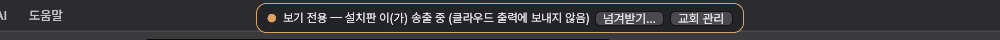
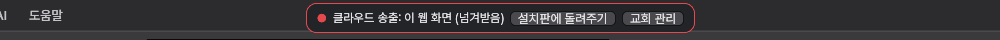
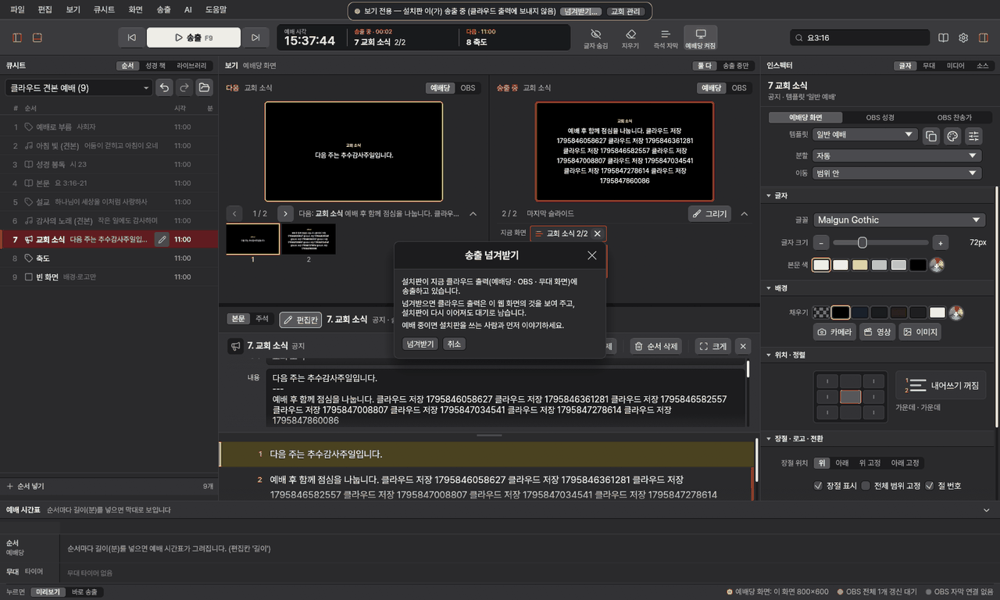
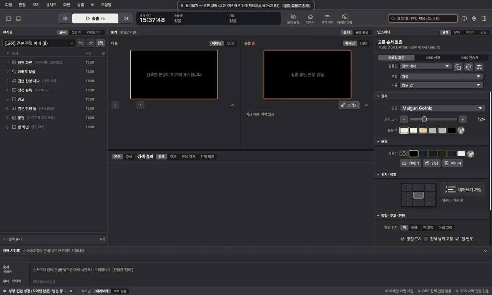

# egui 조작 화면을 웹(WebAssembly)으로 — 관문 시험과 판정 (2026-11-28)

## 판정: 이 길로 간다

설치판 조작 화면 코드(wp-app · wp-core)를 **그대로** wasm32 로 빌드해, Windows 의 Edge 와 Chrome 에 띄웠다.
조작 화면 전체가 뜨고, **실제 Windows 한국어 입력기**로 친 한글 입력 시험 15개가 두 브라우저 모두 통과했다.
글 입력 칸을 HTML 로 덧댈 필요는 없었다(eframe 0.37 의 숨은 `<input>` 이 IME 조합을 받는다).
움직임은 60fps 로 고르고, 50Mbps 회선을 흉내 낸 첫 열기는 3~4초다. 걱정거리는 크기(압축 7.8MB)와
'브라우저에서 오류(panic)가 나면 조작 화면 전체가 멈춘다'는 점이며, 아래 '남은 위험'에 적었다.

- 앞선 Codex 작업자의 '안 된다' 판정(그대로 빌드하면 mio 에서 막힘)은 출발점이었고, 플랫폼 층으로 넘었다.
- 시작점: `a311ce8` (origin/rust 2.1.1 기록)에서 시험한 뒤 `origin/web` 위로 옮기고(9e0707e 위에 다시 쌓음) a5d46fa 를 합쳤다. 가지 `web-egui`.


## 증거

| 무엇 | 결과 |
|---|---|
| 빌드 | `bash tools/web/build.sh` → `dist-web/` (wasm-bindgen 0.2.130 · wasm-opt -O2) |
| 파일 크기 | 관문 때 `wp-app_bg.wasm` 30,978,006 바이트 → brotli 7,759,399 (7.4 MiB). **3단계 마무리 뒤 글꼴을 빼서 18.9 MB → brotli 4.42 MB + 글꼴 보통 · 굵게 1.8 MB** · `wp-app.js` 105KB → 13KB |
| 첫 열기 (캐시 없음) | 내 PC(127.0.0.1): 첫 그림까지 1.2~2.1초. 50Mbps · 지연 20ms 흉내: Edge 3.4초 · Chrome 3.8~4.1초 (받기 1.8~2.7초 + 시작 0.2초 + 첫 프레임 0.4초). PC 가 바쁠 때 한 번 8.6초 |
| 첫 프레임 | 280~560ms (글꼴 아틀라스 만들기, 설치판도 같은 경고) |
| 움직임 | 마우스로 큐시트 · 검색 결과 위를 3초 움직이며 잼: 두 브라우저 모두 평균 16.67ms · 95% 16.8ms · 최대 19ms (60fps, 끊김 없음) |
| 한글 입력 (실제 IME) | Edge 15/15 · Chrome 15/15 (아래 표) |
| 단축키 (실제 키보드) | Edge · Chrome × 앱 창 · 일반 탭 네 가지 모두: F9 송출 · Space · F6 다음 · **F5 이전(새로 고침 안 됨)** · F10 가리기 · Ctrl+K 검색 · Ctrl+R 막힘 |
| 송출 | 큐시트 순서 → 미리보기 → 송출 → 같은 브라우저의 출력 탭에 그대로 (요한복음 3:16-17). 나중에 연 출력 탭도 `sync` 로 지금 화면을 받음. 무대 화면도 받음. 조작 화면 상태 줄에 연결된 출력 수 |
| 설치판 시험 | 아래 '최종 검증 기록' |

시험 도구 (모두 `tools/web/`):
- `probe.js` — 브라우저를 띄워(CDP) 여는 시간 · 콘솔 · 화면 그림. `--headful --app` 이면 실제 창, `--net 50,20` 회선 흉내, `--steps` 로 시나리오.
- `ime-keys.ps1` — 실제 운영체제 키 입력(SendInput 가상 키)이 **한국어 입력기를 거쳐** 조합되게 누른다. CDP 의 글 넣기 · 조합 흉내는 IME 시험을 대신하지 않으므로 이것으로 시험했다.
- `steps/ime-full.js` (한글 15개) · `steps/keys.js` (단축키) · `steps/send.js` (송출) · `steps/frames.js` (움직임) · `steps/search-ime.js` (CDP 흉내, 참고용).
- 점검 상태: 주소에 `?debug=1` 이면 `window.wpDebug()` 가 검색 칸 글 · 큐시트 순서 · 초점 · 송출 상태를 JSON 으로 준다 (평소에는 만들지 않음).

### 한글 입력 시험 (실제 Windows 한국어 IME, 두벌식)

| 칸 | 조작 | 기대 | Edge | Chrome |
|---|---|---|---|---|
| 성경 검색 | `요한복음 3장 16절` + Enter | 그대로 · 요한복음 3:16 미리보기 | 통과 | 통과 |
| 성경 검색 | 조합 중 Backspace (한그 → 한ㄱ → 한, 이어서 글) | `한글` | 통과 | 통과 |
| 성경 검색 | 확정 뒤 Backspace 두 번 | `한` | 통과 | 통과 |
| 성경 검색 | 조합 중 한/영 전환 뒤 abc | `요abc` (요 한 번만) | 통과 | 통과 |
| 성경 검색 | 조합 중 Enter | `요` (두 번 안 들어감) | 통과 | 통과 |
| 성경 검색 | 조합 중 마우스로 다른 곳 | `한` (한 번만 확정) | 통과 | 통과 |
| 성경 검색 | 붙여 넣기 | `시편 23편` | 통과 | 통과 |
| 큐시트 '내용' (여러 줄) | 순서 고르기 | 처음 내용 그대로 | 통과 | 통과 |
| 〃 | 줄 끝 Enter · `안녕하세요` · 조합 중 Enter · `감사` | 조합 중 화면 | 통과 | 통과 |
| 〃 | 다른 곳 누름 | 마지막 음절 한 번만 확정 (`…\n안녕하세요\n감사`) | 통과 | 통과 |
| 〃 | 조합 중 Backspace | `한글` 줄 | 통과 | 통과 |
| 〃 | 여러 줄 붙여 넣기 | 줄바꿈 · 순서 그대로 | 통과 | 통과 |
| 〃 | Ctrl+Z | 방금 친 것만 되돌림 | 통과 | 통과 |
| 〃 | Ctrl+A 뒤 `새 글` | `새 글` | 통과 | 통과 |
| 내용 → 검색 오가기 | 내용 칸 조합 중 검색 칸 누르고 `요` + Enter | 내용 `새 글한` · 검색 `요` (남은 조합이 다른 칸에 안 감) | 통과 | 통과 |


시험 조건과 한계:
- 키는 운영체제 입력, **마우스 누름은 CDP** 로 했다. 시험 도중(10:00:46) Windows 방화벽 알림 창(PickerHost, `FirewallNotificationDialogServer`)이 주 모니터를 어둡게 덮어 운영체제 마우스가 브라우저에 닿지 않았기 때문이다. 이 창은 보안 결정이라 건드리지 않았다(사관님이 정할 일). 키보드는 브라우저에 그대로 갔다. `WP_OS_MOUSE=1` 이면 마우스도 운영체제 입력으로 시험한다.
- 화면 배율 150% PC 에서 브라우저 배율을 1 로 고정해 시험했다(`--force-device-scale-factor=1`). 실제 배율(1.5)에서의 글자 선명도 · 칸 크기는 따로 보지 않았다.
- 입력기 한/영 상태는 운영체제가 알려 주는 값이 Chrome 에서 틀린 적이 있어, 'dk' 를 쳐 보고 맞췄다(시험 도구의 일, 앱과는 무관).
- macOS · 다른 입력기(세벌식 · 구글 한글)는 시험하지 않았다.

## 설치판을 바꾸지 않는 플랫폼 층 (한 것)

기존 파일은 조건부 컴파일(`#[cfg(target_arch = "wasm32")]`)로 몇 줄씩만 덧붙였고, 웹 전용 일은 새 모듈에 두었다.
설치판 빌드에는 새 모듈이 들어가지 않는다.

| 막던 것 | 웹에서 바꾼 것 | 자리 |
|---|---|---|
| tokio net · mio, axum 서버, TLS(ring · rustls · rcgen), ureq TLS | Cargo 의존성을 target 별로: 설치판은 그대로, 웹은 tokio(sync · rt · time) · axum(타입만, 서버 안 띄움) · ureq(TLS 없음, 부르면 오류) | `crates/*/Cargo.toml` |
| 서버 모듈(server · remote · webedit · phonecam · lan)의 tokio::fs · net, ConnectInfo | 처리기 코드는 그대로 컴파일, 소켓을 여는 함수만 웹에서 빈 것 | `wp-core/src/web/{tokio_shim,axum_shim}.rs` + 각 파일 `use` 한 줄 · `start` 자리 |
| SQLite (rusqlite bundled = C) | rusqlite 그대로 + `sqlite-wasm-rs`(메모리 VFS), C 는 wasi-sdk clang 으로 컴파일 | `wp-core/Cargo.toml`, `tools/web/env.sh` |
| std::time::Instant (브라우저에서 panic) | `web_time::Instant` (설치판에서는 std 를 그대로 다시 내보냄 → 같은 타입) | 여러 파일 한 줄씩. 다른 가지를 합친 뒤 `python tools/web/retime.py` 로 다시 |
| 자료 폴더 · settings.json | 설정은 `web::vfs`(localStorage), 자료 폴더 준비 · media 폴더 만들기는 웹에서 건너뜀 | `settings.rs` `use` 한 줄, `core.rs` 몇 줄 |
| 창 · wgpu · 시작(main) | eframe glow(WebGL2) + `WebRunner`, 시작점은 `wp-app/src/web/mod.rs` | `main.rs` cfg |
| 파일 대화상자 (rfd) | `crates/wp-web-rfd` (라이브러리 이름 rfd): 항상 None + 무엇을 열려 했는지 기억. 코드의 `rfd::FileDialog` 는 고치지 않음 | 새 크레이트 |
| 소리 (rodio · cpal) | rodio `wasm-bindgen` 기능 (Web Audio) — 컴파일만 확인, 재생 시험 안 함 | `wp-app/Cargo.toml` |
| 예배당 창 프로세스 (wp-output) | `window.open('/outputs/main')` + 다른 화면이 있고 '창 배치' 권한이 있으면 그 화면으로 옮김 | `outwin.rs` 의 `refresh_monitors · running · open · close` 첫 줄에 cfg, 본체는 `web/live.rs` |
| 로컬 웹 서버 → 출력 (SSE) | `BroadcastChannel('wp-live')` (계약 5절 모양 그대로) | `web/live.rs` · `web/app/local-live.js` |
| 스레드 (설정 저장 일꾼 · 0.2초 흐름) | 설정은 바로 쓰기(이미 있던 실패 길), 0.2초 흐름은 `setInterval` | `web/mod.rs` |

### 웹 모듈

- `crates/wp-app/src/web/mod.rs` — 시작: 견본 자료 받기 → 캔버스에 조작 화면 → 저장 층 · 송출 · 흐름. 오류(panic)가 나면 화면에 까닭과 '새로 고침' 안내. 웹 기본 단축키 한 가지(즉석 자막 `Ctrl+Shift+Y`, 처음 한 번 설정에).
- `crates/wp-app/src/web/live.rs` — 같은 브라우저 송출 (아래).
- `crates/wp-app/src/web/store.rs` — 저장 층 (아래).
- `crates/wp-core/src/web/{mod,vfs,seed,tokio_shim,axum_shim}.rs` — 코어 쪽 자리 메움 · 견본 · 문서 꺼내기/넣기.
- `web/app/index.html` — 받는 진행 막대 · WebGL2 확인 · 단축키 기본 동작 막기 · 송출 중 닫기 물음. `web/app/local-live.js` — 출력 페이지용 같은 브라우저 어댑터. `web/app/sample/seed.json` — 견본.

## 핵심 흐름 (관문 뒤 '나')

| 흐름 | 상태 |
|---|---|
| 성경 장절 검색 (요3:16 · 요한복음 3장 16절) · 낱말 검색 (사랑) | 됨 (견본 6장: 창1 · 시23 · 시100 · 요3 · 롬8 · 고전13, 개역한글 = 공공 영역) |
| 찬양 | 견본 2곡(직접 쓴 시험 가사)이 큐시트 순서로 들어 있고 미리보기 · 송출 됨. 찬양 라이브러리 검색 화면은 따로 시험하지 않음 |
| 큐시트 열기 · 순서 고르기 · 글 고치기 | 됨. 고친 것은 브라우저 저장소에 남아 새로 고침 뒤에도 그대로 (`store.rs`) |
| 미리보기 · 송출 · 다음/이전 · 가리기 | 됨 (단축키 · 단추) |
| 출력 창 | 같은 브라우저의 새 창(`/outputs/main` · `overlay` · `stage`), 인터넷 없이. 전체 화면은 출력 창에서 두 번 누르기 · F11 |

### 같은 PC 송출 (`live.rs` · `local-live.js`)

- 조작 화면 → `{t:'render', client, data, church}` · `{t:'draw', data, church}` — data 는 설치판 SSE 와 같은 `output_payload` · `stage_payload` · `draw_json`. 바뀐 화면만 보낸다.
- 출력 탭 → `{t:'sync', church}`(열릴 때) · `{t:'out', id, client, kind, ack?}`(2초마다, 조작 화면의 '연결된 출력') · `{t:'bye', id}` · `{t:'cmd', cmd:'videoMeta'|'videoEnded', args}`.
- 클라우드 어댑터(`cloud/client/adapter.js`)도 같은 채널을 듣는다 → 클라우드 출력 탭이 같은 브라우저에 있으면 인터넷이 끊겨도 받는다.
- 출력 창 열기는 누른 직후에만 된다(팝업 규칙, 단추 · 단축키 · F9 의 '송출하면 예배당 화면 켜기' 모두 사용자 입력 직후라 됨). 다른 모니터로 옮기기는 Chrome · Edge 의 '창 배치'(Window Management) 권한을 쓰며, 실제 두 모니터에서 옮겨지는지는 아직 눈으로 확인하지 않았다.

### 저장 층 (`store.rs`)

- `DocStore` 한 겹: `load` · `save`. 지금 `Local` = localStorage `wpdocs:v1` 에 `{cue:[…], song:[…], active}` (payload = 설치판 JSON 모양, 계약 6절 `documents` 와 같은 모양). 1초 모아 저장 · 떠날 때 한 번.
- 2단계: 같은 문서를 `/api/v1/documents/{kind}/{id}` + `If-Match` 로 (origin/web-data `docs/web/data-api.md`). 409 면 덮어쓰지 않고 사본. 성경은 `/api/v1/bible/passage`.
- 성경 DB 는 메모리 SQLite (새로 열 때마다 견본에서). 오래 남기는 길(OPFS · IndexedDB VFS)은 6단계(오프라인)와 함께 정한다.

## 단축키 — 브라우저가 가져가는 키

조작 화면 페이지가 캡처 단계에서 브라우저 기본 동작을 막는다: F1 · F3 · F5 · F6 · F7 · F10, Ctrl+R · K · B · H · L · M · F · G · J · D · E · U, Ctrl+Shift+F · E · L · Y, Alt+← · →.
egui 는 막은 뒤에도 키를 그대로 받는다(eframe 0.37 `on_keydown` 은 defaultPrevented 를 보지 않음). 위 '증거' 표처럼 실제 키보드로 확인했다.

| 키 (설치판 기본) | 브라우저에서 | 웹에서 |
|---|---|---|
| F5 이전 장 | 새로 고침 → **막음** | 그대로 F5 |
| F6 다음 장 | 주소 표시줄로 → 막음 | 그대로 |
| F9 · F10 · Ctrl+K · Ctrl+H · Ctrl+L · Ctrl+B · Alt+←/→ | 브라우저 기능 → 막음 | 그대로 |
| Ctrl+T 즉석 자막 | 새 탭 — **페이지가 막을 수 없음** | 웹 기본값 `Ctrl+Shift+Y` (설정 → 단축키에서 바꿀 수 있음) |
| Ctrl+W · Ctrl+N · Ctrl+Tab · Alt+F4 | 막을 수 없음 (앱이 쓰지 않음) | 송출 중이면 페이지를 떠날 때 한 번 묻는다(beforeunload) |
| Esc 보조 화면 끄기 | 출력 창의 전체 화면 풀기와 겹침 | 조작 화면에서는 그대로, 출력 창에서는 전체 화면 풀기 |
| F11 | 전체 화면 | 조작 화면은 앱이 쓰지 않음, 출력 창에서는 전체 화면 |

## PC 글꼴

- **기본: 올려 둔 글꼴.** 조작 화면 글꼴(Pretendard 4굵기, OFL)은 **wasm 에서 뺐다**(3단계 마무리): `dist-web/fonts/*.ttf` 를 따로 받는다(`web/fonts.rs`). 시작 전에 보통 · 굵게 둘(brotli 0.84 + 0.98 MB), 화면이 뜬 뒤 중간 · 조금 굵게. 받은 바이트는 `wp_core::web::register_font` → `measure::font_file(경로)` 같은 길로 꺼낸다 (theme.rs 는 cfg 한 줄).
- 출력 화면(web/output)은 브라우저 글꼴을 쓴다 — Windows 에는 맑은 고딕이 있어 설치판과 같다. 교회 글꼴은 2C 의 `/api/v1/assets/fonts.css` (로그인한 `/control/` 페이지 머리에도 붙인다).
- **Local Font Access(`queryLocalFonts`)는 선택 기능으로만**: Chrome · Edge 에만 있고 권한을 묻는다. 허락받은 맑은 고딕 바이트를 `register_font("C:\\Windows\\Fonts\\malgun.ttf", …)` 로 맡기면 조작 화면 미리보기 · `measure.rs` 가 설치판과 같은 글꼴을 쓰게 된다 — 길은 열어 두었고 단추는 아직 없다.
- `measure.rs`(글이 화면에 들어가는지)는 웹에서 맑은 고딕을 못 읽으면 Pretendard 로 잰다 → 슬라이드 나눔이 설치판과 조금 다를 수 있다 (parity 는 설치판 쪽만 시험함).

## 남은 위험 · 확인 못 한 것

- **오류(panic) = 조작 화면 전체 멈춤.** 설치판은 그 프레임만 버리지만(catch_unwind) wasm 은 되돌릴 수 없다. 화면에 까닭과 새로 고침 안내를 띄우고, 출력 창은 마지막 화면을 유지한다. 새로 고침해도 고친 큐시트는 남는다(저장 층 · 클라우드 문서). 3단계 마무리에서 줄인 것은 아래 '웹에서 뺀 메뉴 · 스레드'.
- AI 는 동기 요청(답이 올 때까지 조작 화면이 멈춤 — 보통 몇 초). 예배 중 쓰는 기능이 아니라 이렇게 두었고, 비동기로 바꾸는 것은 다음 일.
- 시험하지 않은 것: 소리 재생 · 영상 · 카메라 · 그림 파일(미디어는 2C · 4B 부품을 조작 화면에 붙이는 다음 일) · 웹에서 남긴 메뉴 하나하나 · 고배율(150%) 화면 그대로 · 맥.
- 시험 PC 의 방화벽 알림 창(10:00, PickerHost)은 그대로 떠 있다 (조율자가 사관님께 전함).

## 3단계 마무리 (2026-11-28 오후)

### 클라우드 송출 주체 · 넘겨받기

- `crates/wp-app/src/web/cloud.rs`: 주인 쿠키로 `/bridge` 에 붙어 `hello{source:'web', caps 모두 false}` · `render` · `draw` (같은 브라우저 `wp-live` 로 보내는 것과 같은 자료, `live.rs` 가 둘 다 보냄). 끊기면 1 → 15초 간격으로 다시 이음, 4003 이면 '다시 로그인'.
- 중계실 규칙(`cloud/src/room.mjs`, 계약 4절 '송출 주체 겹침'): 설치판이 기본 주체 · 웹은 대기로 붙음(보낸 것은 버려짐) · 주인이 [넘겨받기] → 설치판 4001 · 넘겨받은 동안 다시 붙는 설치판은 대기 · [설치판에 돌려주기] 또는 웹이 떠나면 설치판이 주체. 대기 중인 웹은 저절로 주체가 되지 않는다.
- 화면: 위쪽 가운데 띠 — 클라우드 송출 / 보기 전용(누가 송출 중) / 잇는 중 · [넘겨받기…](확인 창) · [설치판에 돌려주기] · [교회 관리].





### 자료 (2단계 길)

- `web/store.rs`: 로그인하면 큐시트 · 찬양을 `/api/v1/documents?kind=…&include=payload` 로 받아 메모리 DB 에 넣고, 고친 문서만 `PUT` + `If-Match` + `X-Mutation-Id`(1.5초 모아서), 지운 것은 `DELETE` + `If-Match`. 20초마다(보이는 동안) `/api/v1/sync?after=` 로 받기(`more` 끝까지, 내가 올린 `mutationId` 는 건너뜀, 이 화면에서 고치다 만 문서는 들이지 않음).
- 충돌(409 + `conflict`/`current`): 덮어쓰지 않는다 — 최신 것을 들이고, 이 화면의 것은 `id~시각` · `이름 (내 사본)` 새 문서로 남기고 알림. 등급 오류 코드(`drive_disconnected` · `drive_quota` · `drive_rate` · `tier_moving` · `tier_blocked` · `tier_limit`)는 알맞은 글로 알리고 다음 고침 때 다시 해 본다. 보기만 권한은 '저장되지 않습니다' 한 번 알림.
- 성경(`web/bible.rs`): `/api/v1/bible/versions` → 책마다 `/api/v1/control/bible/book`(새 길, `cloud/src/control/`) → IndexedDB(`wp-web`/kv)에 번역본째 보관 → 메모리 SQLite(설치판 `importer::replace_version`) → 장절 · 낱말 검색이 설치판 코어 그대로. 번역본의 `importedAt` · 절 수가 바뀔 때만 다시 받는다(D1 행 읽기). 화면은 먼저 뜨고 성경은 뒤에서.
- 로그인 없이 내 PC 에서 띄우면(`tools/web/serve.js`) localStorage + 견본 — 시험 · 데모용으로 남김. 클라우드의 둘러보기는 tiers 의 `/demo`(demo 역할) → `/control/` 이 같은 클라우드 길을 쓴다.

### 열기 · 로그인 · 크기

- `/control/`: Worker 가 페이지(`web/app/index.html` + `<base href="/control/">` + `WP_CLOUD` + 교회 글꼴 CSS, CSP `wasm-unsafe-eval` · `frame-ancestors 'none'`)를 보내고, wasm · js · 글꼴은 정적 파일 `public/control/*`(`cloud/scripts/assets.mjs` 가 `dist-web/` 에서 가져오며 25 MiB 넘는 파일이 있으면 멈춤). 권한 `read`(주인 · 편집자 · 보기만 · 둘러보기). 로그인 없으면 `/login?next=/control/`.
- 크기: wasm **18.9 MB**(< 25 MiB) · brotli **4.42 MB**. 첫 열기 = wasm + 글꼴 둘 ≈ **6.3 MB** (전에는 7.8 MB 한 덩어리). 로컬(127.0.0.1) 첫 그림 1.4초.
- 둘러보기 페이지(`cloud/client/demo.html`)에 '웹 조작 화면' 링크 한 줄.

### 사람 · 기기 PIN · AI 키 (주인 화면)

- `cloud/client/control/owner-extra.js` + `owner.html` 에 구획 둘(덧붙임): **사람** — 편집자 · 보기만 · 주인 넣기(로그인 이름이면 처음 비밀번호를 한 번 보여 줌, 전자우편이면 Access 계정), 권한 바꾸기 · 비밀번호 새로 · 빼기 (`/api/v1/members`). **교회 AI** — 어디로(공급자 · 직접 https) · 모델 · 키(봉인, 끝 4자리만) · 하루 한도 · 기능별 동의(동의 글을 보이고 확인) (`/api/v1/ai/settings` · `consent`).
- 기기 열쇠(리모컨 · 편집기 PIN · 출력 주소)는 원래 있던 주인 화면 구획. 웹 조작 화면의 [교회 관리] 가 이 화면을 새 탭으로 연다.

### AI

- wasm 에서 `aihelp::chat` → `/api/v1/ai/chat` (`wp_core::web::ai`, 본문 = 설치판 `request_body` + `feature`, `X-WP-Action: user`). 기능은 시스템 글로 알아본다(설치판 코드를 고치지 않으려고). 403 `needConsent` · 409 `needKey` 는 '주인 화면 → AI' 안내.
- 웹에서 AI 를 부르는 길은 `hymns::run_bg` 로 시작하는 일(단추를 눌러 시작)뿐이다: `spawn_big` 이 웹에서는 다음 차례(setTimeout 40ms — '하는 중…' 을 한 번 그린 뒤)에 같은 스레드에서 돈다. 요청은 동기 XHR (`wp_core::web::net`).
- 음성 인식: 웹에서는 하지 않는다(설치판에 맡기기 1순위, Workers AI 꺼 둠).

### 웹에서 뺀 메뉴 · 스레드

- 메뉴(`web/menu.rs`, `menubar::menus()` 첫머리 cfg): 성경 번역본 가져오기 · 찬양 콘티 · 1.x 자료 · PPT 내보내기 · 여러 PC 동기화 · 주석 · 주보 · OBS 원격 · OBS 주소 · 내부망 · 휴대폰 리모컨/카메라 · 웹 편집기 · 클라우드 연결 · 스트림덱 · Companion · 카메라 설정/시험 · 라이브러리 · 새 버전 · 연결 점검 · 로그 묶음/폴더. 도움말 링크는 새 탭.
- `std::thread::spawn(move ||` 문장 32곳 → `wp_core::bg::spawn` (설치판은 그대로 스레드, 웹은 돌리지 않고 '설치판에서 해 주세요' 알림). 다른 가지를 합친 뒤 `python tools/web/rethread.py` · `retime.py`. 결과를 join 하는 곳(lyricsweb) · 설치판 전용 시작 코드는 그대로.

### 증거 (3단계 마무리)

| 시험 | 결과 |
|---|---|
| `tools/web/cloud-e2e.js` (Edge, 로컬 wrangler dev) | **29/29**: 로그인 없이 → 로그인 화면 · 정적 wasm · /control/ 열림 · 교회 큐시트 · 성경 받음 · 송출 주체 · 웹 송출이 클라우드 출력에 · 고친 큐시트가 문서로(판 오름) · 설치판이 붙으면 웹 대기 · 대기 중 송출 새지 않음 · 설치판 안 끊김 · 띠 단추 · 확인 창 · 넘겨받기 → 설치판 4001 · 넘겨받은 뒤 송출 · 방 상태 · AI(동의 · 안내) · 송출 중 떠나기 물음 · 주인 화면 사람 넣기 · 그 사람 로그인 · 편집자는 /bridge 못 붙음 · 둘러보기 |
| `cloud/test/e2e/claim.test.mjs` | 3/3 (몰래 밀어내지 않기 · 다시 붙는 설치판 대기 · 돌려주기 · 웹이 떠나면 설치판 · 주인 아니면 못 붙음) |
| cloud 전체 | 단위 169/169 · 끝에서 끝 61/61 |
| 실제 IME (마무리 빌드) | Edge 15/15 · Chrome 15/15 |
| 둘째 모니터 (이 PC, 두 화면) | '창 배치' 권한을 주면(CDP 로 허락) 출력 창이 둘째 화면 자리 · 크기로 열림 (`tools/web/steps/monitor.js`). 전체 화면은 출력 창에서 두 번 누르기 · F11 |
| 설치판 시험 | wp-app 264 · wp-core 389 |



## 계약에 바라는 것 → 반영함 (2026-11-28 오후, `architecture.md`)

1. IME 문구 삭제 — 반영.
2. `wp-live` 에 `out` · `bye` · `cmd` — 계약 5절에 적고 클라우드 어댑터에도 넣음(`cloud: true` 는 클라우드 연결 중에는 세지 않음).
3. `/control/` 정적 배포 · 25 MiB — 반영(3절 표 · 5절). wasm 18.9 MB.
4. `source:'web'` · 대기(보기 전용) · `claim` · `release` — 4절에 정하고 구현.
5. 성경 한 권 받기 — 3단계 길 `/api/v1/control/bible/book` 으로 직접 만듦(2A 의 `passage` 는 그대로).
- 남은 바람: 2A 의 `bible-import.mjs --only 43:1-21` 처럼 장이 많으면 `SQLITE_TOOBIG` 로 실패했다 (로컬 D1, 2026-11-28 오후) — 문장을 나눠 넣게 고쳐 주면 좋겠다. 시험은 몇 장만 넣어 했다.

## 4~6단계에 미치는 것

- **4A(화면 구성)**: 조작 화면 코드가 설치판과 같다 → 구성 편집기 · 출력별 구성은 wp-app 에 넣으면 웹에도 들어간다. 웹에서 쓸 수 없는 것을 부르면 `wp_core::bg::spawn`(웹은 알림)으로, 새 메뉴 항목이 이 PC 자원을 쓰면 `web/menu.rs` 의 `HIDDEN` 에. 새 출력(out-…)은 `hello.outputs` · `live.rs clients()` 가 설정의 추가 출력을 그대로 따른다. 대기(보기 전용) 중에는 클라우드 출력에 아무것도 가지 않는다 — 구성 전환도 주체일 때만.
- **4B(미디어)**: 웹 조작 화면에서 파일을 고르는 길(`<input type=file>` → `/cloud/media/assets-client.mjs` 올리기)이 아직 없다 — `wp-web-rfd` 는 None 을 돌려주므로 그 자리를 웹 파일 고르기로 바꾸는 것이 다음 일. 카메라 순서는 `settings.cameras[id].label` 을 함께(4B 안내).
- **6(오프라인)**: 조작 화면은 이미 ① 같은 브라우저 출력에 `wp-live` 로 송출(인터넷 무관) ② 성경을 IndexedDB 에 보관 ③ 문서를 `store.rs` 의 받기/올리기 꼴(`mutationId` · `If-Match` · 사본)로 다룬다. 6단계가 할 것: 서비스 워커로 `/control/*` 를 버전별 저장, `store.rs` 의 '올릴 줄'을 IndexedDB 에 두고(지금은 메모리 — 새로 고치면 못 올린 것이 사라짐) 다시 이을 때 `POST /api/v1/sync` 로 20개씩. 다음 · 이전 같은 순간 조작은 쌓지 않는다(지금도 문서가 아님).
- web 을 합칠 때: `crates/wp-core/src/lib.rs` 의 `cloud` · `cloudsync` 는 wasm 에서 빠져 있다. 합친 뒤 `python tools/web/retime.py; python tools/web/rethread.py` 를 돌리고 `cargo check -p wp-app --target wasm32-unknown-unknown`.

## 빌드 · 띄우기

```bash
# 도구 (한 번): %LOCALAPPDATA%\wp-web-tools 에 wasi-sdk-34 · binaryen-133 · wasm-bindgen-0.2.130 (tools/web/env.sh 가 찾음)
rustup target add wasm32-unknown-unknown
bash tools/web/build.sh          # → dist-web/
node tools/web/serve.js dist-web 37610   # http://127.0.0.1:37610/
node tools/web/probe.js --browser edge --headful --app --steps tools/web/steps/ime-full.js --out tmp/web-ime
# 클라우드에 붙여 보기 (로컬 wrangler dev): cloud/ 에서 npm ci · npm run seed · node scripts/assets.mjs (dist-web → public/control)
#   견본 성경 몇 장: node scripts/bible-import.mjs --db <bible.db 사본> --version krv --church sample --only 43:3,19:23,1:1 --local
#   DEMO_ENABLED=1 을 .dev.vars 에 (둘러보기 시험) · wrangler dev --port 8791
node tools/web/cloud-e2e.js --base http://127.0.0.1:8791        # 29개
```

## 최종 검증 기록

| 시험 | 기준 | 결과 |
|---|---|---|
| 설치판 단위 시험 | a311ce8 위 | wp-app 256 · wp-core 372 통과 (2.1.1 과 같은 수) |
| 〃 | origin/web 9e0707e 위로 옮긴 뒤 | wp-app 264 · wp-core 377 통과 |
| 〃 | origin/web a5d46fa 합친 뒤 | wp-app 264 · wp-core 377 통과, wasm 빌드 성공 (wasm 31,184,403 → brotli 7,793,534) |
| wasm32 빌드 | 위 세 기준 모두 | `cargo check -p wp-app --target wasm32-unknown-unknown` 오류 없음, `tools/web/build.sh` 성공 |
| parity (`tools/parity`) | 9e0707e 위 debug exe, 사관님 자료 읽기 전용 사본(SQLite backup · settings.json, 네트워크 설정 끔) | 48개 중 글자 크기 46개 같음. 다른 둘 obs-pip-image 72/46 · obs-pip-score 72/56 은 2.0.7 · 2.1.x 부터 있던 차이(CLAUDE.md). 최대 화소 차 3.8% |
| 브라우저 회귀 (옮긴 뒤) | 9e0707e 위 wasm | 송출(Chrome) · 실제 IME 15/15(Edge) 다시 통과 |
| 브라우저 · 저장 | a311ce8 위 wasm | 큐시트 글 고친 뒤 새로 고침 → 그대로 남음 |

자료 다루기: 사관님 자료(`%APPDATA%\WorshipPresenter-rs\data`)는 읽기만 했다. 견본(개역한글 6장)은 사본에서 뽑았고, parity 는 작업 폴더 `tmp\data`(Git 제외) 사본으로 했다. 실행 중인 다른 프로세스는 끄지 않았다(시험용 브라우저 · 앱만, 프로필 폴더로 골라 정리).
