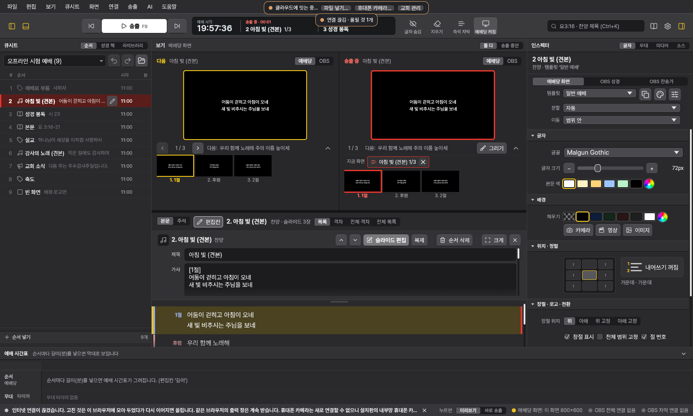
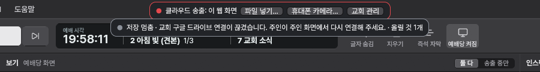
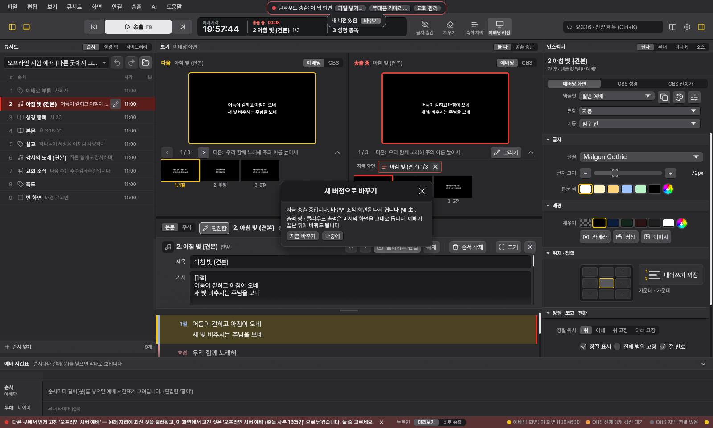

# 웹판 6단계 — 오프라인 대비 (가지 `web-offline`)

인터넷이 끊겨도 **예배는 계속**되게: 웹 조작 화면(`/control/`)이 끊긴 채 새로 고쳐도 뜨고, 마지막 자료로 같은 PC 의 출력 창에 송출하고,
고친 것은 브라우저에 모아 두었다가 다시 이어지면 올린다. 계약은 [`architecture.md`](architecture.md) 7절, 자료 길은 [`data-api.md`](data-api.md) 3절,
충돌 규칙은 설치판과 같다([`sync.md`](sync.md) 4 · 8절).

## 1. 무엇이 끊겨도 되는가

| 쪽 | 인터넷이 끊기면 | 다시 이어지면 |
|---|---|---|
| 웹 조작 화면 (`/control/`) | 그대로 쓴다. 새로 고쳐도 서비스 워커가 앱을, IndexedDB 가 교회 문서 · 성경 · 못 올린 고친 것을 준다 | 올릴 줄을 20개씩 `POST /api/v1/sync` → 받기 `GET /api/v1/sync?after=` (`more` 끝까지) |
| 같은 브라우저의 출력 창 (`/outputs/main` · `overlay` · `stage` · `out-…`) | `BroadcastChannel('wp-live')` 로 계속 받는다 (1 · 3단계 계약). 끊긴 채 새로 고쳐도 서비스 워커가 페이지를 주고, 열리면 `sync` 로 지금 화면을 받는다 | 클라우드로도 다시 붙는다 |
| 다른 PC 의 클라우드 출력 · OBS · 리모컨 | 마지막 화면 유지 (1단계 구현) | 송출 주체(웹 조작 화면)가 다시 붙으면 **지금 화면 하나**를 받는다 |
| 다음 · 이전 · 송출 같은 순간 조작 | **쌓아 두지 않는다** (문서가 아님). 같은 브라우저 출력에만 바로 간다 | 그때의 화면을 보낼 뿐, 끊긴 동안의 조작을 다시 보내지 않는다 |
| 휴대폰 카메라 | 신호가 교회 중계실을 지나므로 **새 연결을 맺지 못한다** (이미 맺은 것은 같은 Wi-Fi 면 계속). 조작 화면이 끊김을 알릴 때 '설치판의 내부망 휴대폰 카메라를 쓰세요' 를 함께 보인다 | 다시 연결 |
| 설치판 | 원래 오프라인에 강하다 (같은 PC 예배당 창 · OBS · 내부망). `cloud.rs` 는 뒤에서 다시 잇기만 | 전체 상태부터 보냄 |

**처음 한 번은 인터넷이 있어야 한다**: 교회 자료를 한 번도 받지 않은 브라우저는 끊긴 채로는 자료를 보일 수 없다 ('연결 끊김 · 교회 자료를 아직 받지 못했습니다'). 예배 전에 그 PC 에서 한 번 열어 두면 된다.

## 2. 앱 껍데기 — 서비스 워커 (`cloud/client/offline/sw.js` → `/sw.js`)

- **판(버전)**: `npm run assets`(`scripts/assets.mjs`) 가 `public/` 의 담을 파일 모두의 내용 지문 12자를 판 이름으로 `public/sw.js` 에 채운다 (`public/sw-version.json` 에도). 파일이 하나라도 바뀌면 새 판. 범위(scope)는 `/` — 출력 페이지까지 맡으려고.
- **담는 것** (판마다 `wp-shell-<판>`, 담아 둔 것 먼저): `/control/*` (wasm 18.9 MB · js · 글꼴) · `/outputs/*.js` · `/shared/*` · `/cloud/*` (어댑터 · 미디어 부품 · **pdf.js 약 5 MB** · 이 오프라인 모듈) · `/remote.js` · `/i18n*.js`. `public/` 전체(견본 `control/sample/` 만 뺌) — 지금 약 240개 · 27 MB (wasm 이 들어간 빌드).
- **페이지 HTML** (`wp-pages-v1`): `/control/` · `/outputs/main` · `overlay` · `stage` · `out-…` 는 늘 **인터넷 먼저**, 닿지 않으면 마지막으로 받은 것. 로그인 · 교회 설정(`WP_CLOUD`)이 페이지 머리에 들어 있어 판으로 묶지 않는다. 처음 깔 때 지금 로그인으로 네 페이지를 함께 담는다(그래서 한 번도 안 연 출력 창도 끊긴 채 열림). 담아 둔 것이 있으면 인터넷을 4초만 기다린다(반쯤 끊긴 망). 로그인이 끝나 302 가 오면 담아 둔 것 대신 그대로 로그인 화면으로.
- **교회 파일** (`wp-files-v1`): `/api/v1/assets/{id}` 의 그림 · 글꼴(내용이 바뀌지 않는 id) — 담아 둔 것 먼저, 400개 · 하나 15 MB 까지. **영상(Range 요청)은 담지 않는다.** `fonts.css` 는 인터넷 먼저. 조작 화면은 큐시트 · 찬양 안의 그림 주소(`…?e=.png` 등, 60개까지)를 자료를 받은 뒤 미리 받아 둔다.
- **손대지 않는 것**: 자료 API(`/api/v1/documents` · `sync` · `bible/*` …) · 로그인 · 실시간 연결(WebSocket 은 서비스 워커를 지나지 않음) · POST 전부. 자료는 조작 화면이 IndexedDB 로 따로 다룬다.
- **나가기** (`POST /auth/logout`): 담아 둔 페이지 · 교회 파일을 지운다(앱 껍데기는 공개 코드라 남김). IndexedDB 의 교회 문서 · 올릴 줄은 지우지 않는다 — 못 올린 고친 것을 잃지 않게 (5절).
- **등록**: 로그인한 조작 화면 페이지에만 `/cloud/offline/offline.js` 를 끼운다 (`src/offline.mjs offlineTag`, `pages.mjs` 한 줄). 둘러보기(demo) · 출력 전용 PC(OBS) 는 등록하지 않는다 — OBS PC 에 27 MB 를 받게 하지 않으려고. 같은 브라우저에서 연 출력 창은 조작 화면이 등록한 서비스 워커가 맡는다.

### 새 판 — 예배 중에 바꾸지 않는다

1. 브라우저가 `/sw.js` 가 바뀐 것을 알면(열 때 · 30분마다 · 다시 이어질 때) 새 판을 **뒤에서 담고 '기다림'** 으로 둔다. 지금 쓰는 판은 그대로다.
2. 조작 화면 위 가운데(송출 띠 아래)에 **'새 버전 있음 [바꾸기]'**.
3. 사람이 누르면: 송출 중이면 한 번 묻고(`지금 바꾸기 · 나중에`) → `skipWaiting` → 옛 판을 지우고 → 조작 화면만 다시 연다. 출력 창은 마지막 화면을 유지하고, 다시 열린 조작 화면이 보내는 것을 받는다.
4. 모든 창을 닫았다 다시 열면 브라우저가 새 판으로 바꾼다 (그때는 예배 중이 아니다).

- 주의: 페이지 HTML 은 늘 인터넷 먼저라 새 HTML 과 옛 판 wasm 이 잠시 같이 돌 수 있다 (`web/app/index.html` 은 받아서 시작만 하는 짧은 틀이라 지금은 문제없음). 틀을 크게 바꾸면 이 점을 볼 것.

## 3. 자료 — IndexedDB (`wp-offline` / `kv`)

| 열쇠 | 값 |
|---|---|
| `d|<교회>|<kind>|<id>` | 클라우드 판 `{kind, id, revision, deleted, payload}` (마지막으로 맞춘 것, 지운 문서는 묘비 판) |
| `o|<교회>|<차례 16자리>` | 올릴 줄 한 줄 `{n, mutationId, kind, id, op, baseRevision, payload?, tries, at}` |
| `m|<교회>` | `{head, full:true, at}` — 받은 차례(seq) |
| (`wp-web`/kv, 3단계) `bible:<교회>:<번역본>` · `bible:<교회>:versions` | 번역본 본문(책째) · 번역본 목록 (6단계에서 목록을 더함 — 끊긴 채 열어도 성경 검색) |

- 지금 다루는 문서는 3단계와 같이 **큐시트(`cue`) · 찬양(`song`)**. 템플릿 · 설정은 웹에서 이 브라우저 설정(localStorage)이다.
- **여는 차례**: IndexedDB 에 받은 것이 있으면 그것으로 먼저 연다(인터넷을 기다리지 않음) → 그 위에 못 올린 고친 것(문서마다 마지막 줄) → 그 뒤 인터넷이 되면 올리기 · 받기. 받은 것이 없으면 `GET /api/v1/sync?after=0&limit=1` 로 **head 를 먼저** 받고 목록(`include=payload&deleted=1`)을 받는다(그 사이에 바뀐 것을 놓치지 않게).
- **고치기** (`web/store.rs record` + `web/outbox.rs`): 화면이 바뀌면 1초 모아(떠나거나 탭을 숨길 때는 바로) 지금 문서와 '줄을 다 적용한 모습' 을 비교해 바뀐 것만 줄에 쓴다. **보내기 전에 IndexedDB 쓰기가 끝난다**(트랜잭션 complete).
  - 아직 한 번도 보내지 않은 줄(tries 0)은 같은 문서를 또 고치면 그 자리에서 바꾼다(줄이 길어지지 않게). 한 번이라도 보낸 줄은 그대로 두고 뒤에 붙인다 — `baseRevision` = 앞의 것 + 1 (서버가 한 요청 안에서 차례대로 적용).
  - 이 화면에서 만들고 올리기 전에 지운 문서는 줄에서 빼기만 한다(서버는 모름).
- **올리기**: 앞에서 20개씩. 보내기 전에 `tries` 를 올려 저장 → `POST /api/v1/sync`. 답을 못 받으면 **같은 mutationId 로** 다시 보낸다 → 서버가 `duplicate` (두 번 들어가지 않음).
  - `applied` · `duplicate` → 줄에서 빼고 클라우드 판으로 적음. `missing`(지울 것이 없음) → 지운 것으로. `invalid` → 줄에서 빼고 알림, 같은 본문을 다시 보내지 않음.
  - `conflict` → 그 문서의 줄을 모두 빼고 아래 4절.
- **받기**: 20초마다(보이는 동안 · 이어져 있을 때), 다시 이어질 때. 내가 올린 mutationId 는 건너뛰고, **줄에 남은 문서는 들이지 않는다**(올릴 때 충돌 규칙으로). 받은 뒤 차례를 저장. `reset:true` 면 목록부터 다시.

## 4. 충돌 — 사본을 만들고 사람이 고른다 (설치판과 같은 규칙)

| 경우 | 웹 조작 화면에서 |
|---|---|
| 양쪽에서 고침 (올리기 409 / `conflict`) | **원래 자리 = 클라우드 판**, 이 화면의 것은 새 id 의 `○○ (충돌 사본 HH:MM)` 으로 남기고 다음 올리기에서 새 문서로 올림. 알림 한 줄 |
| 같은 내용 | 판만 맞춤, 사본 없음 |
| 다른 곳에서 지웠는데 이 화면에서 고침 | 지우지 않고 **묘비 판으로 다시 올려 되살림** |
| 이 화면에서 지웠는데 다른 곳에서 고침 | 클라우드 판으로 되살림 |
| 양쪽 다 지움 | 지운 것으로 |

- 3단계 웹은 사본을 `id~시각` · `(내 사본)` 으로 만들었다 → 설치판(`cloudsync.rs make_copy`)과 같게 바꿨다: 새 id 는 `short_id("c")` · `short_id("s")`(찬양 id 규칙 4~40자 영숫자), 이름 뒤 ` (충돌 사본 HH:MM)` (영어 화면이면 `conflict copy`).

## 5. 화면 — 연결 끊김 · 저장 멈춤 · 새 버전 (`web/offline.rs`)

송출 띠(`web/cloud.rs`) 바로 아래 가운데, 일이 있을 때만 보인다.

| 표시 | 언제 | 사라질 때 |
|---|---|---|
| 주황 `● 연결 끊김 · 올릴 것 N개` | 자료 API 가 닿지 않음 (응답 없음 · 502~504 · 520~530, `code` 없는 것) | 다시 닿으면 (올릴 것이 남아 있어도 올리는 동안은 숨김) |
| 회색 `● 저장 멈춤 · <까닭> · 올릴 것 N개` | 닿지만 교회 저장소가 받지 않음 — `drive_*` · `tier_*` 코드 (구글 드라이브 끊김 · 가득 참 · 옮기는 중 …, tiers.md 5절) | 올리기가 되면 / 줄이 비고 받기가 되면 |
| `새 버전 있음 [바꾸기]` | 새 판이 기다리는 중 | 바꾸면 |

- 누르면 자세한 안내(끊긴 동안 되는 것 · 안 되는 것 · 휴대폰 카메라)가 펼쳐진다. 끊김을 처음 알 때 알림 줄에도 한 번 같은 말을 남긴다.
- **등급 오류는 '연결 끊김' 으로 말하지 않는다** — 구글 드라이브가 끊긴 것은 주인이 다시 연결해야 하고, 인터넷 끊김은 기다리면 된다. 다시 해 보기 간격: 끊김 3 → 6 → 12 → 15초(+흔들림) · 저장 멈춤 15초(`drive_rate` · `drive_busy` · `tier_limit`) / 30초 · 브라우저의 `online` 사건이면 바로.
- 송출 띠의 '클라우드에 잇는 중…' 은 송출 주체 연결(`/bridge`)이고, 이 칸은 자료다. 둘은 따로 돈다.
- 점검(`?debug=1`): `wpDebug().offline` = `{net: 'online'|'offline'|'blocked:<code>', pending, loaded, update, sw, version, controlled, buttons}`, `wpDebug().store` = `{ready, head, queue:[[kind, id, op, baseRevision, tries]…]}`.

## 6. 시험

| 시험 | 명령 | 결과 |
|---|---|---|
| 올릴 줄 계산 (브라우저 없이, 설치판 시험으로) | `cargo test -p wp-app web_outbox` | 9/9 |
| 서비스 워커 담는 규칙 (가짜 self · caches · fetch 위에서 sw.js 그대로) | `cd cloud && node --test test/offline.test.mjs` | 8/8 |
| **끊김 시험** — 실제 Edge(머리 없이), 유료(D1) · 무료(가짜 구글 드라이브) | `bash tools/web/build.sh && cd cloud && node scripts/offline-e2e.mjs` | **52/52** (유료 28 · 무료 24, origin/web c01c705 를 합친 뒤) |
| 기존 시험 | `cd cloud && npm test` · `npm run test:e2e` · `cargo test -p wp-core` · `-p wp-app` | 182/182 · 66/66 · 389 · (아래) |

끊김 시험이 보는 것 (한 교회마다 차례대로):
1. 서비스 워커가 판 이름으로 262개(wasm · `/outputs/*.js` · `/cloud/media/*` · pdf.js)와 페이지 4개(`/control/` · `/outputs/main` · `overlay` · `stage`)를 담고 조작 화면 · 출력 창을 맡음 (처음 담기 2초 — 로컬).
2. 송출 → 같은 브라우저 출력 창 · 클라우드 출력(다른 곳의 OBS 처럼 붙은 /events).
3. **끊음** → 큐시트 글을 고침 → '연결 끊김 · 올릴 것 1개' · 같은 브라우저 출력 창은 다른 찬양 송출을 계속 받음 · F6 두 번은 올릴 줄에 안 들어감 · 클라우드 출력에는 아무것도 가지 않음(마지막 화면 유지).
4. 그사이 '다른 곳' 이 같은 큐시트를 고침(판 2).
5. **끊긴 채 조작 화면 새로 고침** → 앱이 뜨고 · 고친 글이 남아 있고 · '올릴 것 1개' · (유료) 성경도 보관한 것으로 → 송출 → 출력 창에 나옴. **출력 창도 끊긴 채 새로 고침** → 지금 화면을 다시 받음.
6. **다시 이음** → 줄이 비고 상태 칸이 사라짐 · 원래 자리 = 다른 곳에서 고친 것 · 이 화면 것 = `오프라인 시험 예배 (충돌 사본 HH:MM)` 새 큐시트(고친 글 포함) · 클라우드 출력은 지금 화면 **하나**(송출 버전이 조작 화면과 같음 — 끊긴 동안의 조작을 다시 보내지 않음).
7. (무료) 가짜 구글에서 권한을 거둠 → 고침 → `blocked:drive_disconnected` '저장 멈춤' (연결 끊김이 아님) · 고친 것은 줄에 남음.
8. (유료) `public/sw.js` 를 새 판으로 바꿈(배포 흉내) → '새 버전 있음' 만 뜨고 지금 판 그대로 → [바꾸기] → 송출 중이라 확인 창 → [지금 바꾸기] → 새 판으로 다시 열림 (새 판 담기 5초).

그림 전체 · 결과 JSON: `tmp/offline-e2e/` (Git 제외 — 위 명령으로 다시 만든다).

끊김 시험은 브라우저와 로컬 클라우드(wrangler dev) 사이에 **끊을 수 있는 중계(TCP)** 를 둔다. 중계를 닫으면 브라우저만 끊기고(연결 거절 — `navigator.onLine` 은 그대로 true, 교회 인터넷만 끊긴 경우와 같음), 그사이 시험 스크립트(다른 곳)는 클라우드에 바로 붙어 같은 큐시트를 고친다. 실행마다 새 D1 · DO 자리(`--persist-to` 임시)와 빈 포트 — 다른 작업자의 wrangler dev 와 겹치지 않는다.

## 7. 확인 못 한 것 · 남은 것

- **진짜 Cloudflare(workers.dev) 에 올려 보지 않았다** (배포 금지 범위). 정적 파일 압축 · `_headers` 의 `/sw.js` no-cache · 판 바꾸기는 로컬 wrangler dev 로만 봤다.
- 끊김은 TCP 중계를 닫아 흉내 냈다(교회 인터넷만 끊긴 경우 — `navigator.onLine` 은 true). Wi-Fi 를 끄는 경우(브라우저 `offline` · `online` 사건)는 코드만 있고 끝에서 끝으로는 안 봤다. Chrome · 맥 Safari · 휴대폰은 안 봤다 (Edge 만).
- 교회 그림 미리 받기(`/api/v1/assets/…?e=.png`)는 서비스 워커 단위 시험으로만 — 시험 큐시트에 올린 그림이 없다.
- 휴대폰 카메라: 끊긴 동안 새 연결이 안 되는 것은 그대로 두고 알림 글로만 알린다(실제 휴대폰으로 안 봄).
- **같은 브라우저에 조작 화면 탭을 둘 열면** 둘 다 같은 IndexedDB 줄을 쓴다 — 하나만 열 것 (잠금은 아직 없음).
- 처음 한 번 받는 양: `public/` 전체 약 42 MB (wasm 18.9 · 조작 화면 글꼴 4개 12.5 · pdf.js 약 5 · 출력 글꼴 …, 전송은 압축돼 더 작음). 새 판마다 다시 받는다(바뀐 파일만이 아니라 전부 — 판별 통째 저장).
- 로컬 wrangler dev 에서 서비스 워커의 큰 파일 받기가 한 번 멈춘 채 끝나지 않은 적이 있다 → 파일마다 90초 · 세 번까지 다시 받게 했고, 그 뒤 세 번 돌려 다시 생기지 않았다. 원인(로컬 정적 파일 서버인지)은 확인 못 함.
- 이미 있던 것 (6단계가 만든 것 아님): ① **무료(드라이브) 교회는 웹 조작 화면에서 성경을 못 받는다** — `/api/v1/control/bible/book`(3단계)이 D1 만 읽는다. 그래서 무료의 성경 오프라인은 시험하지 못했다. ② 찬양 id 가 설치판 규칙(영숫자 4~40자) 밖이면(예: `sample-song-1`) 코어가 새 id 로 저장해 열 때마다 새 찬양이 올라가던 것 → 설치판 동기화처럼 **건너뛰게** 했다(올리지도 지우지도 않음).
- 서버 쪽(`cloud/src/sync/` 받기)은 고칠 것이 없었다 — 기존 `GET/POST /api/v1/sync` 그대로 쓴다.

## 8. 사관님이 정하실 것

1. **나가기(로그아웃) 때 이 브라우저의 교회 문서 · 못 올린 고친 것을 지울지** — 지금은 지우지 않는다(고친 것을 잃지 않게). 교회 공용 PC 라면 '나가기 전에 올리기 → 지우기' 가 필요할 수 있다.
2. **출력 전용 PC(OBS · 예배당 PC 의 브라우저)에도 오프라인 담기를 켤지** — 지금은 조작 화면에서만 켠다(출력 PC 가 42 MB 를 받지 않게). 켜면 그 PC 의 출력 창도 끊긴 채 새로 고쳐 마지막 페이지가 뜨지만, 받을 화면은 여전히 클라우드(또는 같은 브라우저 조작 화면)에서 와야 한다.
3. 위 '이미 있던 것 ①' (무료 교회의 웹 성경)을 어느 작업에서 고칠지.
