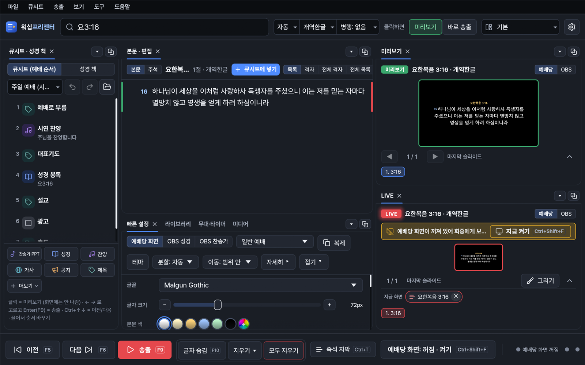
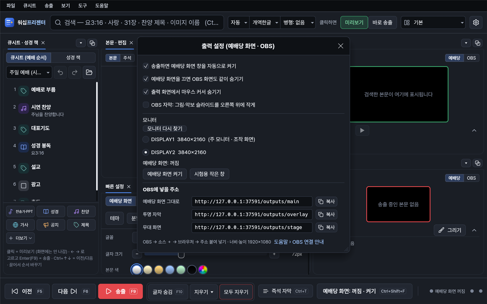
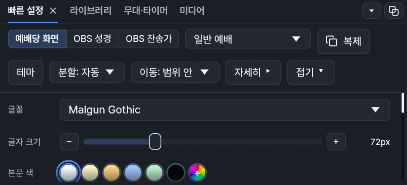
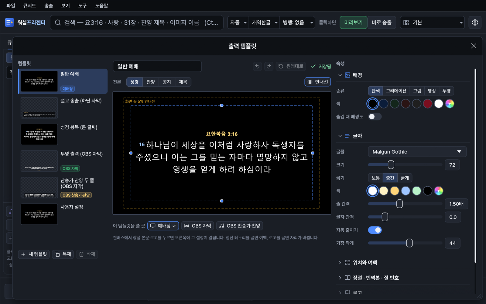
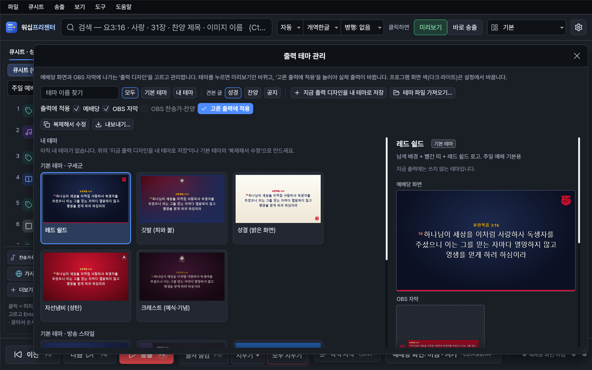
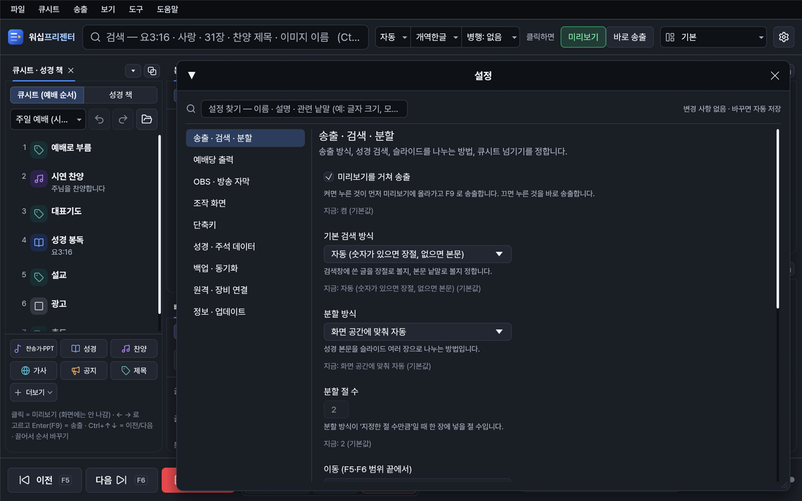
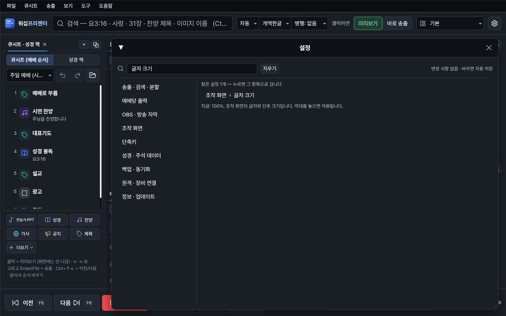
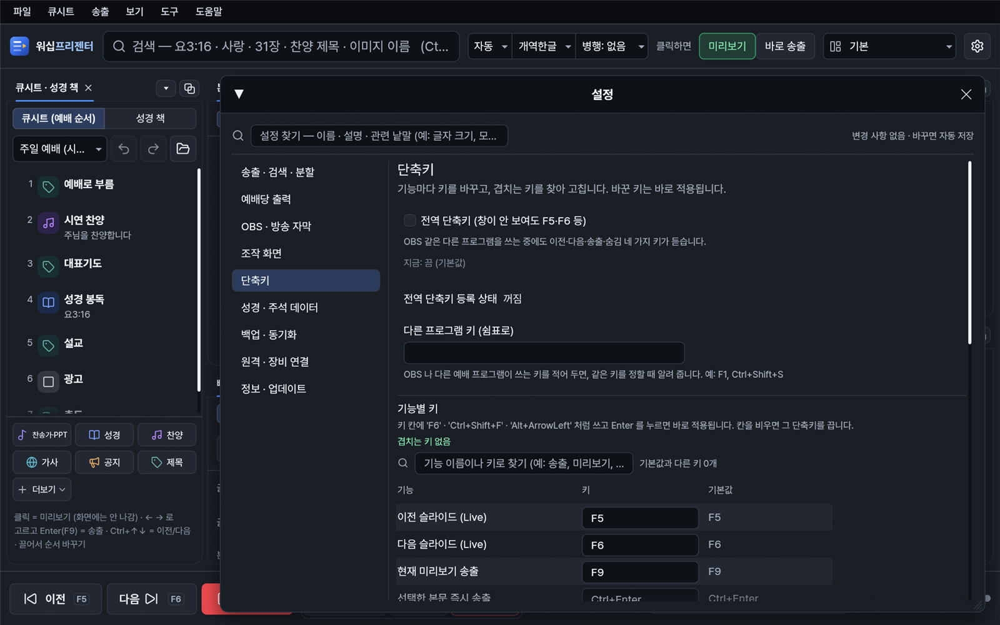

# 워십프리젠터 사용자 설명서 (2.0.2, Windows)

워십프리젠터는 교회 예배 순서(큐시트)를 미리 만들어 두었다가, 예배 중에 성경·찬양 가사·찬송가 악보·광고를 차례대로 예배당 화면과 OBS 방송에 내보내는 프로그램입니다.

**검색, 미리보기, 편집은 회중에게 보이는 화면을 바꾸지 않습니다.** 송출(F9, Enter, Ctrl+Enter)했을 때만 LIVE 화면이 바뀝니다.

이 설명서는 **2.x(2.0.2)** 기준입니다. Windows 화면으로 설명하며, 맥(애플 실리콘)판도 같은 메뉴를 씁니다. 맥에서는 Ctrl 대신 ⌘을 누르고, 설치·업데이트와 안 되는 기능은 [README의 맥에서 쓰기](../README.md#맥macos)를 보세요. 영어판 1.x(1.14.1) 설명은 [1.x 설명서](v1/사용자설명서.md)에 있습니다. 그림으로 보는 짧은 안내는 [README](../README.md), OBS 연결은 [OBS 설정 가이드](OBS설정가이드.md)를 보세요.

## 목차

1. [시작하기](#1-시작하기)
2. [화면 구성과 메뉴](#2-화면-구성과-메뉴)
3. [예배 준비: 큐시트 만들기](#3-예배-준비-큐시트-만들기)
4. [예배 진행: 송출](#4-예배-진행-송출)
5. [성경 검색과 슬라이드 나누기](#5-성경-검색과-슬라이드-나누기)
6. [화면 배치와 작업공간](#6-화면-배치와-작업공간)
7. [출력 디자인: 템플릿과 테마](#7-출력-디자인-템플릿과-테마)
8. [설정 센터와 단축키](#8-설정-센터와-단축키)
9. [자료, 백업, 업데이트](#9-자료-백업-업데이트)
10. [문제 해결](#10-문제-해결)

---

## 1. 시작하기

### 1-1. 설치

1. [최신 릴리스](https://github.com/hahadark/WorshipPresenter/releases/latest)에서 `WorshipPresenter-2.0.2-Setup.exe`를 받아 실행합니다. 설치 없이 쓰려면 `WorshipPresenter-2.0.2-Portable.zip`을 풀어서 `WorshipPresenter.exe`를 실행합니다.
2. 1.x를 쓰던 PC에서는 같은 자리(`%LOCALAPPDATA%\Programs\WorshipCue`)에 2.x가 설치됩니다. 바탕화면·시작 메뉴 바로가기와 제거 항목도 그대로 이어집니다.
3. 처음 켤 때 1.x 자료(성경, 큐시트, 설정)를 복사해 옵니다. **1.x 원본 자료는 바꾸지 않습니다.** 자세한 내용은 [9-1](#9-1-자료-위치와-1x-자료)을 보세요.

> 성경 검색, 송출, 예배당 화면, OBS 연결은 이 PC 안에서 처리합니다. 인터넷은 새 버전 확인, AI 주보 정리, 온라인 찬양 찾기처럼 일부 기능에만 씁니다.

### 1-2. 처음 할 일

1. **성경**: 개역한글이 기본으로 들어 있습니다. 다른 번역본은 `파일 → 성경 번역본 가져오기…`로 넣습니다. 개역개정·새번역처럼 저작권이 있는 번역본은 권리자의 허가를 받은 뒤 쓰세요.
2. **예배당 모니터**: 보조 모니터를 연결하고 `보기 → 출력 설정 (예배당 화면 · 모니터 · OBS 숨김)`에서 모니터를 고릅니다([4-3](#4-3-예배당-화면-켜고-끄기)).
3. **OBS**: 같은 창 아래쪽 'OBS에 넣을 주소'를 복사해 OBS 브라우저 소스에 붙입니다([OBS 설정 가이드](OBS설정가이드.md)).
4. **출력 디자인**: `보기 → 출력 테마 관리`에서 테마를 골라 적용합니다([7장](#7-출력-디자인-템플릿과-테마)).
5. **예배 전 점검**: 예배 시작 전에 `도움말 → 연결 점검 (예배 전 점검)`을 한 번 돌려 봅니다.

---

## 2. 화면 구성과 메뉴

| 위치 | 내용 |
|---|---|
| 맨 위 | 메뉴 줄: 파일 · 큐시트 · 송출 · 보기 · 도구 · 도움말 |
| 위쪽 줄 | 검색창(Ctrl+K), 검색 방식(자동), 번역본, 병행 번역본, **클릭하면 [미리보기 / 바로 송출]**, 작업공간 선택, 설정(톱니바퀴) |
| 왼쪽 | **큐시트 (예배 순서)** / **성경 책** 탭. 아래에 순서 넣기 단추(찬송가·PPT, 성경, 찬양, 가사, 공지, 제목, 더보기) |
| 가운데 위 | **본문 · 편집**: 찾은 성경 본문이나 고른 순서의 슬라이드. 목록·격자·전체 격자·전체 목록으로 볼 수 있습니다 |
| 가운데 아래 | **빠른 설정 · 라이브러리 · 무대·타이머 · 미디어** 탭 |
| 오른쪽 위 | **미리보기** (초록 테두리): 송출하면 이렇게 나갑니다 |
| 오른쪽 아래 | **LIVE** (빨간 테두리): 지금 실제로 나가는 화면. 예배당 화면이 꺼져 있으면 노란 안내와 [지금 켜기] 단추가 보입니다 |
| 맨 아래 | 송출 줄: 이전(F5) · 다음(F6) · 송출(F9) · 글자 숨김(F10) · 지우기 ▾ · 모두 지우기 · 즉석 자막(Ctrl+T) · 예배당 화면: 꺼짐·켜기(Ctrl+Shift+F) · 출력 상태 |

미리보기와 LIVE 오른쪽 위의 **예배당 / OBS** 단추로 각 출력에 나가는 모양을 따로 확인할 수 있습니다.

### 2-1. 메뉴 한눈에

| 메뉴 | 들어 있는 것 |
|---|---|
| 파일 | 성경 번역본 가져오기… · 사용 기록 (저작권 보고) · 여러 PC 동기화 · 백업 · 설정 (Ctrl+,) |
| 큐시트 | 슬라이드 편집 (고른 순서) Ctrl+E · 큐시트 관리 (휴지통 · 복제 · 내보내기) · 실행 취소 Ctrl+Z · 다시 실행 Ctrl+Y · 큐시트 인쇄 Ctrl+P |
| 송출 | 송출 기록 Ctrl+H · 즉석 자막 Ctrl+T · 회중 메시지 Ctrl+M · 오버레이 (시계 · 카운트다운 · 배너) · 무대 화면 · 매크로 · 예약 실행 Alt+1~9 · 화면에 그리기 · 강조 |
| 보기 | 작업공간 · 패널 배치 · 주석 보기 · 가져오기 · **출력 템플릿 편집** · **출력 테마 관리** · Language · 언어 (한국어 / English) · OBS 자막 모양 두 가지 · 출력 설정 (예배당 화면 · 모니터 · OBS 숨김) |
| 도구 | 찬양 라이브러리 · 그림 · 음악 · 영상 라이브러리 · 카메라 설정 · 휴대폰 리모컨 · 스트림덱 · 외부 단추 · Companion · 장비 (X32 · PTZ) · 내부망 출력 (다른 PC 의 OBS) · OBS 원격 조작 · 주보 → 큐시트 · 홈페이지 주보 → 큐시트 · 광고 · 설교 포인트 슬라이드 · 예배 전 화면 만들기 |
| 도움말 | 연결 점검 (예배 전 점검) · 로그 묶음 저장… · 로그 폴더 열기 · 사용 설명서 · 그림으로 보는 사용법 · OBS 연결 안내 · 단축키 보기 · 새 소식 · 문제 알리기 · 건의 · 정보 · 라이선스 · **새 버전 확인** · 1.x 자료 다시 가져오기… |

메뉴에 적힌 단축키는 설정에서 바꾼 키를 그대로 보여 줍니다. 어디서든 **오른쪽 클릭**하면 그 자리에서 쓸 수 있는 기능이 나옵니다.

---

## 3. 예배 준비: 큐시트 만들기

### 3-1. 순서 넣기와 고치기

- 왼쪽 큐시트 아래 단추로 순서를 넣습니다: **찬송가·PPT, 성경, 찬양, 가사, 공지, 제목**. 이미지·영상·음악·카메라·빈 화면 같은 나머지 종류는 **＋ 더보기**에 있습니다.
- 순서를 누르면 가운데에 그 순서의 슬라이드와 편집칸이 열립니다. 고친 내용은 바로 저장됩니다.
- 순서는 끌어서 옮깁니다. 실수했으면 `큐시트 → 실행 취소`(Ctrl+Z)로 되돌립니다.
- 같은 찬송가·찬양을 다시 넣으려고 하면 이미 있는 순서를 골라 줍니다. 일부러 하나 더 넣으려면 알림의 [그래도 하나 더 넣기]를 누르세요.
- 큐시트 목록 위의 선택칸으로 다른 큐시트를 엽니다. 복제·휴지통·내보내기는 `큐시트 → 큐시트 관리`에 있습니다.

### 3-2. 주보로 큐시트 만들기

`도구 → 주보 → 큐시트`에서 주보 파일이나 순서 글을 넣으면 큐시트를 만듭니다.

- **규칙으로 바로 (AI 없이, 무료)**: 정해진 규칙으로 순서를 나눕니다.
- **AI 로 (오픈라우터, 유료)**: 오픈라우터 키를 넣은 경우에만 씁니다. 사용료는 오픈라우터 계정에서 나갑니다.
- 키 없이 쓰려면 [프롬프트 복사]로 다른 채팅 AI에 붙여 넣고, 받은 답을 [답으로 큐시트 만들기]에 넣습니다.

교회 홈페이지 주보에서 순서와 광고를 가져오는 기능은 `도구 → 홈페이지 주보 → 큐시트 · 광고`입니다.

### 3-3. 찬송가·찬양 PPT

- **찬송가·PPT** 단추로 등록한 PPT 폴더에서 찬송가나 찬양 PPT를 찾아 넣습니다. 폴더는 처음 쓸 때 [폴더 더하기…] 또는 [폴더 통째로… (하위 폴더까지)]로 등록합니다.
- 찬송가 배경은 원래 배경, 흰 배경, 템플릿 배경, 지정한 이미지 가운데서 고를 수 있습니다.

### 3-4. 찬양 가사

- **찬양** 단추나 `도구 → 찬양 라이브러리`에서 곡을 찾아 넣습니다.
- 가사는 빈 줄로 슬라이드를 나눕니다. `[1절]`, `[후렴]`처럼 대괄호 줄은 슬라이드 이름이 됩니다.
- 부를 순서(예: `1절 후렴 2절 후렴`)를 적으면 그 순서대로 슬라이드가 나옵니다.

### 3-5. 슬라이드 편집

순서를 고른 뒤 `큐시트 → 슬라이드 편집 (고른 순서)`(Ctrl+E)를 누르면 슬라이드마다 글 위치·크기를 따로 고칠 수 있습니다.

### 3-6. 그 밖의 준비 도구

| 메뉴 | 하는 일 |
|---|---|
| `도구 → 설교 포인트 슬라이드` | 설교 원고에서 대지 카드를 만듭니다 |
| `도구 → 예배 전 화면 만들기` | 예배 시작 전에 돌릴 슬라이드쇼를 만듭니다 |
| `송출 → 매크로 · 예약 실행` | 여러 동작을 묶어 Alt+1~9로 실행합니다 |
| `큐시트 → 큐시트 인쇄` | 진행자용 큐시트를 인쇄합니다 |

---

## 4. 예배 진행: 송출

### 4-1. 기본 송출

1. 위쪽 줄의 **클릭하면** 단추로 순서를 눌렀을 때의 동작을 고릅니다.
   - **미리보기**(기본): 눌러도 화면에는 안 나가고 미리보기에만 올라갑니다. ← →로 고르고 Enter(F9)로 송출합니다.
   - **바로 송출**: 누르면 바로 회중 화면에 나갑니다. 켜져 있는 동안 화면 위에 노란 안내 줄이 보입니다.
2. 송출 중에는 **다음(F6)**, **이전(F5)**으로 슬라이드를 넘깁니다. 순서를 건너뛸 때는 Ctrl+↓ / Ctrl+↑입니다.
3. 검색한 본문을 미리보기 없이 바로 내보내려면 Ctrl+Enter입니다.

### 4-2. 화면 지우기

| 단추 | 하는 일 |
|---|---|
| 글자 숨김 (F10) | 글자만 숨기고 배경은 남깁니다. 다시 누르면 보입니다 |
| 지우기 ▾ | 배경, 오버레이, 로고 화면, 음악을 하나씩 끄고 켭니다 |
| 모두 지우기 | 나가는 것을 모두 지웁니다 |

### 4-3. 예배당 화면 켜고 끄기

- 하단 **예배당 화면: 꺼짐 · 켜기**(Ctrl+Shift+F)로 예배당 모니터의 전체 화면 창을 켜고 끕니다.
- 2.0.2부터는 **화면을 다 그린 뒤에 한 번에 켜집니다.** 켤 때 흰 화면이 먼저 비치지 않고, 처음 화면은 전환 효과 없이 바로 나옵니다. 켜지기까지 1초 안팎 걸릴 수 있습니다.
- 끄는 방법: Ctrl+Shift+F를 다시 누르거나, 조작 화면에서 Esc를 누릅니다. 예배당 화면을 마우스로 한 번 누른 뒤 Esc를 눌러도 꺼집니다.
- `보기 → 출력 설정`에서 할 수 있는 것:
  - 예배당 화면을 띄울 모니터 고르기([모니터 다시 찾기])
  - 송출하면 예배당 화면 창을 자동으로 켜기
  - 예배당 화면을 끄면 OBS 화면도 같이 숨기기
  - 출력 화면에서 마우스 커서 숨기기
  - [시험용 작은 창]: 모니터 없이 모양만 확인
- 같은 창 아래에 OBS에 넣을 주소가 있습니다. 기본 포트에서는 다음과 같습니다(설정에서 포트를 바꾸면 주소도 바뀝니다).

| 쓰는 곳 | 주소 |
|---|---|
| 예배당 화면 그대로 | `http://127.0.0.1:37528/outputs/main` |
| 투명 자막 (OBS 자막) | `http://127.0.0.1:37528/outputs/overlay` |
| 무대 화면 | `http://127.0.0.1:37528/outputs/stage` |

### 4-4. 즉석 자막, 메시지, 오버레이

- **즉석 자막**(Ctrl+T): 큐시트에 없는 글을 바로 띄웁니다.
- **회중 메시지**(Ctrl+M): 화면 한쪽에 짧은 안내를 띄웁니다.
- **오버레이**: 시계, 카운트다운, 배너를 슬라이드 위에 겹칩니다(`송출 → 오버레이`).
- **화면에 그리기 · 강조**: LIVE 화면 위에 표시를 그립니다. LIVE 아래 [그리기] 단추로도 엽니다.

### 4-5. 무대 화면, 리모컨, 외부 장비

| 메뉴 | 하는 일 |
|---|---|
| `송출 → 무대 화면` | 설교자·찬양팀용 화면(다음 슬라이드, 타이머, 메시지) |
| `도구 → 휴대폰 리모컨` | 같은 와이파이의 휴대폰으로 넘기기 |
| `도구 → 스트림덱 · 외부 단추` | 스트림덱·매크로 키보드에서 주소를 불러 조작 |
| `도구 → Companion · 장비 (X32 · PTZ)` | Companion, 음향 콘솔, PTZ 카메라 연결 |
| `도구 → OBS 원격 조작` | OBS 방송·녹화·장면을 워십프리젠터에서 조작 |
| `도구 → 내부망 출력 (다른 PC 의 OBS)` | 다른 PC의 OBS에 화면 보내기 |

> 2.x에서 OBS, 카메라, Companion, 음향 콘솔 같은 실제 장비 연결은 아직 충분히 시험하지 못했습니다. 예배에 쓰기 전에 꼭 미리 연결해 보세요.

---

## 5. 성경 검색과 슬라이드 나누기

### 5-1. 찾기

- 위쪽 검색창(Ctrl+K)에 장절(`요3:16`, `시23`, `창1:1-5`)이나 단어(`사랑`)를 씁니다.
- 검색 방식 **자동**은 숫자가 있으면 장절로, 없으면 본문 단어로 찾습니다.
- 찾은 본문은 가운데에 나오고 미리보기에 올라갑니다. **＋ 큐시트에 넣기**로 순서에 넣을 수 있습니다.
- 왼쪽 **성경 책** 탭(Ctrl+B)에서 책과 장을 눌러 찾을 수도 있습니다.
- **병행** 칸에서 두 번째 번역본을 고르면 두 번역을 함께 띄웁니다.

### 5-2. 미리보기 안에서 움직이기

| 키 | 하는 일 |
|---|---|
| PageUp / PageDown | 미리보기의 이전·다음 슬라이드 |
| Alt+← / Alt+→ | 이전·다음 절 |
| Ctrl+Home | 장의 처음으로 |

### 5-3. 슬라이드 나누기

빠른 설정의 **분할**에서 정합니다.

- **자동**: 화면 공간에 맞춰 나눕니다.
- **한 절씩, 2절씩, 3절씩, 4절씩**: 정한 절 수만큼 한 장에 넣습니다.

**이동**은 F5·F6이 범위 끝에 닿았을 때의 동작입니다. **범위 안**이면 거기서 멈추고, **다음 절로 계속**이면 이어서 넘어갑니다.

---

## 6. 화면 배치와 작업공간

- 패널 탭을 끌어 다른 자리로 옮기거나, 패널 오른쪽 위 단추로 따로 띄울 수 있습니다.
- 위쪽 줄 오른쪽의 작업공간 선택칸(기본)으로 저장해 둔 배치를 바꿉니다. 저장과 관리는 `보기 → 작업공간 · 패널 배치`입니다.
- 조작 화면의 색(다크·라이트), 글자 크기, 언어는 `설정 → 조작 화면`에서 바꿉니다. 이것은 회중에게 나가는 화면과 상관없습니다.

---

## 7. 출력 디자인: 템플릿과 테마

**템플릿**은 한 출력의 디자인(글꼴, 색, 배경, 위치, 로고)입니다. **테마**는 예배당 화면·OBS 자막·OBS 찬송가 자막 디자인을 한 벌로 묶은 것입니다.

### 7-1. 빠른 설정과 템플릿 복제

가운데 아래 **빠른 설정** 탭에서 자주 고치는 것을 바로 바꿉니다.

1. 맨 앞에서 고칠 출력을 고릅니다: **예배당 화면 · OBS 성경 · OBS 찬송가**.
2. 옆의 선택칸에서 그 출력에 쓸 템플릿을 고릅니다.
3. **[복제]**: 지금 템플릿의 복사본("○○ 복사본")을 만들어 이 출력에 바로 겁니다.
   - 원래 템플릿은 그대로 남습니다. 다른 출력이나 다른 순서가 원래 템플릿을 쓰고 있어도 바뀌지 않습니다.
   - 복사본은 모양이 같으므로 누르는 순간 송출 화면은 바뀌지 않습니다.
   - 복사본을 고치려면 **자세히 ▸**를 누릅니다.
4. 아래 칸에서 글꼴, 글자 크기, 본문 색 등을 바로 바꿀 수 있습니다.

### 7-2. 출력 템플릿 편집

`보기 → 출력 템플릿 편집` 또는 빠른 설정의 **자세히 ▸**로 엽니다.

- 왼쪽: 템플릿 목록. 각 템플릿을 어디에 쓰는지 표시가 붙습니다(예배당, OBS 자막, OBS 찬송가·찬양). 아래에 **[새 템플릿] [복제] [삭제]**가 있습니다. 출력에서 쓰고 있는 템플릿은 지울 수 없습니다.
- 가운데: 견본 화면. **성경 · 찬양 · 공지 · 제목** 견본 글을 바꿔 가며 봅니다. 화면에서 장절·본문·로고를 누르면 오른쪽에 그 설정이 열리고, 점선 테두리를 끌면 여백이, 로고를 끌면 자리가 바뀝니다. [안내선]은 화면 끝 5% 안전 영역을 보여 줍니다.
- 오른쪽: 배경, 글자, 위치와 여백, 장절·번역본·절 번호, 로고 등의 속성.
- 고친 것은 바로 저장됩니다(머리에 '저장됨' 표시). 되돌리려면 실행 취소 단추나 **[원래대로]**를 씁니다.
- **이 템플릿을 쓸 곳** 단추로 이 템플릿을 예배당·OBS 자막·OBS 찬송가·찬양 출력에 겁니다.

### 7-3. 출력 테마 관리

`보기 → 출력 테마 관리`에서 디자인을 한 벌씩 고르고 관리합니다.

- **테마 카드를 누르면 오른쪽 미리보기만 바뀝니다.** 실제 출력은 **[고른 출력에 적용]**을 눌러야 바뀝니다.
- **출력에 적용** 옆 체크로 바꿀 출력을 고릅니다: 예배당, OBS 자막, OBS 찬송가·찬양. 체크하지 않은 출력은 바뀌지 않습니다. 기본 테마에는 OBS 찬송가·찬양 디자인이 없어서 그 칸은 고를 수 없습니다.
- 적용한 뒤 마음에 들지 않으면 **[적용 되돌리기]**로 바꾼 출력만 전으로 돌립니다. 적용 뒤에 템플릿 편집에서 고친 내용은 되돌리기가 덮어쓰지 않습니다. 되돌리기 기록은 프로그램을 끄면 사라집니다.
- **기본 테마**(구세군, 방송 스타일)는 이름을 바꾸거나 지울 수 없습니다. 고치려면 **[복제해서 수정]**을 누릅니다.
- **내 테마** 만들기:
  - **[＋ 지금 출력 디자인을 내 테마로 저장]**: 지금 출력에 걸린 디자인을 묶어 저장합니다.
  - 기본 테마의 **[복제해서 수정]**으로도 만듭니다.
  - 내 테마는 복제, 이름·설명 바꾸기, 디자인 편집, 삭제를 할 수 있습니다. 내 테마를 지워도 그 안의 템플릿은 '출력 템플릿'에 남습니다.
- **[내보내기…] / [테마 파일 가져오기…]**: 다른 PC나 다른 교회와 테마를 주고받습니다.
  - 파일에는 디자인만 들어갑니다. API 키, OBS 비밀번호, 큐시트 같은 다른 설정은 들어가지 않습니다.
  - 배경 그림·영상·로고는 **파일 경로만** 들어갑니다. 받는 PC에도 같은 파일을 따로 옮겨 두어야 합니다. 가져온 뒤 빠진 파일이 있으면 목록으로 알려 줍니다.
  - 가져온 테마는 늘 새 테마로 추가되므로 있던 테마를 덮어쓰지 않습니다.

---

## 8. 설정 센터와 단축키

### 8-1. 설정 센터

`파일 → 설정`(Ctrl+,) 또는 위쪽 줄의 톱니바퀴로 엽니다. 설정은 9개 분류로 나뉩니다.

| 분류 | 내용 |
|---|---|
| 송출 · 검색 · 분할 | 송출 방식, 성경 검색, 슬라이드 나누기, 큐시트 넘기기 |
| 예배당 출력 | 예배당 모니터에 나가는 화면과 템플릿·로고 |
| OBS · 방송 자막 | OBS 브라우저 소스 주소, 방송 자막 모양, OBS 원격 조작 |
| 조작 화면 | 조작 화면의 색 테마, 글자 크기, 언어, 패널 배치 |
| 단축키 | 기능별 키 바꾸기, 겹치는 키 찾기 |
| 성경 · 주석 데이터 | 성경 번역본과 주석서 가져오기·관리 |
| 백업 · 동기화 | 자료 백업, 여러 PC 동기화, 큐시트 내보내기 |
| 원격 · 장비 연결 | 휴대폰 리모컨, 스트림덱, Companion·음향·카메라 장비, 다른 PC 출력 |
| 정보 · 업데이트 | 버전, 업데이트, 사용 통계, 라이선스 |

- 항목마다 **지금 값과 기본값**이 적혀 있고, 바꾼 항목에는 **[기본값으로]** 단추가 생깁니다. 바꾼 값은 바로 적용되고 자동 저장됩니다.
- 창 오른쪽 위에 저장 상태(변경 사항 없음, 저장 중, 저장됨, 저장 실패)가 보입니다.
- 템플릿 편집, 출력 설정, 리모컨처럼 다른 창에서 다루는 설정은 설정 센터에서 그 창으로 가는 단추가 있습니다.

**설정 찾기**: 맨 위 칸에 이름이나 관련 낱말(예: `글자 크기`, `모니터`)을 쓰면 해당 설정이 어느 분류에 있는지 보여 주고, 누르면 그 항목으로 갑니다.

### 8-2. 단축키 바꾸기

`설정 → 단축키`에서 기능별 키를 바꿉니다.

- 키 칸에 `F6`, `Ctrl+Shift+F`, `Alt+ArrowLeft`처럼 쓰고 Enter를 누르면 바로 적용됩니다. 칸을 비우면 그 단축키를 끕니다.
- 같은 키를 두 기능에 쓰면 '겹치는 키'로 알려 줍니다. 위쪽 찾기 칸으로 기능 이름이나 키를 찾을 수 있습니다.
- **다른 프로그램 키 (쉼표로)**: OBS나 다른 예배 프로그램이 쓰는 키를 적어 두면, 같은 키를 정할 때 알려 줍니다.
- **전역 단축키**를 켜면 OBS처럼 다른 프로그램을 보고 있어도 이전·다음·송출·숨김 네 가지 키가 듣습니다(기본은 꺼짐).
- Space(다음), ← →, Enter, Alt+1~9(매크로)는 고정 키라서 바꿀 수 없습니다.

### 8-3. 기본 단축키

| 키 | 하는 일 |
|---|---|
| F5 / F6 | 이전 / 다음 슬라이드 (LIVE) |
| F9 | 미리보기를 송출 |
| Ctrl+Enter | 고른 본문을 바로 송출 |
| F10 | 글자 숨김·보이기 |
| Ctrl+Shift+F | 예배당 화면 켜기·끄기 |
| Esc | 예배당 화면 끄기 |
| Ctrl+↑ / Ctrl+↓ | 이전 / 다음 순서 |
| F2 | 고른 순서 고치기 |
| Ctrl+Shift+E | 편집칸 보이기·숨기기 |
| PageUp / PageDown | 미리보기의 이전 / 다음 슬라이드 |
| Alt+← / Alt+→ | 미리보기의 이전 / 다음 절 |
| Ctrl+Home | 장의 처음으로 |
| Ctrl+K | 검색창으로 |
| Ctrl+B | 성경 책 목록 |
| Ctrl+H | 송출 기록 |
| Ctrl+L | 온라인 가사 찾기 |
| Ctrl+T | 즉석 자막 |
| Ctrl+M | 회중 메시지 |
| Ctrl+P | 큐시트 인쇄 |
| Ctrl+E | 슬라이드 편집 |
| Ctrl+Z / Ctrl+Y | 실행 취소 / 다시 실행 |
| Ctrl+, | 설정 |
| Alt+1~9 | 매크로 실행 (고정) |

지금 PC에 설정된 키는 `도움말 → 단축키 보기`에서 확인합니다.

---

## 9. 자료, 백업, 업데이트

### 9-1. 자료 위치와 1.x 자료

| 무엇 | 위치 |
|---|---|
| 2.x 자료 (성경, 큐시트, 설정) | `%APPDATA%\WorshipPresenter-rs\data` |
| 1.x 자료 (읽기만 함) | `%APPDATA%\WorshipCue\data` |
| 자동 백업 | `%APPDATA%\WorshipPresenter-rs\data\backups` |
| 로그 | `도움말 → 로그 폴더 열기` |

- 2.x를 처음 켤 때 1.x 자료를 2.x 자료 폴더로 **복사**합니다. 1.x 원본은 바꾸지 않습니다. 1.x에서 저장해 둔 AI 키와 OBS 비밀번호도 이어받습니다.
- 2.x로 옮긴 뒤에도 한동안 1.x를 같이 썼다면 `도움말 → 1.x 자료 다시 가져오기…`로 1.x 자료를 다시 복사할 수 있습니다. 이때 지금 2.x 자료는 지우지 않고 자료 폴더 안 `pre-reimport`에 보관한 뒤 프로그램이 다시 켜집니다.

### 9-2. 백업과 여러 PC 동기화

- `파일 → 여러 PC 동기화 · 백업`에서 자동 백업 목록을 보고, 날짜를 골라 되돌릴 수 있습니다. 백업은 날짜별 파일(`WorshipCue-날짜.db`, `settings-날짜.json`)로 남습니다.
- 같은 창에서 동기화 폴더(예: 클라우드 드라이브 폴더)를 정하면 여러 PC가 큐시트와 설정을 함께 씁니다.
- 큐시트 하나만 다른 PC로 옮길 때는 `큐시트 → 큐시트 관리`의 내보내기를 씁니다.

### 9-3. 업데이트

- **1.x를 쓰는 PC**: 프로그램을 끌 때 2.x로 자동 업데이트됩니다.
- **2.0.x를 쓰는 PC**: 자동으로 바뀌지 않습니다. 다음 순서로 올립니다.
  1. `도움말 → 새 버전 확인`
  2. **[검증하여 다운로드]**: 새 버전을 받고 SHA-256으로 파일을 검증합니다.
  3. **[지금 설치 요청 (프로그램 종료)]**: 프로그램이 닫히고 설치됩니다.
- 받아 둔 채로 두면 프로그램을 끌 때 설치됩니다. 예배 중에 저절로 다시 시작하지는 않습니다.
- 큐시트, 성경, 설정은 업데이트해도 그대로 남습니다.
- 포터블판은 새 버전이 있다고 알려 주기만 합니다. 새 zip을 받아 직접 바꾸세요.

### 9-4. 사용 기록과 저작권

`파일 → 사용 기록 (저작권 보고)`에서 송출한 찬양 목록을 기간별로 모아 저작권 보고에 씁니다. 개역한글은 저작재산권 보호기간이 지난 번역본입니다. 개역개정·새번역 같은 번역본은 각 권리자의 이용 조건을 따르세요.

---

## 10. 문제 해결

| 증상 | 확인할 것 |
|---|---|
| 예배당 화면이 안 켜짐 | `보기 → 출력 설정`에서 모니터를 다시 찾고 고릅니다. [시험용 작은 창]으로 모양을 먼저 확인합니다 |
| 예배당 화면이 조작 화면 모니터에 뜸 | 출력 설정에서 '주 모니터 · 조작 화면'이 아닌 모니터를 고릅니다 |
| 송출했는데 회중 화면이 그대로 | LIVE 위에 '예배당 화면이 꺼져 있어…' 안내가 있으면 [지금 켜기] 단추 또는 Ctrl+Shift+F |
| 순서를 눌렀더니 바로 나가 버림 | 위쪽 줄 **클릭하면**이 '바로 송출'입니다. '미리보기'로 바꾸세요 |
| OBS에 안 보임 | 출력 설정의 주소를 OBS 브라우저 소스에 다시 붙이고, 너비·높이 1920×1080을 확인합니다([OBS 설정 가이드](OBS설정가이드.md)) |
| 단축키가 안 들음 | `설정 → 단축키`에서 겹치는 키가 없는지, 다른 프로그램을 보고 있다면 전역 단축키가 켜져 있는지 확인합니다 |
| 테마를 바꿨는데 일부 출력만 바뀜 | 테마 관리에서 '출력에 적용' 체크를 확인합니다 |
| 가져온 테마의 배경이 안 보임 | 테마 파일에는 그림 경로만 들어 있습니다. 그 그림 파일을 이 PC의 같은 자리에 복사합니다 |
| 1.x에서 고친 자료가 2.x에 없음 | `도움말 → 1.x 자료 다시 가져오기…` |
| 원인을 모르겠음 | `도움말 → 연결 점검`을 돌린 뒤, `도움말 → 로그 묶음 저장…`으로 파일을 만들어 [문제 알리기](https://github.com/hahadark/WorshipPresenter/issues)에 첨부합니다 |
